# 约翰霍普金斯大学数据科学课程1：《数据科学家工具》｜P11：版本控制 📚

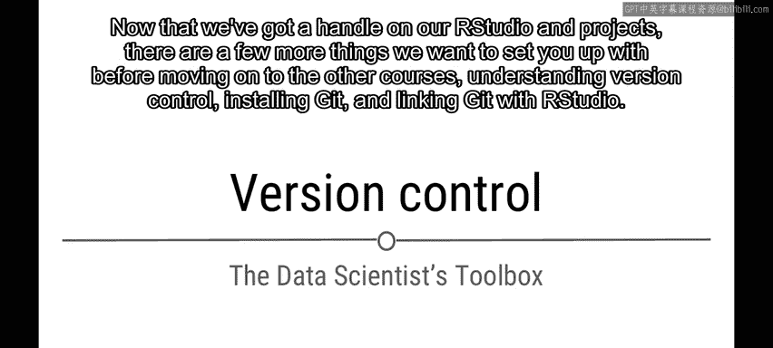

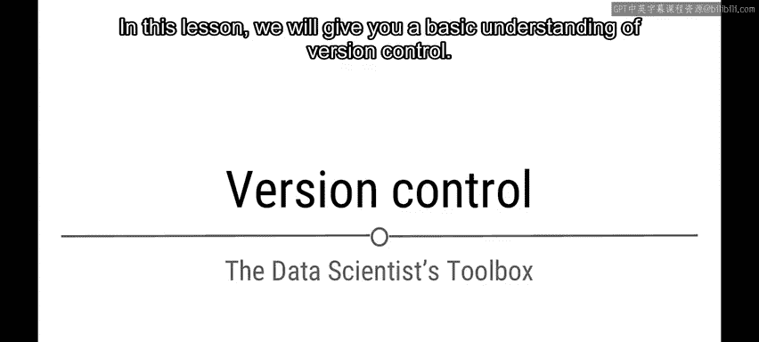

在本节课中，我们将要学习版本控制的基本概念，了解它为何是数据科学家工具箱中不可或缺的一部分。我们将介绍版本控制是什么、它的主要好处，并重点讲解最流行的版本控制工具——Git及其在线平台GitHub。

## 什么是版本控制？🤔

上一节我们介绍了RStudio和项目设置，在进入其他课程之前，我们还需要掌握一些关键工具。本节中，我们来看看版本控制。

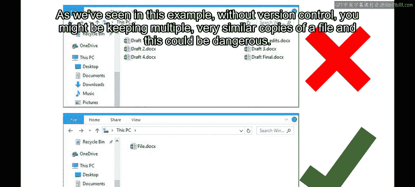

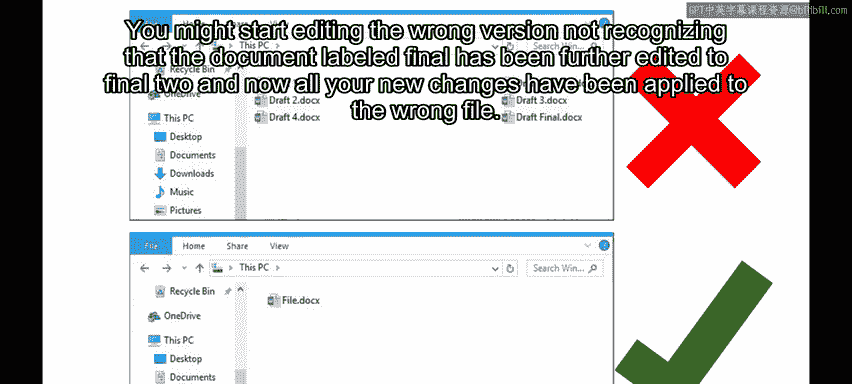

版本控制系统是一种记录文件随时间变化的系统。当你对文件进行编辑时，该系统会为你的文件和更改内容创建快照并保存。这样，你可以在需要时参考或恢复到之前的版本。

如果你使用过Microsoft Word中的“跟踪修订”功能，那么你已经见过一种初级的版本控制形式。在该功能中，文件的更改被跟踪，你可以选择保留这些编辑或恢复到原始格式。像Git这样的版本控制系统就像是更高级的“跟踪修订”，它们功能更强大，能够细致地跟踪多个文件的连续更改，并且允许多人同时在同一组文件上工作。

## 版本控制的好处 💡

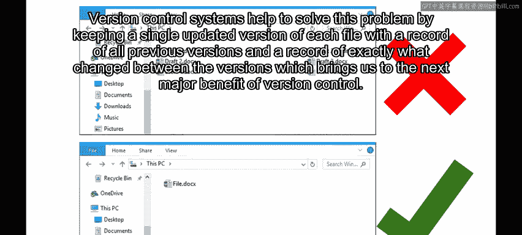

### 解决文件版本混乱问题

没有版本控制时，你可能会保存多个非常相似的文件副本，这很危险。你可能会开始编辑错误的版本，没有意识到标记为`Fi`的文档已被进一步编辑为`final2`，导致所有新更改都应用到了错误的文件上。版本控制系统通过为每个文件维护一个单一的最新版本，并记录所有先前版本以及版本之间的具体更改，从而帮助解决这个问题。

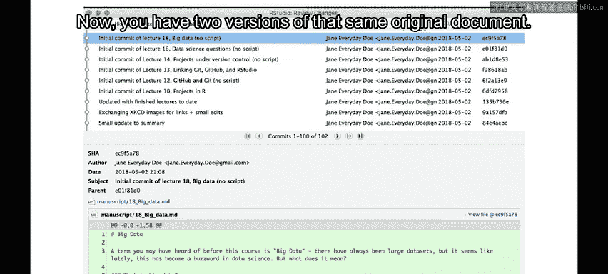

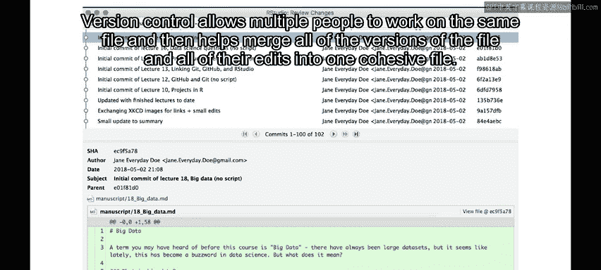

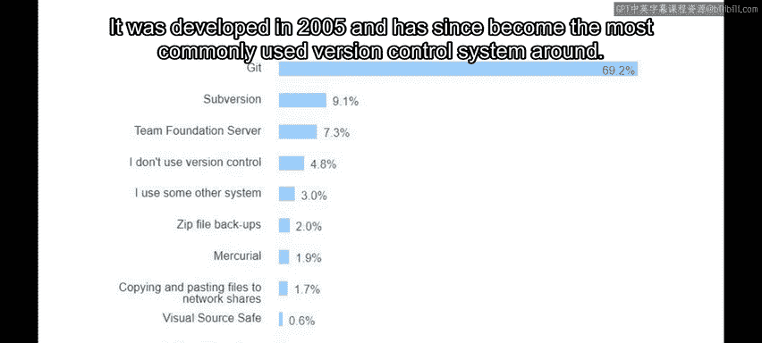

### 记录所有更改

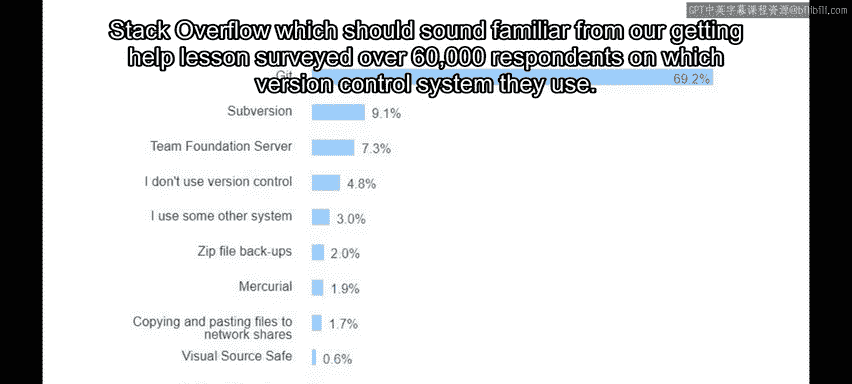

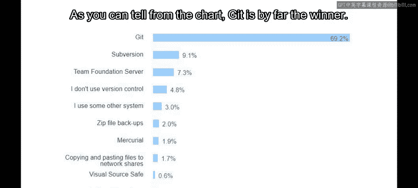

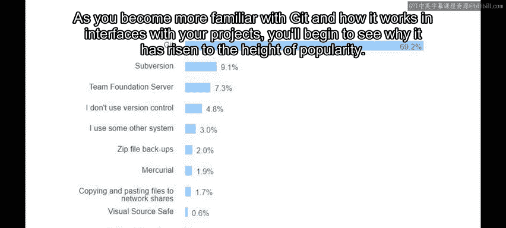

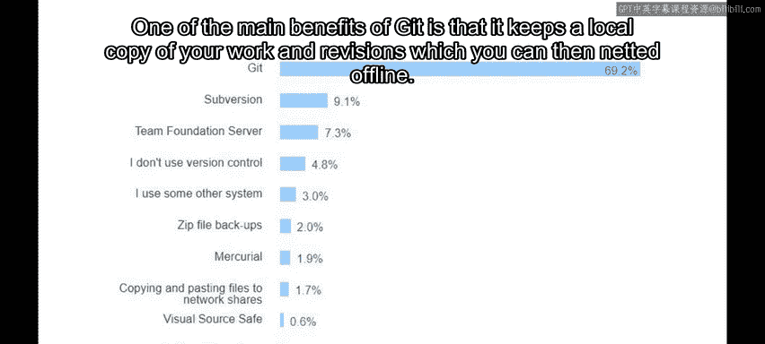

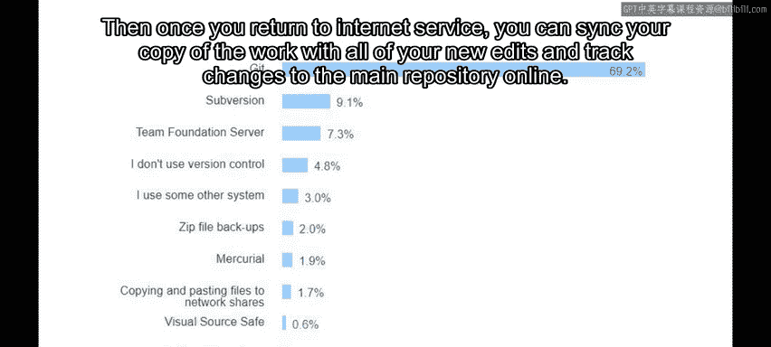

版本控制的另一个主要好处是，它保留了文件所有更改的记录。当你与多人在同一文件上协作时，这非常有帮助。版本控制软件会跟踪是谁、在何时、为何进行了这些特定更改。这就像是“跟踪修订”的极致体现。这个记录在开发代码时也很有用：如果你过了一段时间后发现犯了一个错误并引入了问题，你可以找到上次编辑那段特定代码的时间，查看所做的更改，并恢复到原始未损坏的代码，同时保留在此期间所做的所有其他工作。

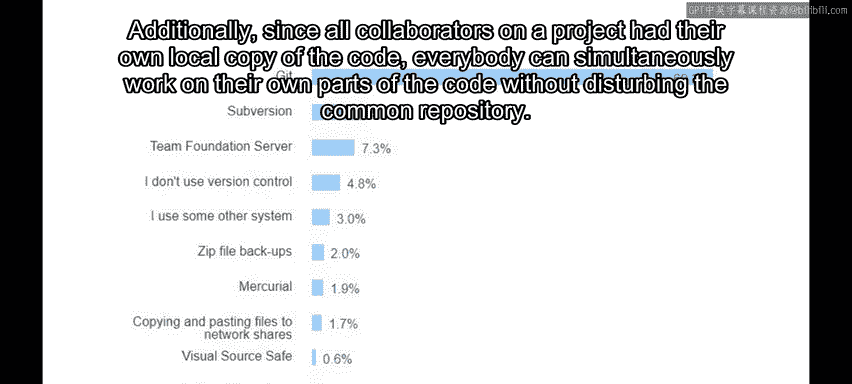

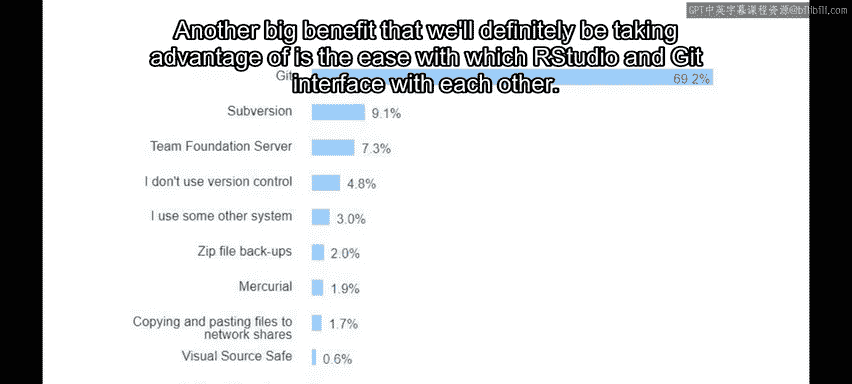

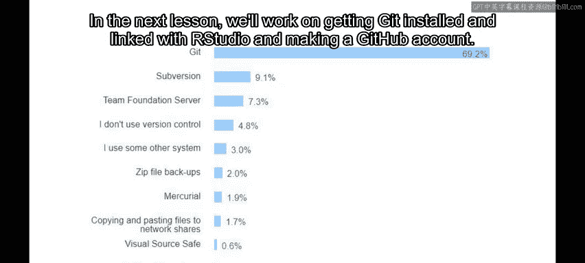

### 管理协作冲突

当与一组人在同一组文件上工作时，版本控制有助于确保你不会对文件进行与其他人的更改相冲突的修改。如果你曾与他人共享文档进行编辑，就会体会到将他们的编辑整合到一个自你发送原始文件以来已发生变化的文档中的挫败感。现在你有了同一原始文档的两个版本。版本控制允许多人在同一文件上工作，然后帮助将所有版本及其编辑合并成一个连贯的文件。

## Git与GitHub简介 🛠️

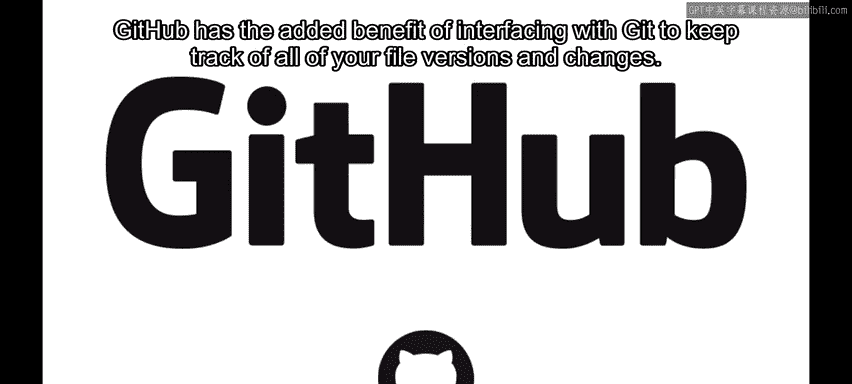

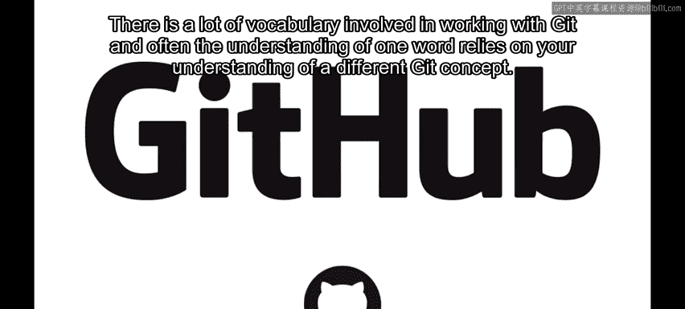

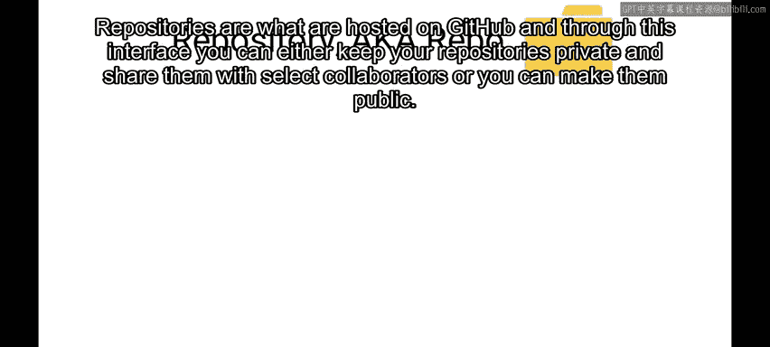

Git是一个免费开源的版本控制系统。它于2005年开发，此后成为最常用的版本控制系统。Stack Overflow（在我们“获取帮助”课程中应该很熟悉）调查了超过60,000名受访者关于他们使用哪种版本控制系统，从图表中可以看出，Git是遥遥领先的赢家。随着你越来越熟悉Git及其如何与项目交互，你会开始明白它为何如此受欢迎。

Git的主要好处之一是它保存了你工作和修订的本地副本，你可以在离线状态下编辑，然后一旦恢复网络服务，就可以将你的工作副本与所有新编辑同步，并跟踪在线主仓库的更改。此外，由于项目的所有协作者都有自己的代码副本，每个人都可以同时处理自己的代码部分，而不会干扰公共仓库。

另一个我们将充分利用的巨大好处是RStudio和Git彼此交互的便捷性。在下一课中，我们将安装Git并将其与RStudio链接，并创建一个GitHub账户。

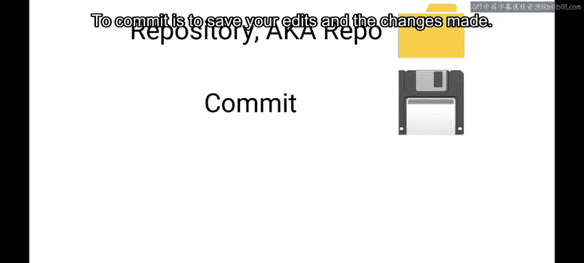

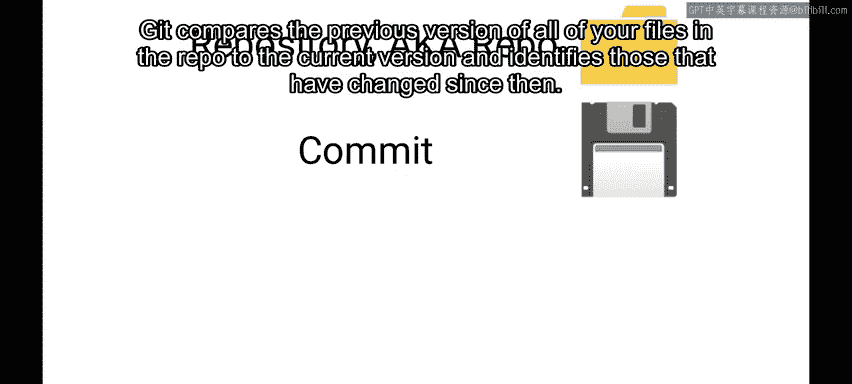

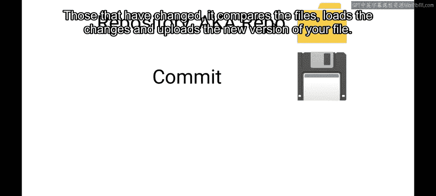

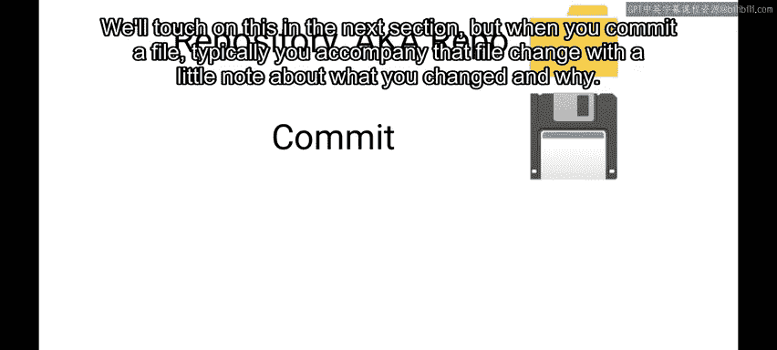

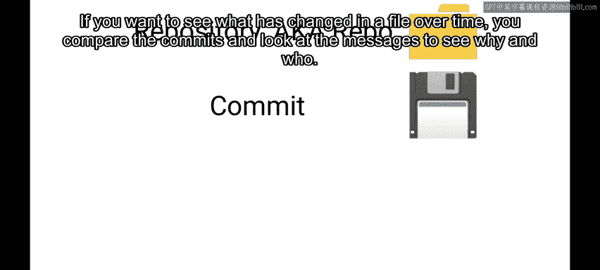

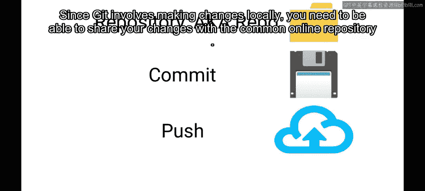

## 核心概念与术语 📖

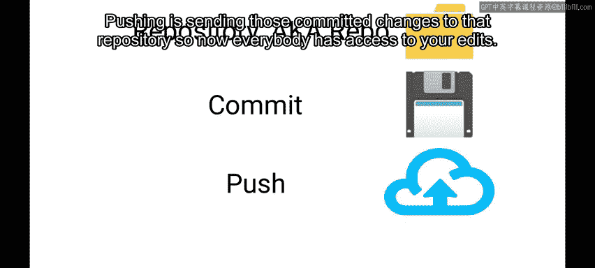

使用Git涉及大量词汇，通常对一个词的理解依赖于你对另一个Git概念的理解。请花些时间熟悉以下词语，并多复习几次以理解这些概念之间的关系。

以下是Git中的核心概念：

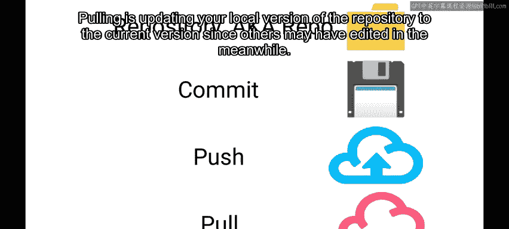

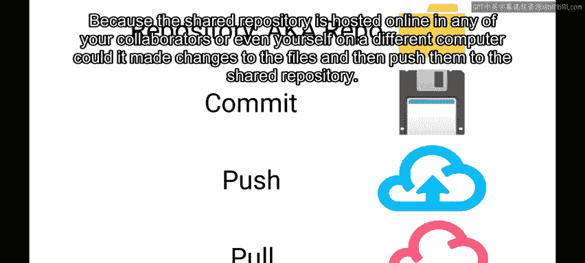

*   **仓库**：相当于项目文件夹或目录。你所有受版本控制的文件和记录的更改都位于一个仓库中。这通常简称为`repo`。仓库托管在GitHub上，通过这个界面，你可以将仓库设为私有并与选定的协作者共享，也可以将其公开，让任何人都能看到你的文件及其历史记录。
*   **提交**：保存你的编辑和所做的更改。一次提交就像是文件的一个快照。Git将仓库中所有文件的上一个版本与当前版本进行比较，识别出自那时起发生变化的文件。对于未更改的文件，它保持先前存储的文件不变。对于已更改的文件，它会比较文件、记录更改并上传文件的新版本。当你提交文件时，通常会附带一条简短说明，说明你更改了什么以及为什么更改。在版本控制系统中，提交是其核心。如果你发现错误，可以将文件恢复到之前的提交。如果你想查看文件随时间的变化，可以比较提交记录并查看消息以了解原因和作者。
*   **推送**：用你的编辑更新仓库。由于Git涉及在本地进行更改，你需要能够与公共在线仓库共享你的更改。推送就是将那些更改发送到该仓库，这样每个人都能访问你的编辑。
*   **拉取**：将你的本地仓库版本更新到当前版本。因为其他人可能在此期间进行了编辑。由于共享仓库托管在线上，你的任何协作者甚至你自己在不同的计算机上都可能对文件进行了更改，然后将其推送到共享仓库。你落后于时代了，你本地计算机上的文件可能已经过时，因此你需要拉取以检查你是否与主仓库保持同步。
*   **暂存**：准备文件以进行提交的行为。例如，如果你自上次提交以来编辑了三个文件，且原因完全不同，你不想一次性提交所有更改，因为你关于为何提交以及更改了什么的提交信息会变得复杂。相反，你可以只暂存其中一个文件并准备提交。提交该文件后，你可以暂存第二个文件并提交，依此类推。暂存允许你将文件更改分离到不同的提交中，这非常有用。

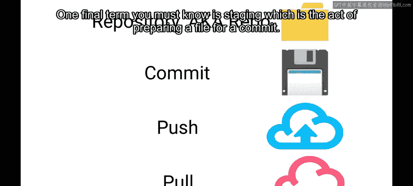

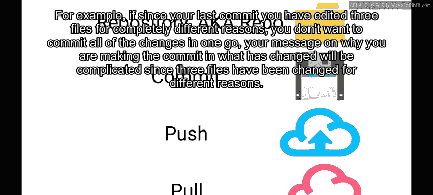

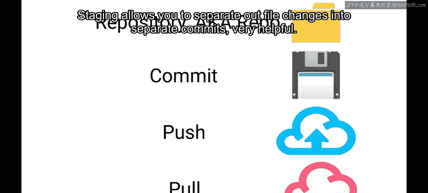

为了总结这些目前常用的术语，并测试你是否已经掌握，我们梳理一下基本流程：文件托管在一个与协作者在线共享的仓库中。你拉取仓库内容，以便拥有可以编辑的文件的本地副本。一旦你对文件的更改满意，就暂存该文件然后提交。你将此提交推送到共享仓库。这会上传你的新文件和所有更改，并附带一条解释更改内容、原因和作者的消息。

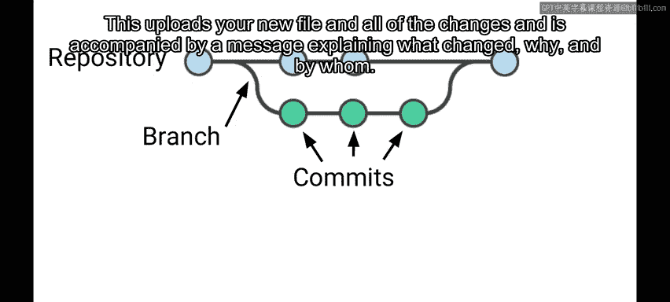

## 分支、合并与冲突 🔀

当同一个文件有两个同时存在的副本时，就会涉及到分支。当你在本地编辑文件时，你创建了一个分支，你的编辑尚未与主仓库共享。因此存在两个版本的文件：仓库上每个人都可以访问的版本，以及你本地编辑的版本。在你推送更改并将其合并回主仓库之前，你正在一个分支上工作。在分支点之后，版本历史会分成两条，分别跟踪仓库中原始文件（其他人可能正在编辑）的独立更改，以及你分支上更改的跟踪，然后将文件合并在一起。

**合并**是指将同一文件的独立编辑整合到一个统一的文件中。Git会识别编辑，并将它们合并到一个包含两组编辑的单一文件中。但这里存在一个潜在问题：如果两个人都对同一个句子进行了编辑，导致其中一个编辑无法实现，我们就遇到了问题。Git识别到这种差异，即**冲突**，并请求用户协助选择保留哪个添加。所以，冲突是指多人对同一文件进行更改，而Git无法合并这些编辑。你可以选择手动尝试合并编辑，或者保留一个编辑而放弃另一个。

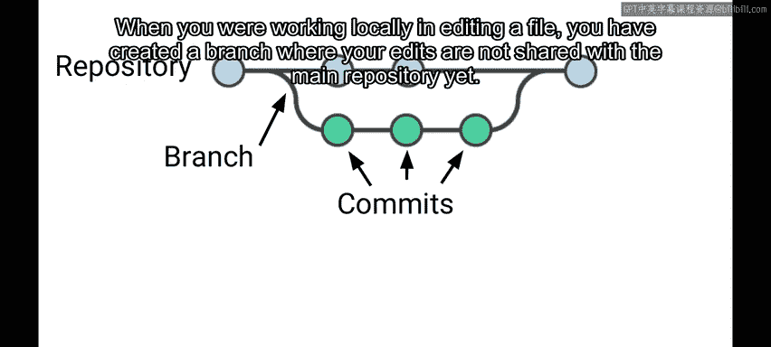

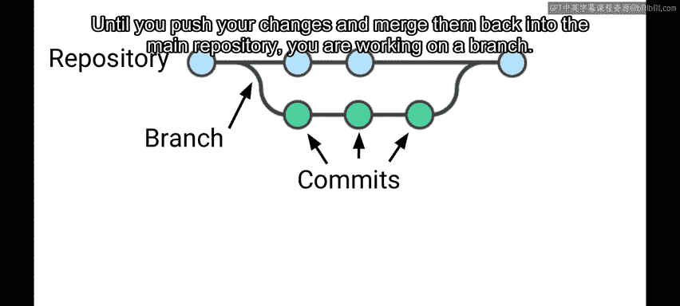

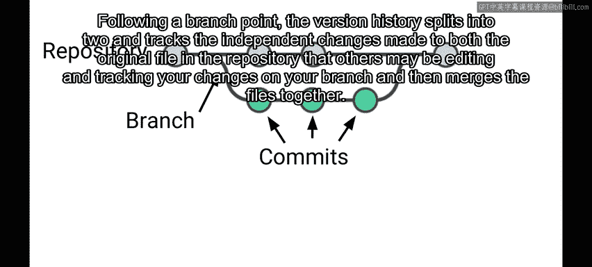

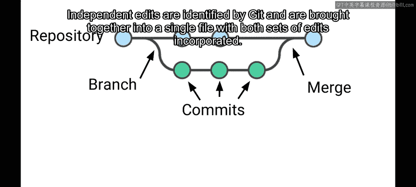

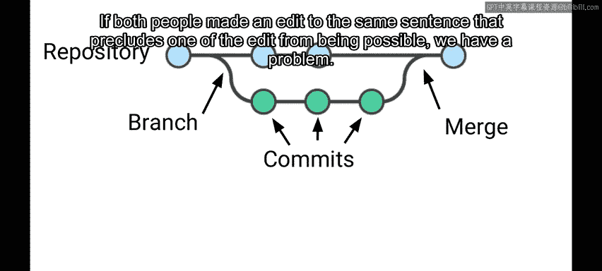

## 克隆与分叉 📥

**克隆**是指复制一个现有的Git仓库。如果你刚加入一个使用版本控制跟踪的项目，你会克隆该仓库以获取并创建仓库所有文件及其跟踪更改的本地版本。

**分叉**是你从他人那里获取的仓库的个人副本。如果有人在做一个很酷的项目，你想尝试一下，你可以分叉他们的仓库。然后当你进行更改时，编辑会记录在你的仓库中，而不是他们的仓库里。

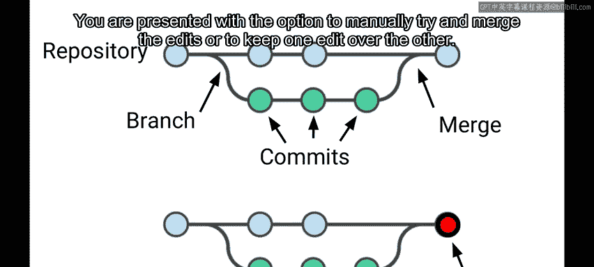

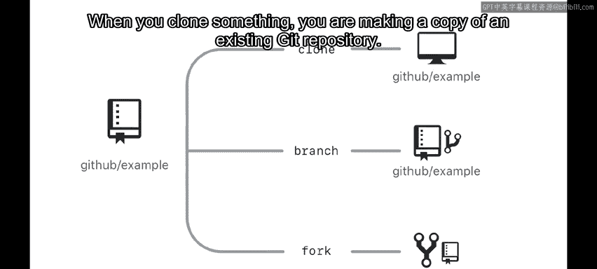

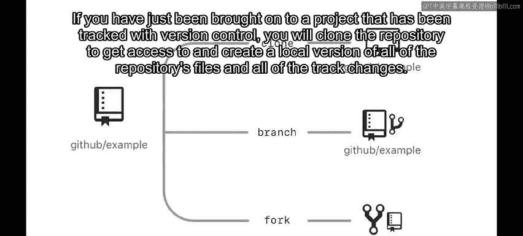

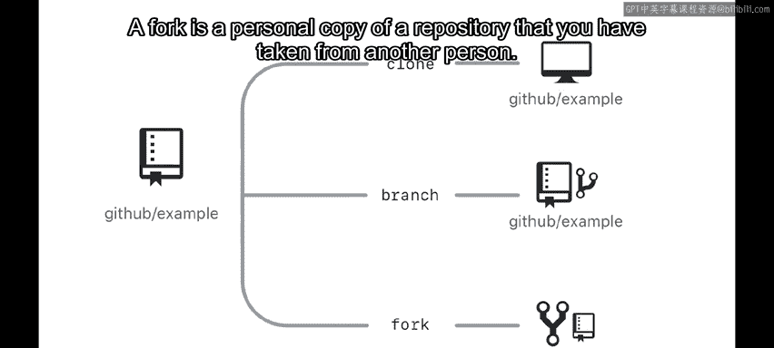

## Git使用最佳实践 ✅

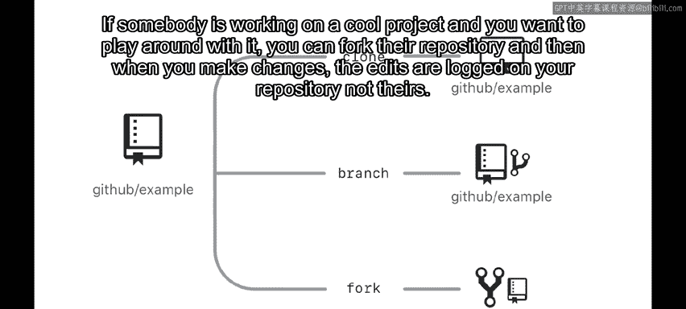

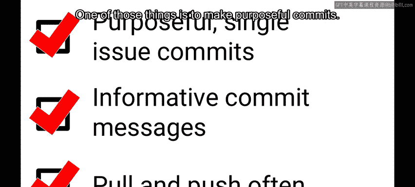

适应使用Git这样的版本控制软件可能需要一些时间，但记住以下几点有助于建立良好的习惯，这对你未来大有裨益。

以下是建立良好Git习惯的几个要点：

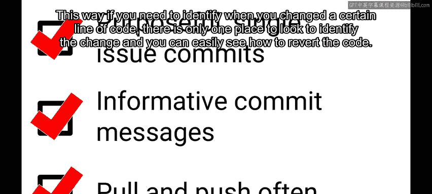

*   **进行有目的的提交**：每次提交应该只解决一个单一问题。这样，如果你需要确定何时更改了某行代码，只需查看一个地方就能识别更改，并且可以轻松地看到如何恢复代码。
*   **编写清晰的提交信息**：确保为每次提交编写信息丰富的消息是一个需要养成的好习惯。如果每条消息都精确说明了更改内容，任何人都可以检查提交的文件并识别你更改的目的。此外，如果你正在寻找过去所做的特定编辑，可以轻松扫描所有提交记录，以找到与所需编辑相关的那些更改。
*   **保持文件版本同步**：经常检查你与当前仓库是否同步，要频繁拉取。此外，不要囤积已编辑的文件。一旦你提交了文件并写好了有用的消息，就应该将这些更改推送到公共仓库。如果你已完成某部分代码的编辑并计划转向处理不相关的问题，你需要立即与协作者分享该编辑。

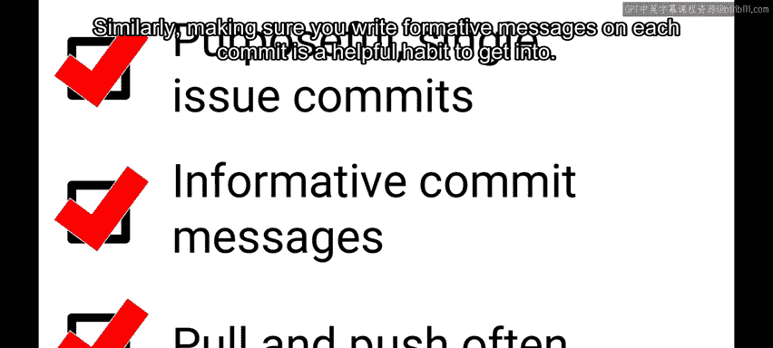

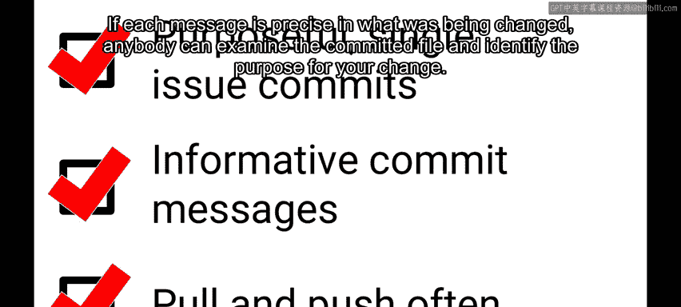

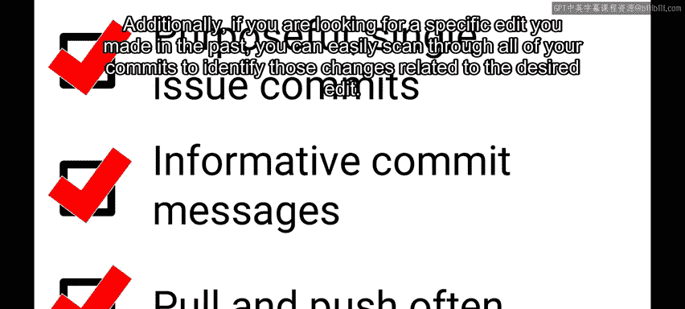

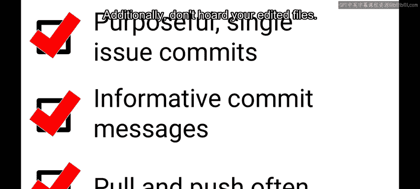

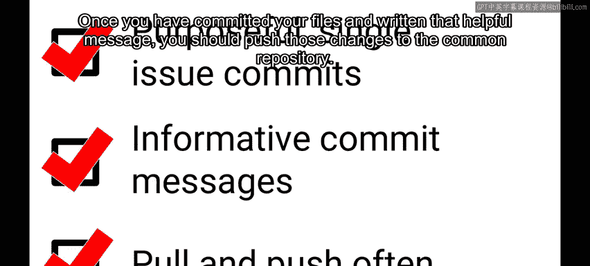

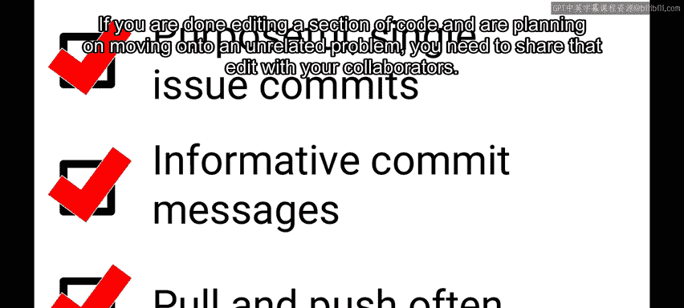

## 总结 📝

本节课中，我们一起学习了版本控制的基础知识。我们探讨了什么是版本控制及其主要好处，了解了为什么我们需要三整节课来专门讲解它。我们介绍了Git和GitHub是什么，然后讲解了版本控制工作中许多常用且有时令人困惑的词汇。接着，我们快速回顾了使用Git的一些最佳实践，但掌握这一切的最好方法就是去使用它。希望你现在对Git的工作原理有了更好的理解。那么，让我们进入下一课，开始安装它吧。