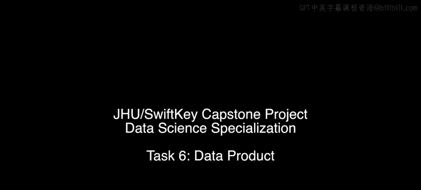

# 数据科学毕业课程（约翰霍普金斯大学）｜课程10：任务6介绍 - 构建数据产品 🚀

在本节课中，我们将学习如何构建一个面向广泛受众的前端界面，以展示你的预测算法的工作原理。这是整个项目的最终任务，目标是创建一个易于他人使用的数据产品，从而有效传达你工作的价值。

---

经过漫长的学习与实践，现在到了展示成果的时刻。

本任务的目标是构建一个前端界面，供广大受众使用，以演示你的预测算法如何工作。

你可能需要在几种不同的场景中完成此任务。例如，你可能需要向同事演示原型，展示你工作的潜力，并说服他们投入更多资源；你也可能需要向潜在用户和客户展示你开发的所有酷炫功能；或者，你只是想向世界分发你的软件，并希望构建一个简单的网络界面供人们访问。

无论出于何种原因，此处的目标是构建一个他人可以轻松使用的东西。因为如果他人能够使用你的软件，他们就有机会自己体会到它的出色之处，这会让你的工作变得轻松许多。

这是本项目中的最终任务，可以说是最后的乐章。希望你花时间思考你所构建的内容，并努力让它真正脱颖而出。

我们都很期待看到你的成果。

---

## 总结

本节课中，我们一起学习了构建数据产品前端界面的重要性。这是展示你预测算法价值的最终步骤，关键在于创建一个**易于使用**的界面，让同事、客户或广大用户能够直观地理解并认可你的工作成果。请精心打磨这最后的展示环节，让你的项目完美收官。