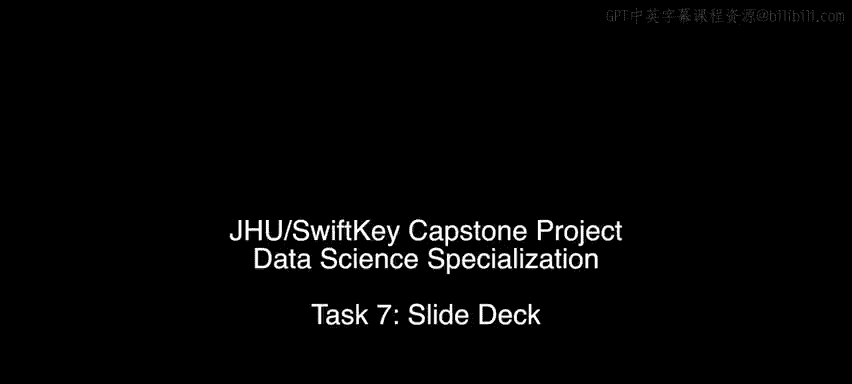

# 数据科学毕业课程（约翰霍普金斯大学）｜课程10：任务7介绍 🎯

在本节课中，我们将学习如何为你的数据科学项目创建最终演示文稿。你已经完成了数据产品的构建，现在是时候向他人展示你的成果并说明其价值了。

---

## 创建演示文稿幻灯片 📊

上一节我们完成了数据产品的开发，本节中我们来看看如何有效地展示你的工作。你需要制作一份幻灯片演示文稿，用于展示你的成果并解释其吸引力。

这份幻灯片不应超过五页，并且必须使用我们工作室的演示工具来制作。

---

## 演示文稿的核心内容

在演示中，你需要清晰地传达几个关键部分。以下是构建演示文稿时需要涵盖的核心要素：

1.  **项目背景**：简要介绍你试图解决的问题的背景信息。
2.  **解决方案**：描述你为解决该问题所采取的方法和途径。
3.  **产品与应用**：介绍你的应用程序或产品，并说明用户应如何使用它。
4.  **产品亮点**：重点展示你产品中一些非常出色的功能和特点。

---

## 演示的目标与对象

想象你正在向你的上司、经理或潜在投资者进行这次演示。你的目标是以清晰、简洁的方式，传达你所完成的所有出色工作。

---

本节课中，我们一起学习了如何为数据科学项目构建最终的演示文稿。我们明确了演示文稿的页数限制、制作工具，并梳理了需要包含的核心内容模块，包括项目背景、解决方案、产品介绍以及亮点展示。最后，我们明确了演示的目标是向决策者或投资者清晰、有力地展示你的工作价值。祝你演示顺利！