# 约翰霍普金斯大学数据科学课程1：《数据科学家工具》｜P13：链接GitHub与RStudio 🔗

在本节课中，我们将学习如何将RStudio与GitHub连接起来。通过建立这个连接，你可以在RStudio中直接使用Git进行版本控制，并将项目轻松推送到GitHub仓库。我们将分步完成配置、密钥创建、仓库链接以及提交第一个文件的完整流程。

---

## 概述

你已经在本机安装了RStudio和Git，并拥有一个GitHub账户。本节教程将指导你完成以下核心步骤：
1.  在RStudio中配置Git路径。
2.  创建SSH密钥并将公钥添加到GitHub。
3.  在GitHub上创建新仓库并与RStudio项目关联。
4.  在RStudio中创建文件，并完成`stage`、`commit`、`push`操作至GitHub。

完成这些步骤后，你就能在RStudio中无缝地进行版本控制和远程协作。

---

## 第一步：在RStudio中链接Git


上一节我们介绍了Git和GitHub的基本概念，本节中我们来看看如何在RStudio中配置Git。

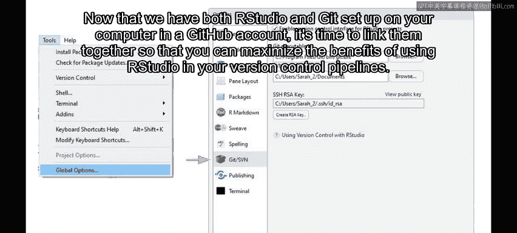

首先，打开RStudio，进入顶部菜单栏的 **Tools**， 然后选择 **Global Options**， 接着点击 **Git/SVN**。

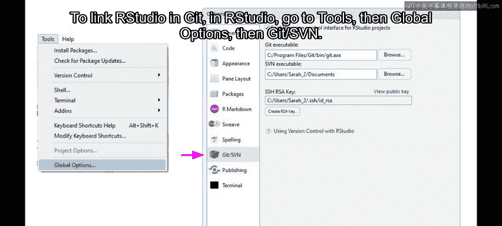

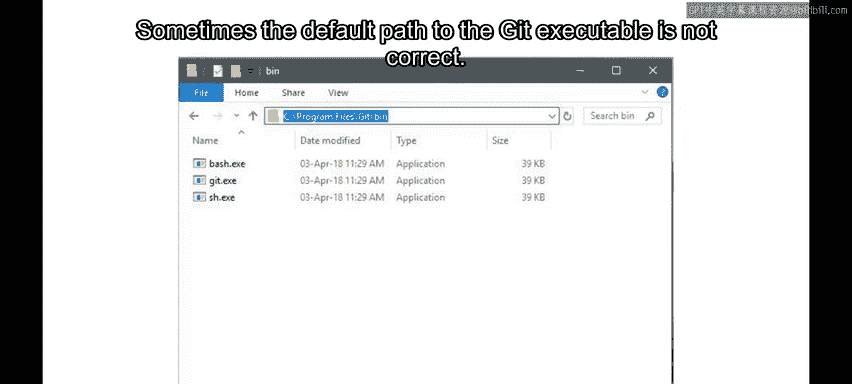

有时，RStudio自动检测到的Git可执行文件路径可能不正确。你需要确认`Git.exe`是否位于RStudio指定的目录中。如果路径错误，请将其修改为正确的路径。确认无误后，点击 **OK** 或 **Apply**。

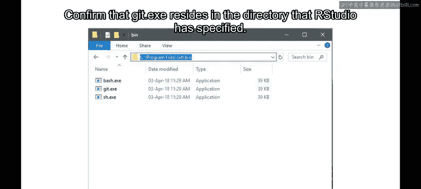

至此，RStudio与Git已成功链接。


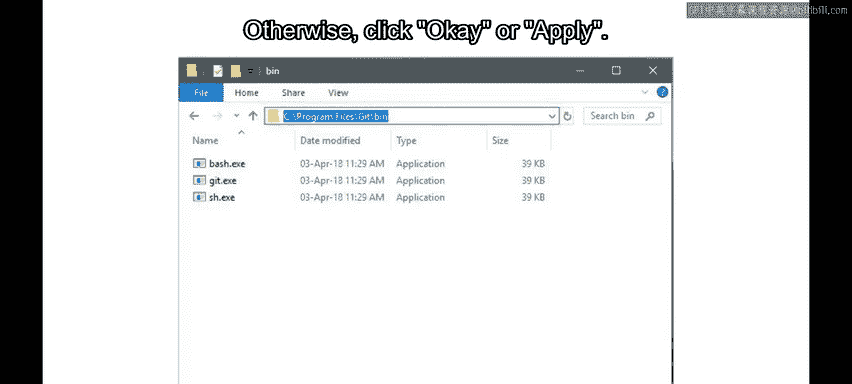


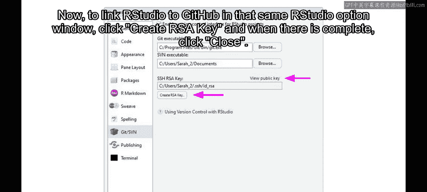

---

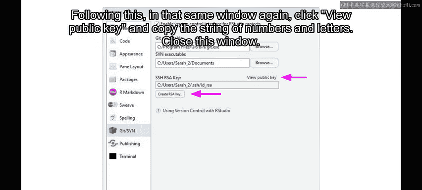

## 第二步：创建SSH密钥并链接GitHub

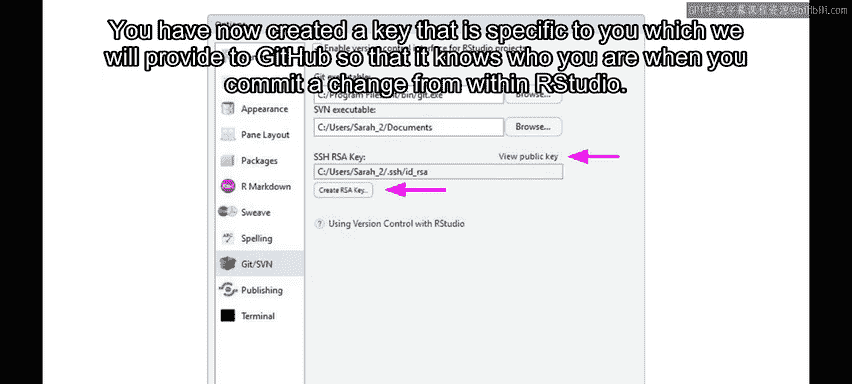

现在，我们需要让GitHub认识来自RStudio的“你”。这通过创建一对SSH密钥来实现。

在同一个RStudio选项窗口中，点击 **Create RSA Key**。创建完成后，点击 **Close**。

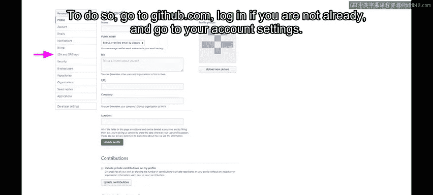

接着，再次在同一窗口中点击 **View public key**， 复制弹出的那串数字和字母组合。关闭此窗口。

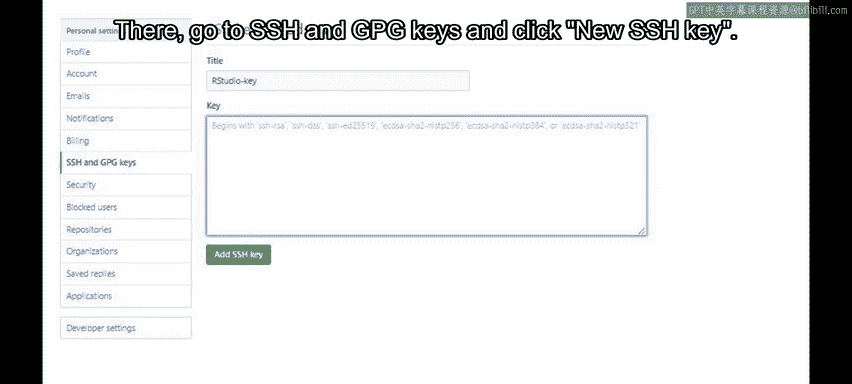

你已创建了一个专属的密钥对。我们将把公钥提供给GitHub，这样当你从RStudio提交更改时，GitHub就能识别你的身份。


以下是具体操作步骤：

1.  访问 [GitHub.com](https://github.com)， 登录你的账户。
2.  点击右上角头像，进入 **Settings**。
3.  在左侧边栏中找到 **SSH and GPG keys**。
4.  点击 **New SSH key**。
5.  在“Title”中，为这个密钥起一个与RStudio相关的名字（例如“My RStudio”）。
6.  在“Key”框中，粘贴你刚从RStudio复制的公钥。
7.  输入你的GitHub密码以确认添加。

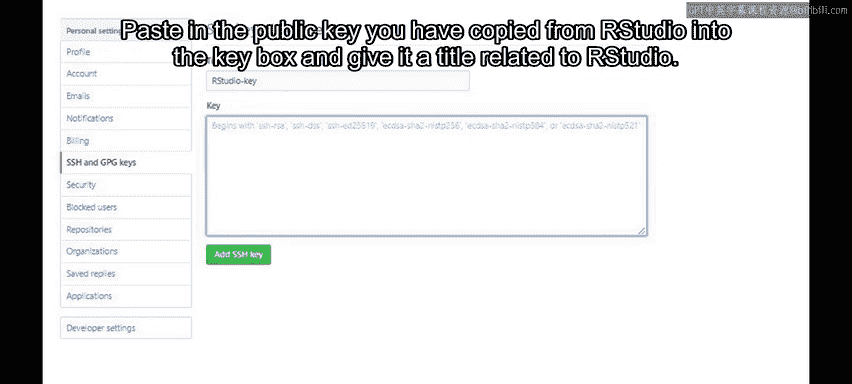

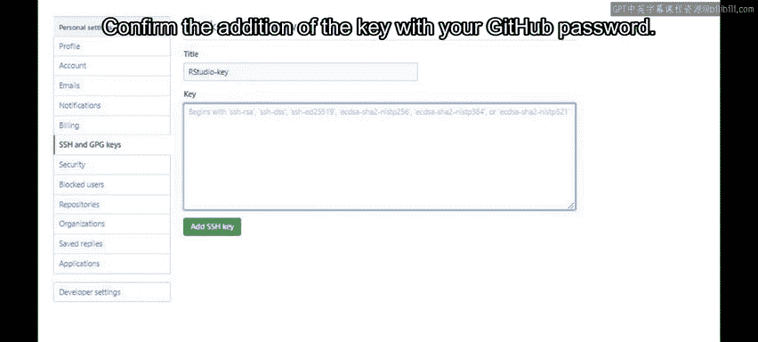

现在，RStudio与GitHub已通过SSH密钥建立链接。


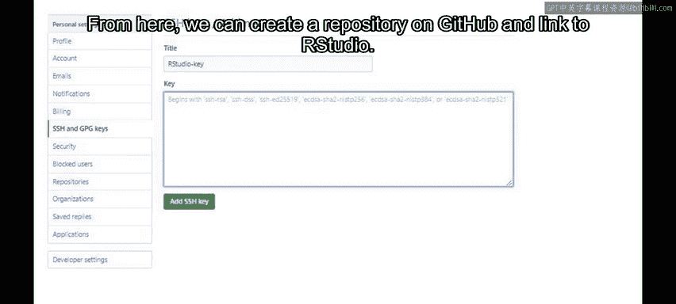


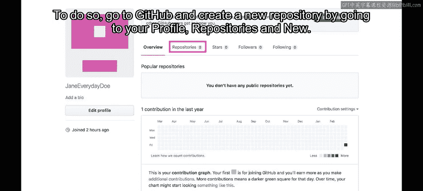


---

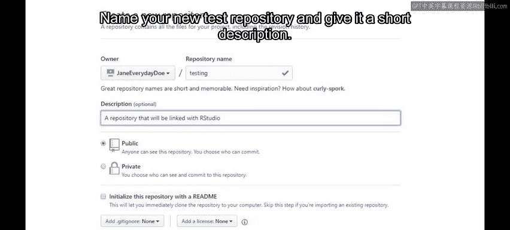

## 第三步：创建GitHub仓库并链接到RStudio项目

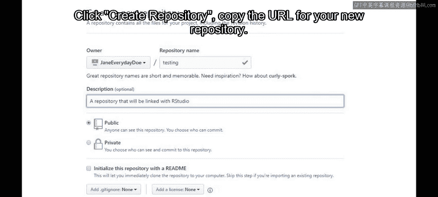

链接建立后，我们可以创建一个GitHub仓库，并在RStudio中打开它。

首先，在GitHub上创建新仓库：
1.  点击右上角头像旁的 **+** 号，选择 **New repository**。或者，进入你的个人主页，点击 **Repositories** 标签页，然后点击 **New**。
2.  为你的新测试仓库命名，并添加一个简短的描述。
3.  点击 **Create repository**。
4.  创建成功后，复制该仓库的URL（SSH或HTTPS格式均可，建议使用SSH）。


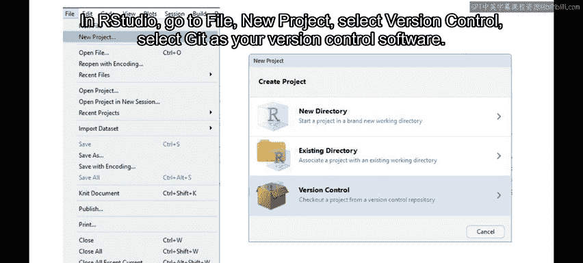

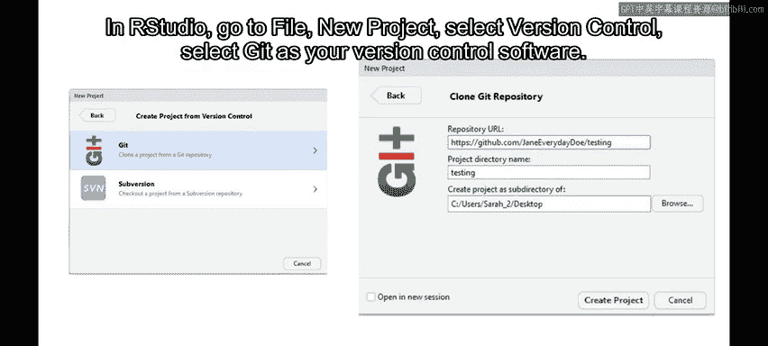


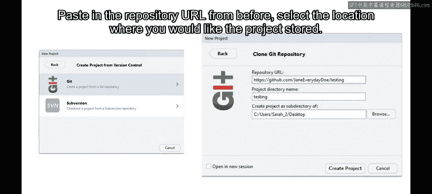


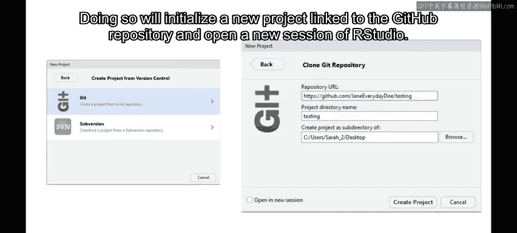

然后，在RStudio中创建关联项目：
1.  在RStudio中，点击 **File** -> **New Project**。
2.  选择 **Version Control**。
3.  选择 **Git**。
4.  在“Repository URL”框中，粘贴你刚才复制的GitHub仓库URL。
5.  选择你希望存储该项目的本地目录。
6.  点击 **Create Project**。

此操作将初始化一个新项目，链接到GitHub仓库，并开启一个新的RStudio会话。


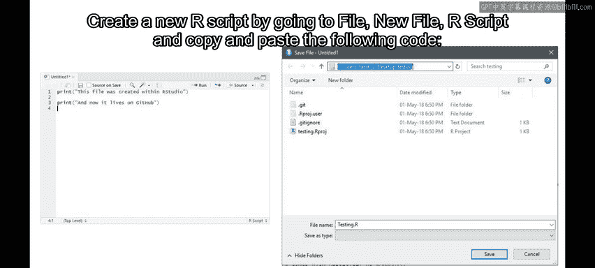

---

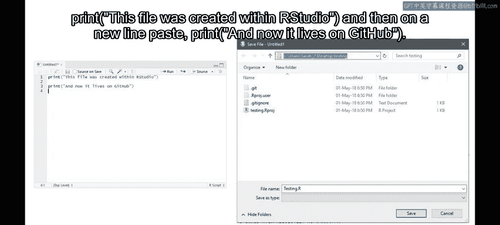

## 第四步：创建文件并提交到GitHub

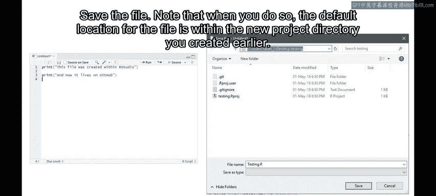

现在，让我们在项目中创建一个新文件，并体验完整的版本控制流程。

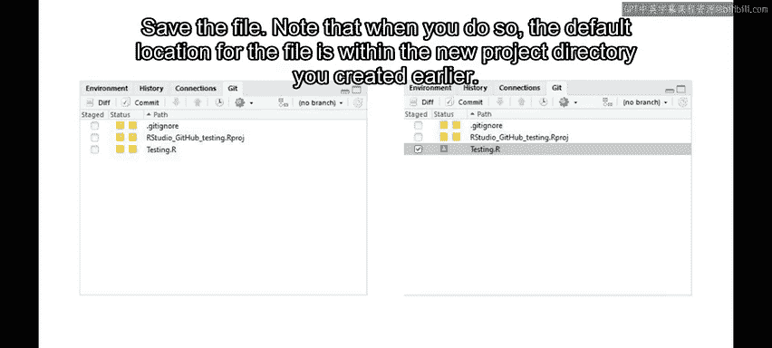

首先，创建一个R脚本：
1.  点击 **File** -> **New File** -> **R Script**。
2.  在新建的脚本文件中，输入以下代码：
    ```r
    print("This file was created within RStudio")
    print("And now it lives on GitHub")
    ```
3.  保存文件。注意，默认保存位置就是你刚创建的项目目录。


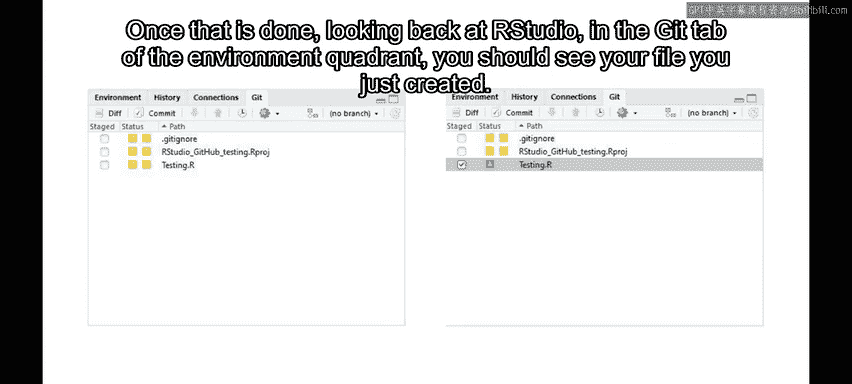

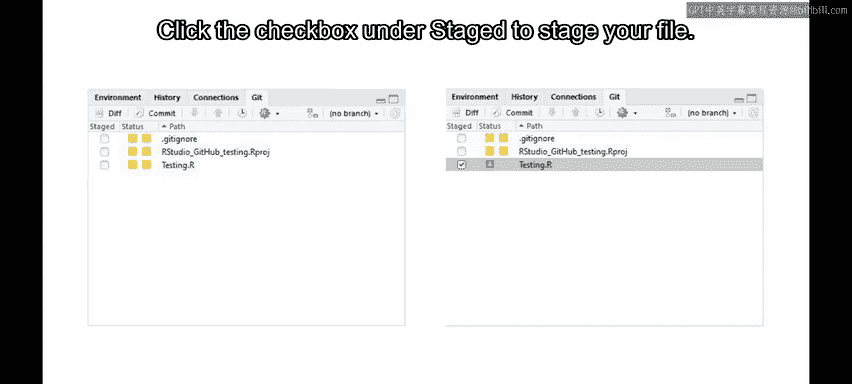


保存后，查看RStudio界面右上方的 **Git** 标签页（通常在Environment标签页旁边）。你应该能看到刚刚创建的文件。

以下是提交文件的步骤：
1.  勾选文件下方的 **Stage** 复选框，将文件加入暂存区。
2.  点击 **Commit** 按钮，会弹出一个新窗口。
3.  在“Commit message”框中，输入本次提交的描述信息（例如“Initial commit: added test script”）。
4.  点击 **Commit** 按钮，然后关闭提交窗口。


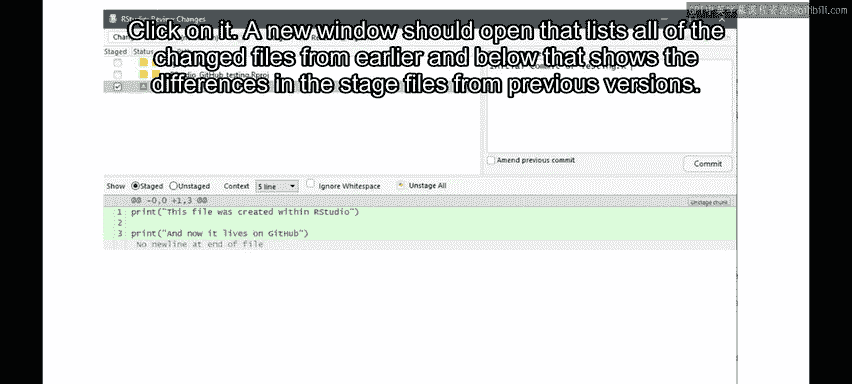


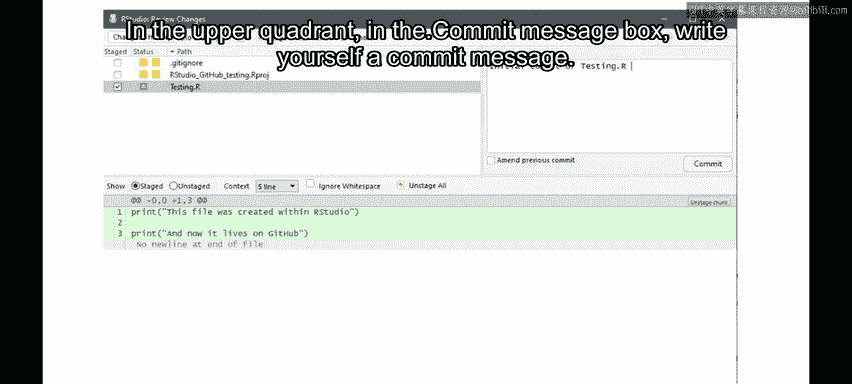


到目前为止，你已完成创建文件、保存、暂存和本地提交。根据版本控制流程，下一步是将更改推送到远程仓库。

在Git标签页中，点击 **Push** 按钮。RStudio会将你的本地提交推送到GitHub。

最后，打开你的GitHub仓库页面，刷新后即可看到刚刚的提交记录。你已成功从RStudio向GitHub推送了第一次提交。


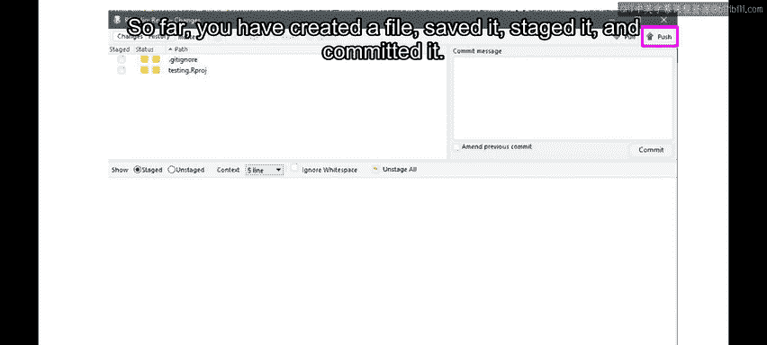


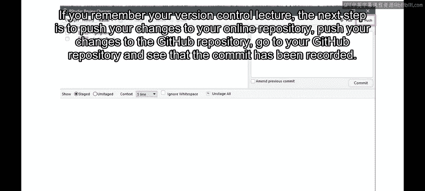


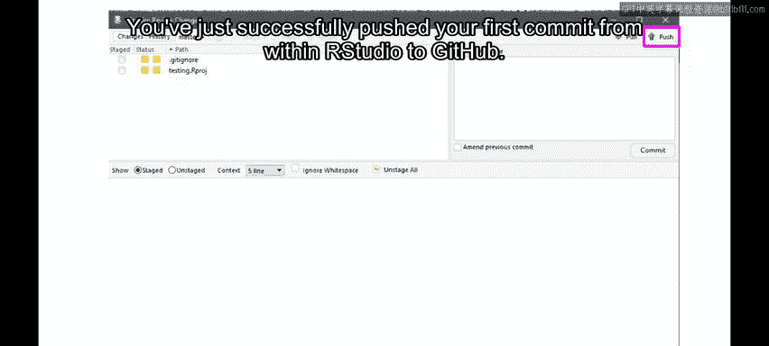


---

## 总结

本节课中，我们一起学习了如何将RStudio与GitHub进行完整集成。

我们首先在RStudio中配置了Git路径，使其能识别Git作为版本控制软件。接着，我们通过创建SSH密钥对，将RStudio与你的GitHub账户安全链接。为了测试整个流程，我们在GitHub上创建了一个新仓库，并在RStudio中创建了与之关联的项目。最后，我们创建了一个新的R脚本文件，并完整地执行了`stage`（暂存）、`commit`（提交）和`push`（推送）操作，成功将文件同步到了GitHub远程仓库。

掌握这个工作流程，将极大提升你使用RStudio进行数据科学项目管理和协作的效率。


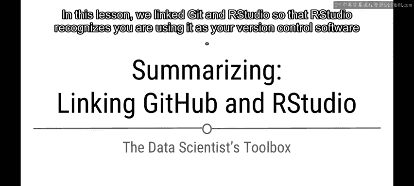


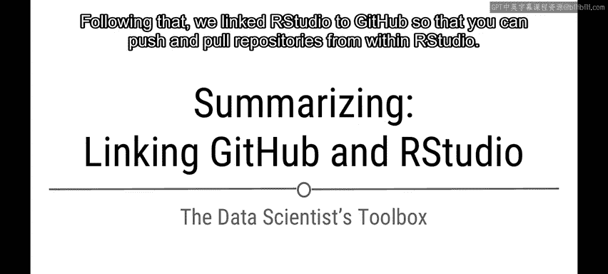


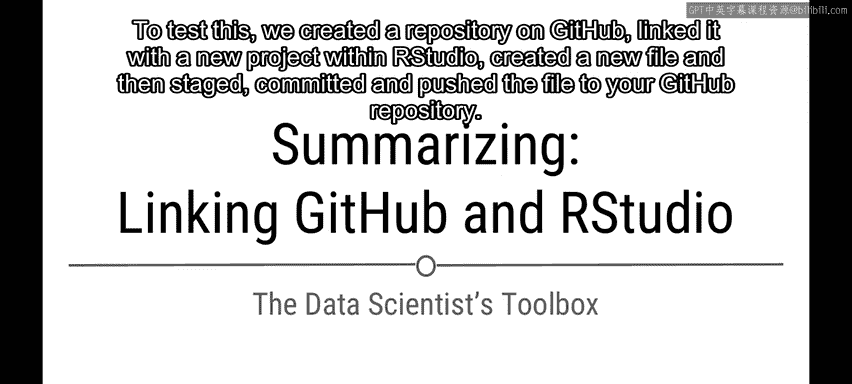


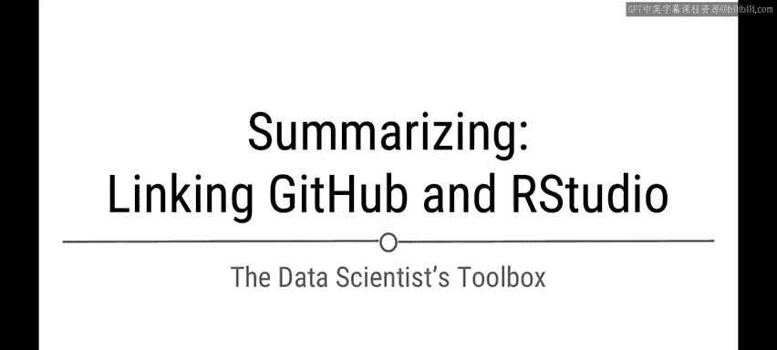

