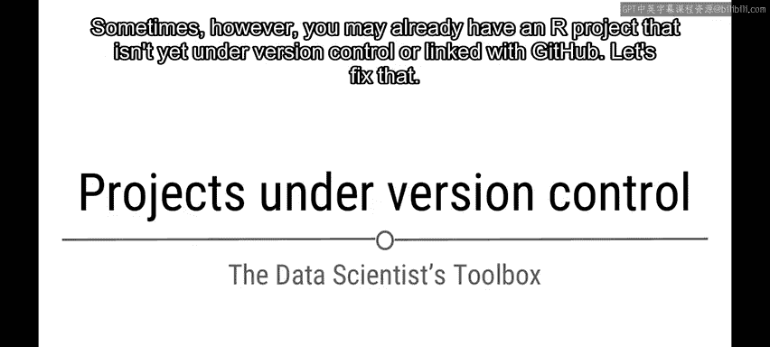
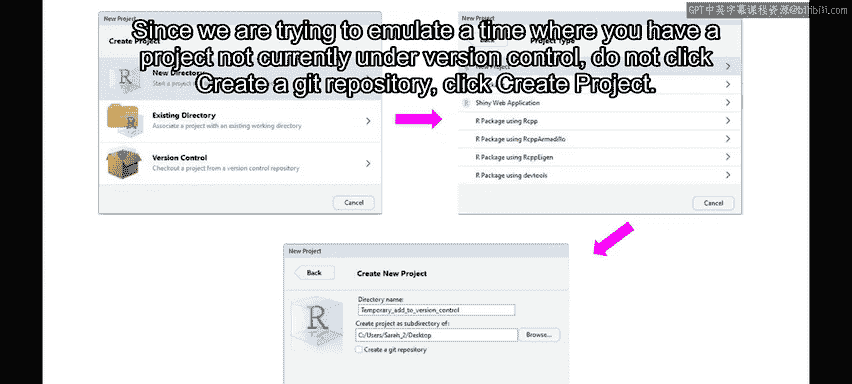
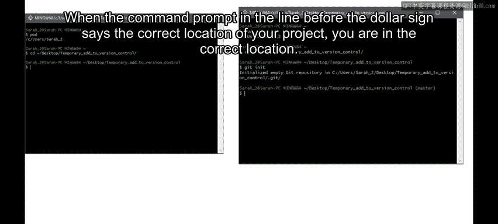
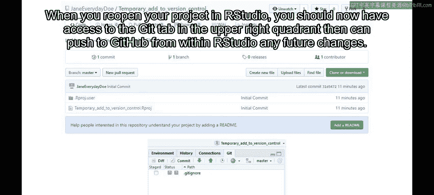
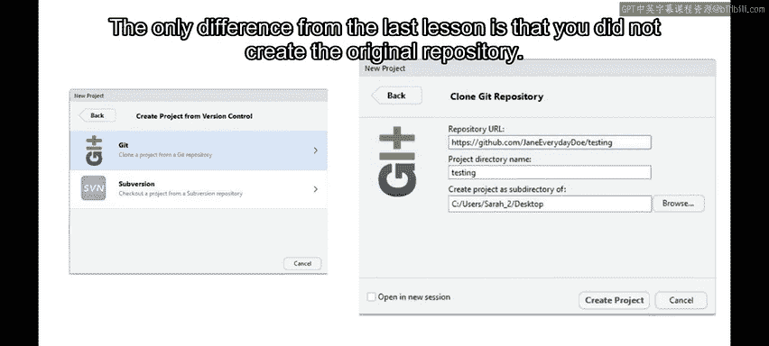
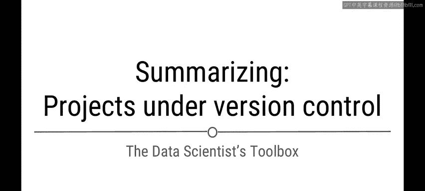

# 约翰霍普金斯大学数据科学课程1：《数据科学家工具》｜P14：将现有项目纳入版本控制 📂

在本节课中，我们将学习如何将一个已经存在但尚未使用版本控制的R项目，纳入Git版本控制并与GitHub关联。我们还将回顾如何克隆一个已存在于GitHub上的项目到本地。



---

## 概述

上一节我们介绍了如何从零开始，在GitHub上创建仓库并与RStudio链接。然而，有时你可能已经有一个正在开发的R项目，它尚未与任何版本控制系统关联。本节中，我们来看看如何解决这个问题。

## 模拟一个未受版本控制的项目

首先，我们需要创建一个模拟场景：一个本地的R项目，但未使用Git进行版本控制。

1.  在RStudio中，点击 **File（文件）** -> **New Project（新建项目）** -> **New Directory（新建目录）** -> **New Project（新项目）**。
2.  为你的项目命名。
3.  **关键步骤**：为了模拟项目未受版本控制的情况，请**不要勾选**“Create a git repository（创建git仓库）”选项。
4.  点击 **Create Project（创建项目）**。

现在，我们创建了一个尚未进行版本控制的R项目。接下来，我们将修复这个问题。



## 将本地项目初始化为Git仓库

第一步是让这个项目目录与Git交互。我们需要使用命令行工具（如Git Bash或终端）。

以下是操作步骤：

1.  打开Git Bash或终端。
2.  使用 `cd` 命令导航到你的项目目录。例如：
    ```bash
    cd /path/to/your/project
    ```
3.  确认命令行提示符（`$` 符号前的路径）显示为你项目的正确位置。
4.  在项目目录中，依次输入以下命令：
    ```bash
    git init
    git add .
    git commit -m "initial commit"
    ```
    *   `git init` 将此目录初始化为一个Git仓库。
    *   `git add .` 将目录中的所有文件添加到暂存区。
    *   `git commit -m "initial commit"` 提交这些更改，并附上提交信息。

至此，我们已经创建了一个R项目，并将其链接到了本地的Git版本控制。下一步是将其与GitHub关联。

## 将本地仓库链接到GitHub

现在，我们需要在GitHub上创建一个远程仓库来存放我们的代码。



1.  访问 [GitHub.com](https://github.com)，创建一个新的仓库（New Repository）。
2.  **确保仓库名称与你的R项目名称完全相同**。
3.  创建时，**不要**初始化README、.gitignore或许可证文件。
4.  仓库创建成功后，页面会显示“推送现有仓库”的选项，并附带命令行指令。

在Git Bash或终端中，复制并粘贴GitHub提供的这两行（或类似）代码：
```bash
git remote add origin https://github.com/your-username/your-repo-name.git
git branch -M main
git push -u origin main
```
这些命令会将你的本地仓库与远程的GitHub仓库关联，并将代码推送到GitHub。

操作完成后，刷新你的GitHub页面，应该能看到项目文件已经存在。当你重新在RStudio中打开这个项目时，右上角的面板应该会出现 **Git** 选项卡，未来你可以直接从RStudio内部推送更改到GitHub。

## 克隆现有的GitHub项目到本地



如果存在一个他人正在开发的项目，你需要参与贡献，你可以将现有项目链接到你的RStudio。这遵循与上一课完全相同的前提：克隆一个GitHub仓库到本地计算机。

以下是简要步骤：

1.  在RStudio中，点击 **File（文件）** -> **New Project（新建项目）** -> **Version Control（版本控制）**。
2.  选择 **Git** 作为版本控制系统。
3.  如同上一课，提供你想要克隆的仓库URL，并选择本地存储文件的位置。
4.  点击 **Create Project（创建项目）**。

现在，仓库中的所有现有文件都已存储在本地计算机上，并且你可以通过RStudio界面推送编辑。与上一课的唯一区别在于，你没有创建原始仓库，而是克隆了他人的仓库。

---

## 总结





本节课中，我们一起学习了如何将一个现有项目转换为受Git版本控制的项目，主要使用了命令行操作。随后，我们结合GitHub页面指令和命令行，将新受版本控制的项目链接到了GitHub。最后，我们简要回顾了如何使用RStudio将GitHub上已有的仓库克隆到本地机器。掌握这些流程，能让你更灵活地管理各种状态下的数据科学项目。