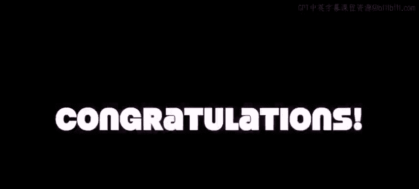
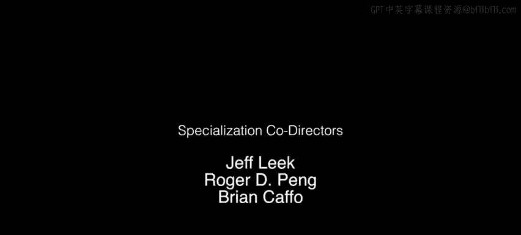
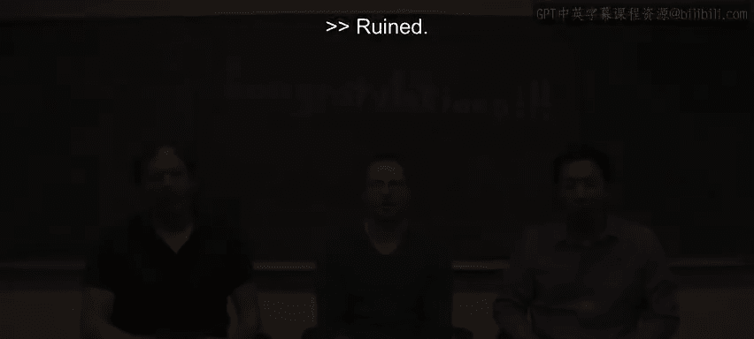
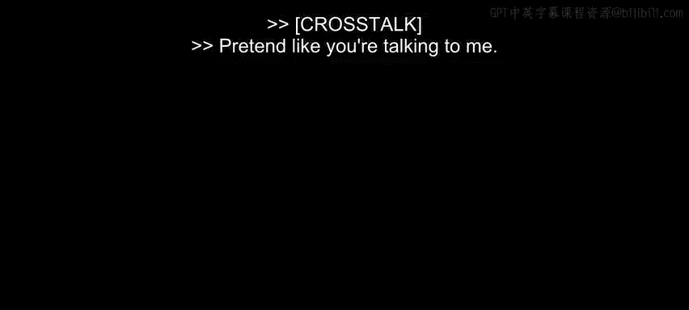

# 约翰霍普金斯大学数据科学课程10：《数据科学毕业课程》🎓

## 概述

在本节课中，我们将一起回顾并整理约翰霍普金斯大学数据科学专项课程的毕业寄语。本节内容旨在祝贺学员完成全部课程，并提供毕业后的后续步骤与资源指引。

---

## 课程核心内容

恭喜各位毕业生，我们非常高兴你们完成了整个数据科学专项课程。

这是一段漫长的旅程，你们至今已经完成了许多课程。你们在短时间内取得的成就给我们留下了深刻的印象。

我们有机会查看了一些毕业设计项目，你们所展现的创造力和在所有工作中展示的技术专长令我们印象深刻。

在整个专项课程中，与你们的互动让我们感到非常愉快，我们甚至有机会在线上见到了你们中的一些人。因此，我们非常期待你们未来能够取得的成就。

---

## 毕业后的重要步骤

以下是完成课程后你需要做的几件事。

*   **发布证书**：请务必将你的证书凭证发布到LinkedIn上。
*   **加入社群**：此外，你将收到一封来自我的电子邮件，邀请你加入一个LinkedIn群组，该群组专为完成本专项课程的学员设立。
*   **利用社群**：这是一个进行社交、发布职位、寻找工作以及展示你利用本专项课程所做其他伟大事情的绝佳平台。

---

## 持续学习与关注

上一节我们介绍了毕业后的社群资源，本节中我们来看看如何持续获取最新的学习内容。

我们霍普金斯大学一直在开发新的课程和新的专项课程，目前有很多项目正在开发中。

如果你想了解我们三人的工作动态，请在社交媒体上关注我们，我们会定期发布关于我们工作的更新。

---

## 总结与最终鼓励

干得漂亮，很高兴你们所有人都参与了这项专项课程，我们真的很期待看到你们接下来的行动。

现在，去用科学方法挖掘那些数据的价值吧。

---

## 课程总结

本节课中我们一起学习了约翰霍普金斯大学数据科学专项课程的毕业流程。主要内容包括对学员成就的祝贺、将证书发布至LinkedIn并加入专属毕业生社群的重要性，以及如何关注未来的新课程。课程以一句鼓励的话语“Now go drop some science on that data.”作为结束，勉励毕业生将所学知识应用于实践。