# 约翰霍普金斯大学数据科学课程1：《数据科学家工具》｜P1：为什么是自动视频？🤖

在本节课中，我们将要学习约翰霍普金斯大学数据科学课程为何采用自动生成的视频，以及这种创新方法如何利用R语言和数据科学的力量来提升课程质量与可维护性。

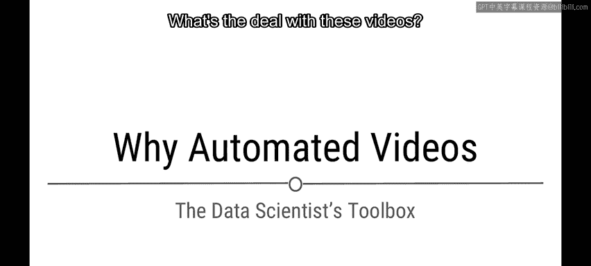

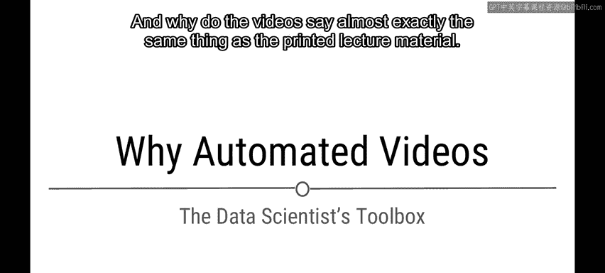

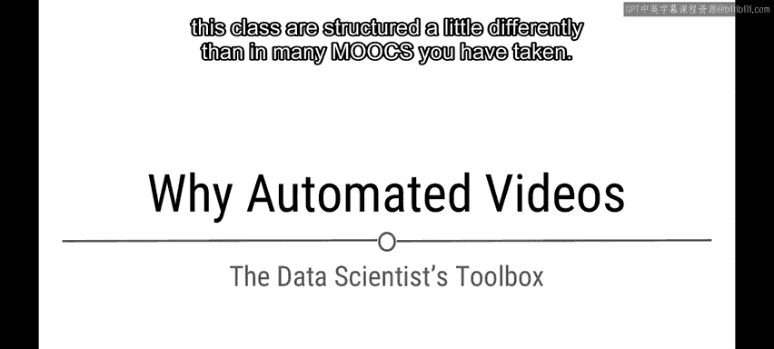

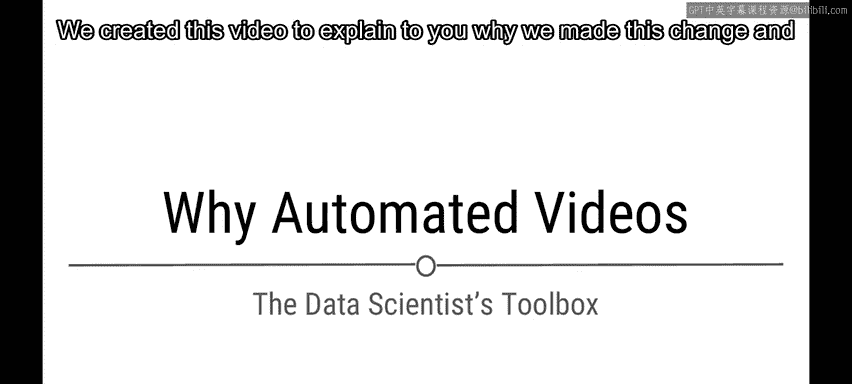

您可能已经注意到，本课程的讲座和视频结构与许多其他MOOC（大规模开放在线课程）有所不同。视频内容与印刷版讲义几乎完全一致。我们制作这个视频，旨在解释我们做出这一改变的原因，并展示R语言与数据科学的强大能力。

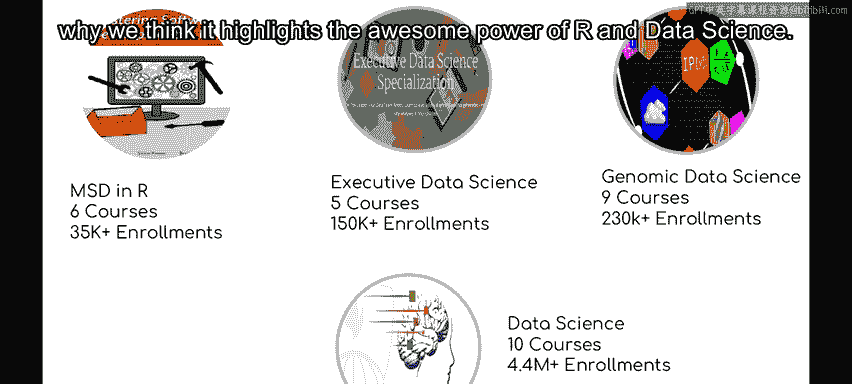

---

## 传统课程制作的挑战 🧩

上一节我们介绍了课程形式的差异，本节中我们来看看传统MOOC制作方法面临的困难。

约翰霍普金斯大学数据科学实验室在过去五年中，于多个平台创建了超过30门课程。我们的目标是为最广泛的受众提供最佳、最新的信息。然而，在线维护如此大量的课程材料面临着巨大挑战：软件包会过时，新的工作流程被发明，还有各种笔误。

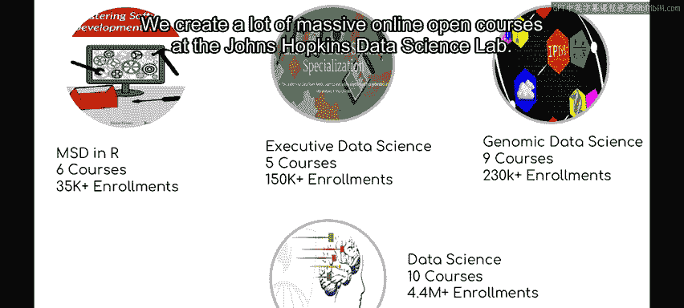

我们曾像许多其他大学一样制作课程：先制作讲义幻灯片，然后在录音棚录制授课视频。这种方式有其优点，例如您能听到我们真实的声音。但其缺点是，更新内容非常困难和耗时。整个过程包括预订录音棚、架设设备、录制讲座、后期编辑以及上传系统。

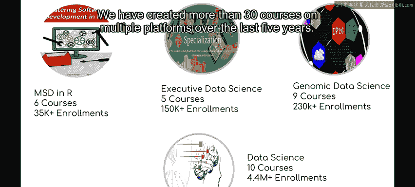

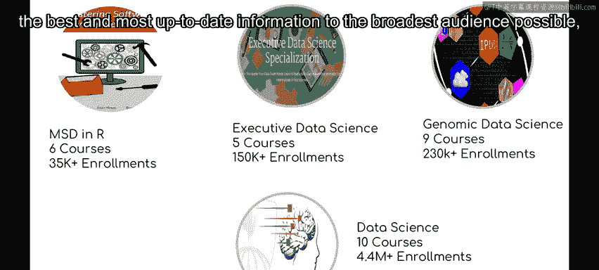

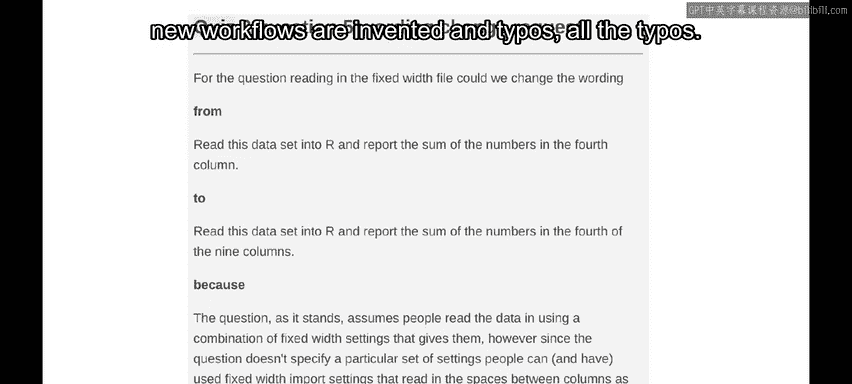

结果就是，我们的许多讲座视频内容过时、包含错误，或未能纳入最新、最佳的工作流程和管道。随着课程数量增长，保持内容更新对我们而言挑战越来越大。

---

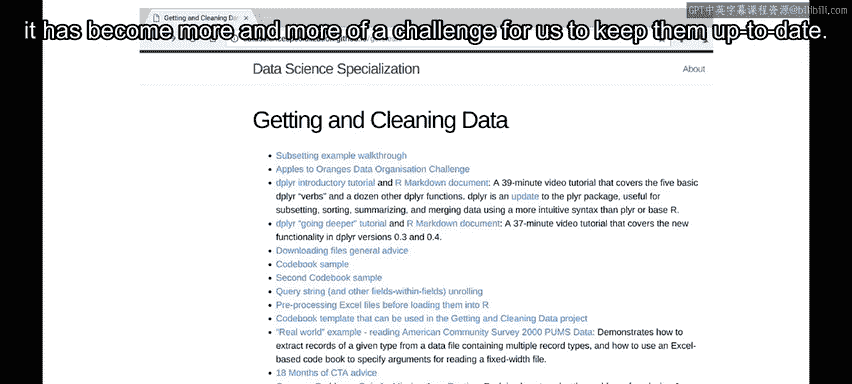

## 解决方案：转向文本驱动 📄

面对维护挑战，我们开始思考解决方案。我们意识到，录制和编辑视频极其耗时，但另一种类型的内容——普通的纯文本文档——我们可以更频繁地编辑、更新和维护。

我们并非唯一有此想法的人。MOOC领域的创新者，如洛雷娜·巴尔巴，曾指出这类课程甚至不一定需要视频。

因此，在设计新的课程创建与维护流程时，我们尝试探索能否完全用纯文本文档来构建课程。我们将一门MOOC分解为以下几个基本要素：

以下是课程的核心组成部分：
1.  **教程**：我们可以轻松地用Markdown或R Markdown等纯文本格式编写。
2.  **幻灯片**：使用类似Google幻灯片这样的工具制作，易于维护和分享。
3.  **评估**：可以使用标记语言来创建测验和其他评估内容。
4.  **视频**：这是关键难点——如何从纯文本文档生成视频？

幸运的是，数据科学和人工智能社区为我们解决了大部分难题：**文本到语音合成技术**。我们现在可以为视频编写脚本，并使用Amazon Polly等工具来合成语音。

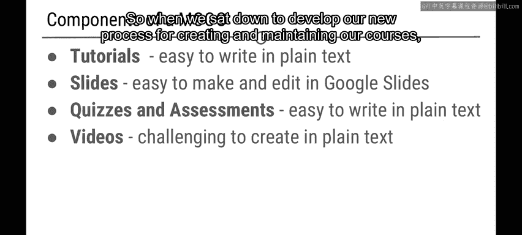

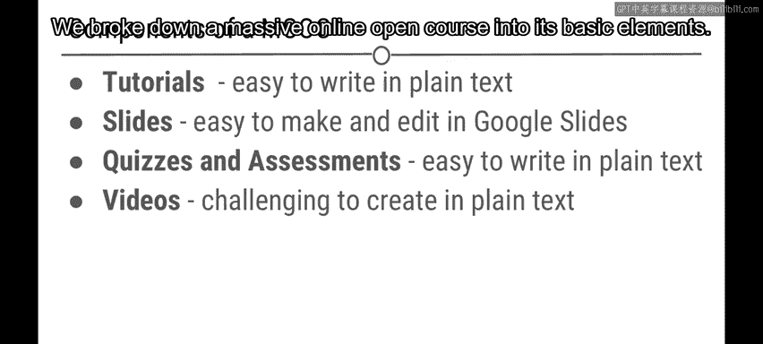

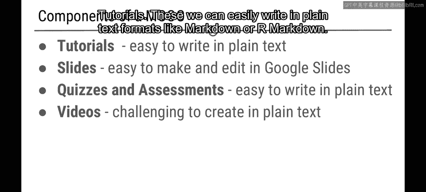

---

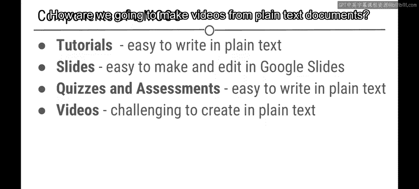

## 自动化流程的实现 ⚙️

为了利用这项新技术，我们创建了两个新的R软件包。

以下是实现自动化的核心工具：
*   **`ari`**：该软件包接收一个脚本和一组Google幻灯片，并使用Amazon Polly来为幻灯片配音。它还会生成包含字幕所需的时间轴文件，确保视频对听障人士可访问。
*   **`dctor`**：该软件包自动化了从用`ari`创建视频到上传至YouTube的多个步骤。

这样，当我们修改脚本或幻灯片后，只需几分钟就能重新制作并上传视频，极大地降低了保持内容新鲜的维护开销。整个过程都在R环境中完成。

转向新流程最酷的一点，是向您展示R编程语言有多么强大。R是本课程计划中您将学习的主要语言，我们希望您在完成课程时，也能构建出像本系统一样出色的工具。

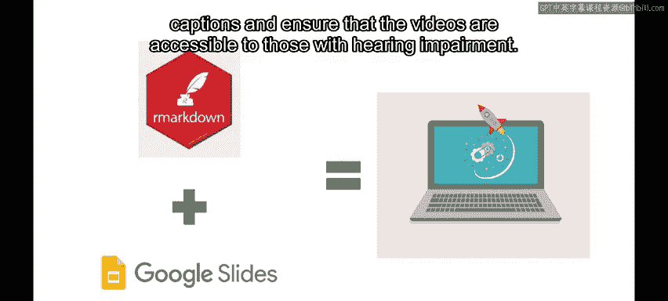

---

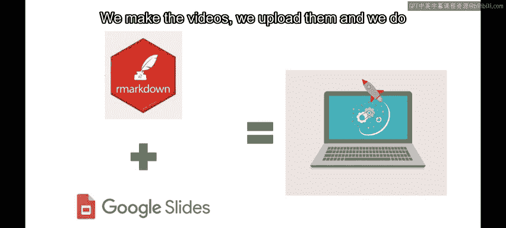

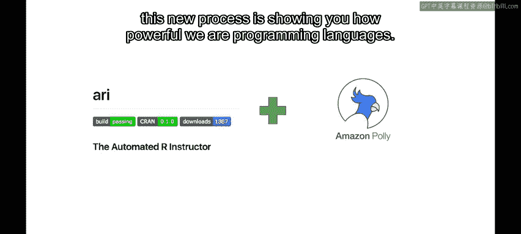

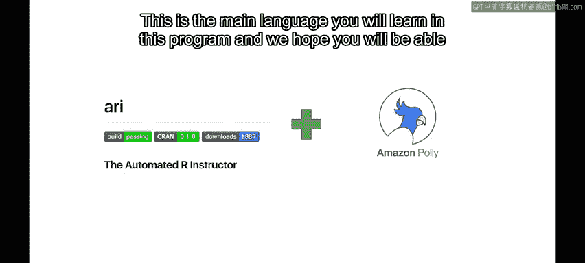

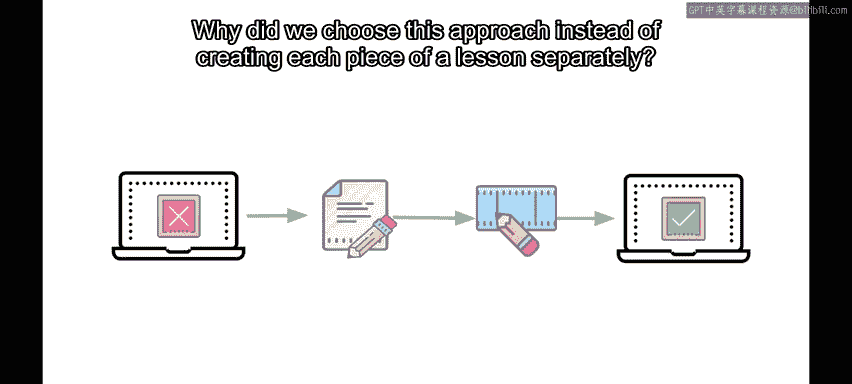

## 新方法的优势 ✨

我们为何选择这种方法，而不是单独制作课程的每个部分？

以下是采用自动化流程的三个主要优势：
1.  **易于维护和更新**：如果您报告问题或发现课程错误，我们只需修改脚本或Google幻灯片，然后重新生成整个课程即可。这为我们提供了一种更高效的课程内容维护与更新方式。
2.  **提升可访问性**：由于视频配有字幕，且字幕可由语音合成器朗读，这使得有残疾的学习者也能访问课程内容。对于其他学习者，您可以根据喜好自由选择阅读、听或看。
3.  **持续改进与可扩展性**：使用文本转语音合成的一个很酷的特点是，随着语音合成软件的改进，我们的视频质量也会持续提升。这意味着我们可以更换不同的语音。最终，我们将能够利用机器学习，快速、自动地将课程翻译成不同语言。

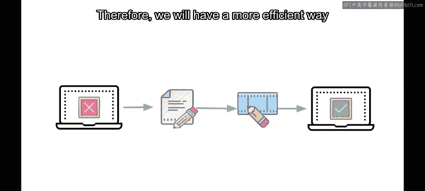

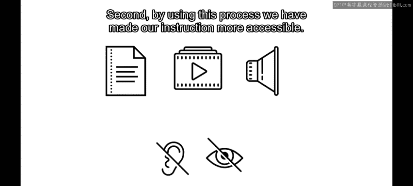

我们认为，这突显了数据科学和人工智能在改善世界方面的惊人力量。

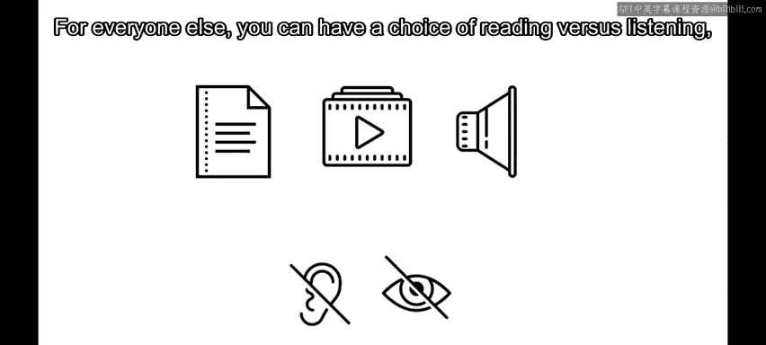

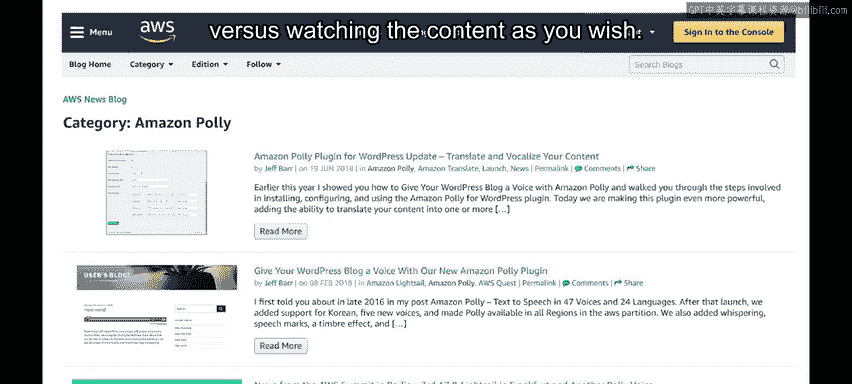

如果您觉得机器人语音有些恼人，我们理解。我们知道这项技术尚不完美。因此，我们确保书面讲义材料尽可能与视频讲座内容一致，以便您选择自己喜欢的方式来学习我们的课程。

我们希望这一改变能让我们以最快的速度，为您提供最好的内容。感谢您与我们一同参与课程开发的新阶段。

---

## 总结 📝

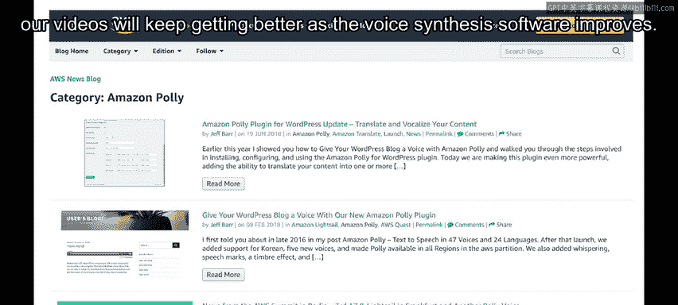

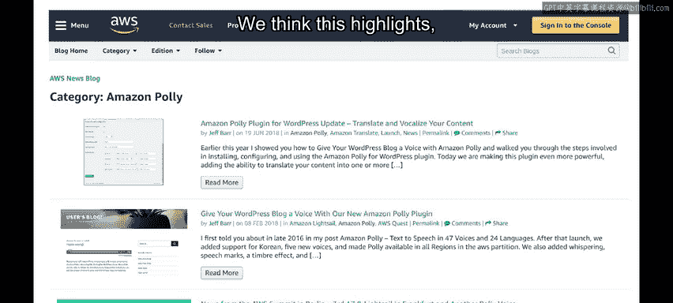

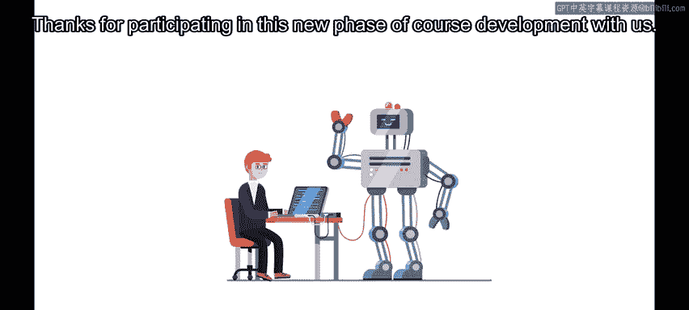

本节课中我们一起学习了约翰霍普金斯大学数据科学课程采用自动生成视频背后的原因。我们探讨了传统MOOC制作的维护挑战，介绍了转向以文本为核心、利用`ari`和`dctor`等R包实现自动化视频生成与更新的解决方案。这种方法不仅使课程更易于维护、更具可访问性，也展示了R语言与数据科学在实际应用中的强大能力，为未来课程的多语言化与持续改进奠定了基础。