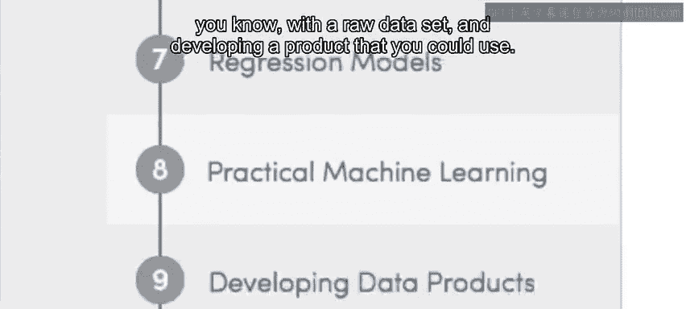

# 课程10：数据科学毕业项目 🎓

## 概述

在本节课中，我们将要学习约翰霍普金斯大学数据科学专项课程的毕业项目。该项目旨在让你综合运用此前九门课程中学到的所有技能，从头开始完成一个完整的数据科学项目。

## 欢迎来到毕业项目

大家好，欢迎来到约翰霍普金斯大学数据科学专项课程的毕业项目。

此刻，你已经完成了专项课程中的所有九门课程，从《数据科学家的工具箱》一直到《开发数据产品》。你学到了一系列非常实用的数据科学技能。

我们想给你一个机会，让你将所有学到的技能应用到一个全新的项目中。这个项目将从原始数据集开始，最终开发出一个可用的产品。

## 项目合作伙伴：SwiftKey

为了实现这个目标，我们与一家非常出色的公司——SwiftKey——建立了合作。该公司在预测性文本分析领域处于世界领先地位。

他们以其在安卓平台上的自定义键盘应用和在iOS平台上的SwiftKey应用而闻名。如果你想了解更多关于这家公司的信息，可以访问他们的网站。这是一家非常出色的公司。

## 项目内容介绍

在与SwiftKey的合作下，我们设计了一个非常有趣的毕业项目。该项目涉及开发一个文本预测模型，起点是一个庞大的、非结构化的英语语言数据库。

在整个课程中，我和Jeff Bryan将全程陪伴你，帮助你设定项目里程碑并进行评估。

此外，SwiftKey的工程师也将加入我们，在论坛上帮助解答问题，并通过定期的Google Hangouts与我们交流。

## 结语

我知道，完成之前的九门课程是一段漫长的旅程，而这是整个过程的最后一步。我相信，完成这个毕业项目会很有趣，你也能学到很多东西。

期待与大家共同完成这个项目。😊

## 总结

本节课中，我们一起了解了约翰霍普金斯大学数据科学专项课程的毕业项目概况。我们介绍了项目的目标、合作伙伴SwiftKey公司，以及项目的主要内容——开发一个基于大型英语语料库的文本预测模型。这是对你整个专项课程所学技能的一次综合应用与检验。