# 课程1：《数据科学家工具》｜P3：什么是数据？📊

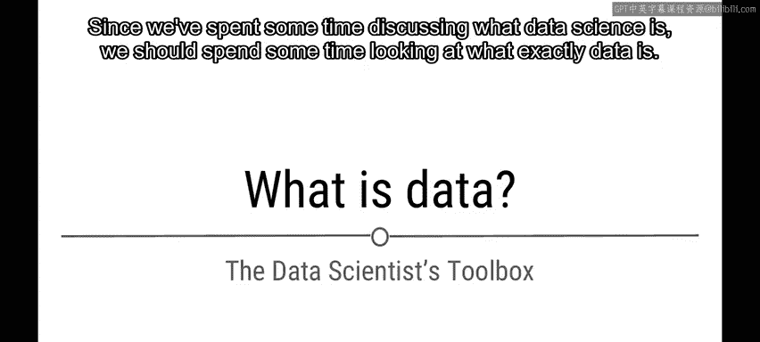

在本节课中，我们将深入探讨数据科学的核心基础——数据。我们将了解数据的定义、构成要素以及常见的数据来源，并强调数据与科学问题之间的关系。

## 概述

我们已经花了一些时间讨论什么是数据科学，现在应该花些时间看看数据究竟是什么。

## 数据的定义

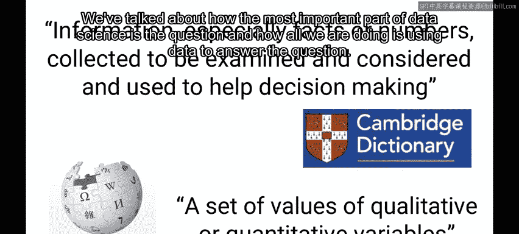

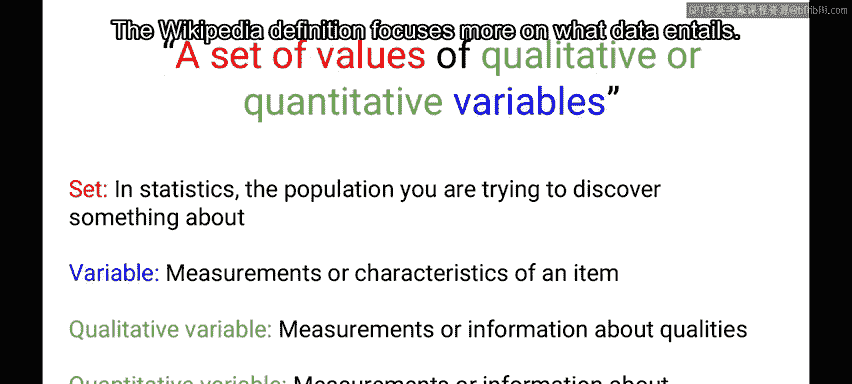

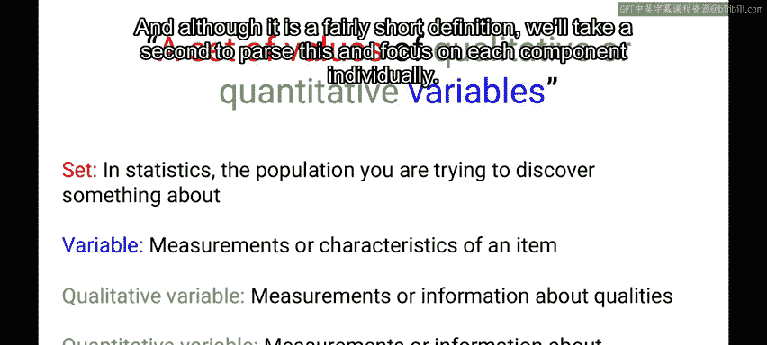

首先，我们来看看几个权威来源对数据的看法。

以下是两种常见的定义：

1.  **剑桥英语词典**：数据是信息，特别是为**被检查、考虑并用于辅助决策**而收集的事实或数字。
2.  **维基百科**：数据是**定性或定量变量的一组值**。

这两种定义略有不同，强调了数据的不同方面。两者都同意数据是值、数字或事实。但剑桥的定义侧重于围绕数据的**行动**：数据被收集、检查，最重要的是用于辅助决策。我们之前也强调过这一点，即数据科学最重要的部分是**问题**，我们所做的一切都是使用数据来回答问题。剑桥定义聚焦于此。

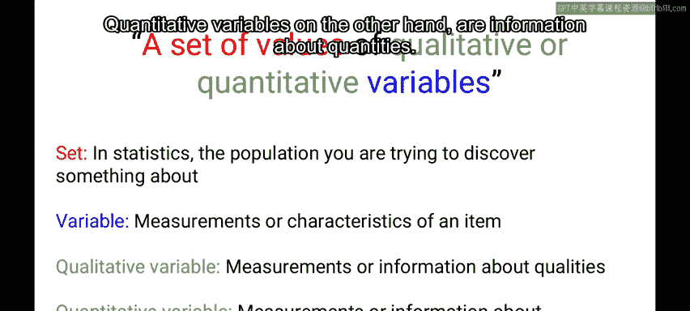

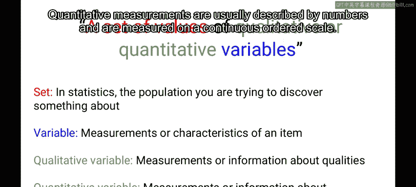

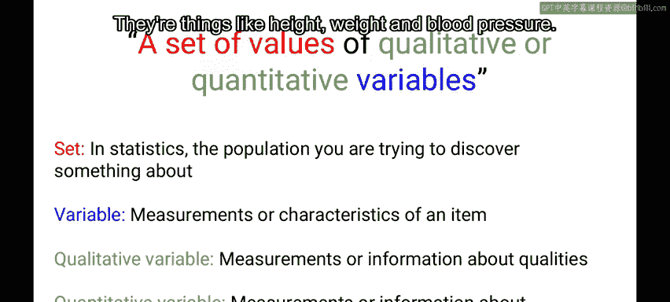

维基百科的定义则更侧重于数据的**构成要素**。虽然定义简短，但我们需要花点时间来解析它。

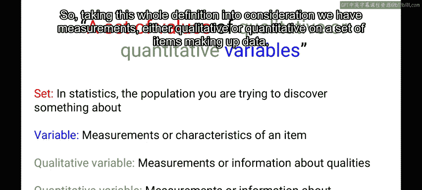

## 解析数据的构成要素

上一节我们介绍了两种数据定义，本节中我们来详细解析维基百科的定义：“**定性或定量变量的一组值**”。

我们可以逐一关注每个组成部分：

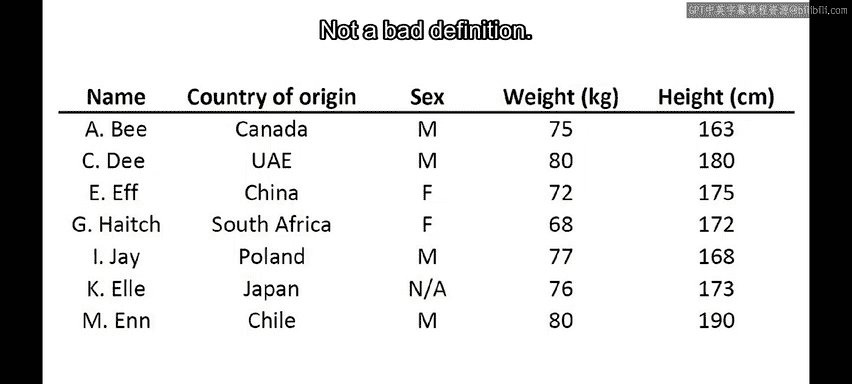

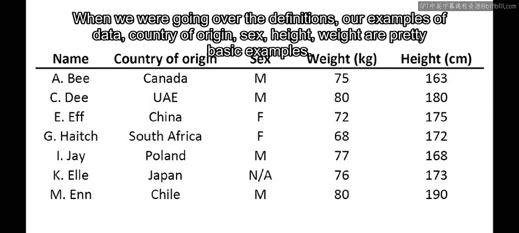

*   **一组值**：要拥有数据，你需要一组待测量的项目。在统计学中，这组项目通常称为**总体**。你试图了解的是这个集合整体的情况。
*   **变量**：变量是项目的**测量值**或**特征**。
*   **定性变量与定量变量**：
    *   **定性变量**：顾名思义，是关于**品质**的信息。例如：原产国、性别或治疗组。它们通常用**文字**描述，而非数字，并且不一定有顺序。
    *   **定量变量**：是关于**数量**的信息。定量测量通常用**数字**描述，并在连续有序的尺度上进行测量。例如：身高、体重和血压。

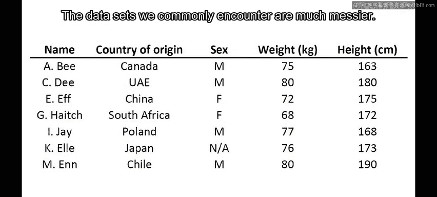

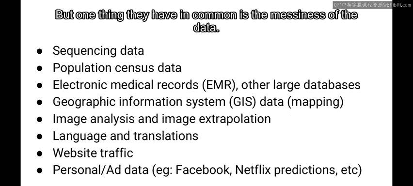

综合起来考虑这个定义，我们得到：数据是在一组项目上进行的**定性或定量**测量。这个定义相当不错。

## 现实中的数据：从整洁到混乱

当我们回顾定义时，所举的数据例子（原产国、性别、身高、体重）都是非常基础的。你可以很容易地想象它们在一个美观的电子表格中，个体在表格的一侧（行），这些变量的测量值在另一侧（列）。

然而，这很少是你遇到数据时的样子。我们通常遇到的数据集要**混乱得多**。我们的工作就是从这些混乱的数据中提取所需的信息，将其整理成像前面表格那样整洁的形式，进行适当的分析，并经常将结果可视化。

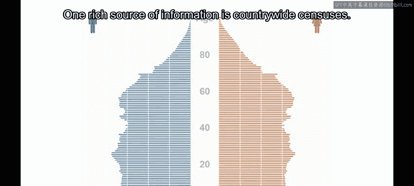

以下是你可能遇到的一些数据来源。它们的一个共同点是数据的**混乱性**——你必须努力提取所需信息来回答你的问题。

## 常见数据源示例

以下是几种常见的数据集类型及其处理方式：

*   **测序数据**：我经常处理的一类数据是测序数据。这种数据通常首先以 **`fastQ`** 格式出现，这是测序机器产生的原始文件格式。这些文件通常有数亿行长，我们的工作是将其解析为可理解和可解释的格式，并推断有关个体基因组的某些信息。在本例中，这些数据被解释为表达数据，并生成了一个名为火山图的图表。
*   **人口普查数据**：一个丰富的信息来源是全国人口普查。几乎所有国家成员都会回答一组标准化问题，并将答案提交给政府。当有如此多的受访者时，数据量巨大且混乱。但一旦这个大型数据库准备好被查询，其中蕴含的答案就非常重要。这里展示的是最近一次美国人口普查的一个非常基本的结果，其中所有受访者按性别和年龄划分，其分布绘制在这个人口金字塔图中。我建议你查看本国的人口普查数据（如果有的话）。
*   **电子病历**：这是一个电子病历的模拟示例。这是存储健康信息的一种流行方式，越来越多的基于人群的研究使用这些数据来回答问题、对广大人群进行推断，或作为确定改善医疗保健方法的手段。例如，如果你要询问人群的常见过敏症，你必须提取许多个体的过敏信息，并将其放入易于解释的表格格式中，然后进行分析。
*   **图像/视频数据**：一个更复杂的数据源是图像/视频。图像或视频中编码着大量信息，正等待被提取。你可能熟悉的一个图像分析例子是，当你将图片上传到Facebook时，它不仅会自动识别图片中的人脸，还会建议他们可能是谁。一个你可以尝试的有趣例子是 **`deep dream`** 软件，它最初设计用于检测图像中的人脸，但后来转向了更具艺术性的追求。谷歌还有另一个涉及图像分析的有趣项目，你可以通过涂鸦来帮助为谷歌的机器学习算法提供数据。

## 重申：问题优先

认识到我们已经花了大量时间讨论数据是什么，我们需要重申：**数据很重要，但它次于你的问题**。一个好的数据科学家**先提出问题，再寻找相关数据**。

诚然，可用的数据常常会限制甚至可能促成你试图提出的某些问题。在这些情况下，你可能需要重新构建你的问题，或者回答一个相关的问题。但**数据本身并不驱动问题的提出**。

## 总结

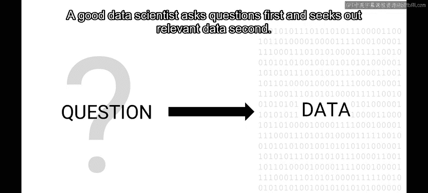

本节课中，我们一起学习了数据的核心概念。

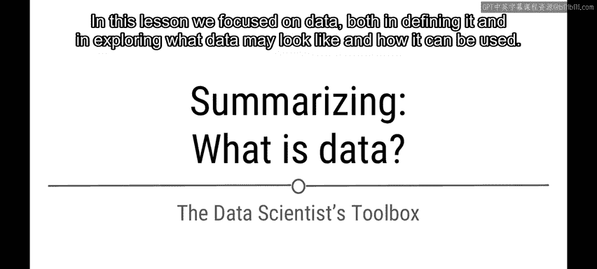

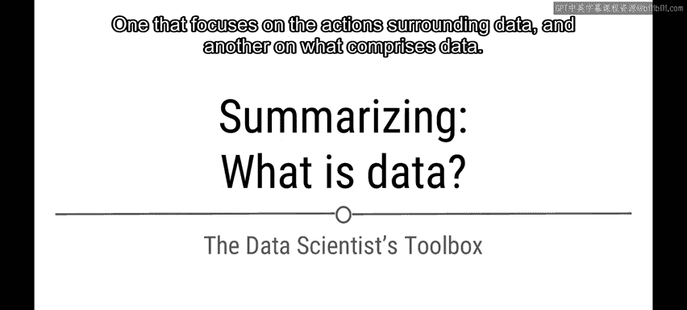

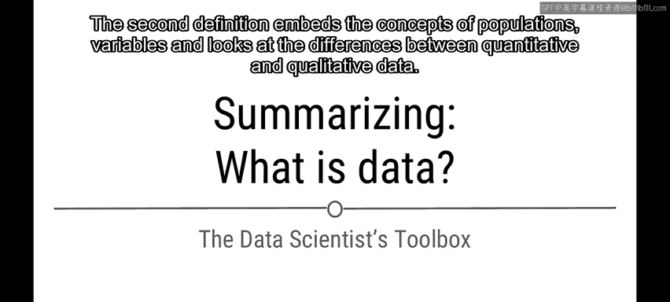

首先，我们探讨了数据的两种定义：一种侧重于围绕数据的**行动**，另一种侧重于数据的**构成要素**。第二种定义包含了**总体**、**变量**的概念，并区分了**定量数据**和**定性数据**。

其次，我们审视了你可能遇到的不同**数据来源**，并强调了整洁数据集的缺乏。需要被整理成可解释形式的混乱数据集示例包括测序数据、人口普查数据、电子病历等。

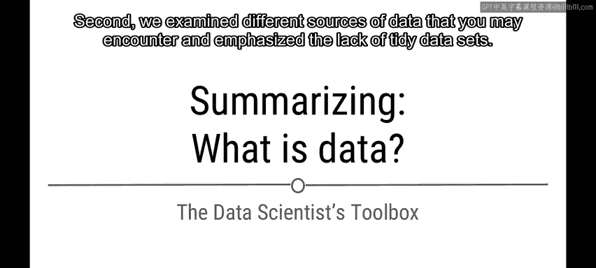

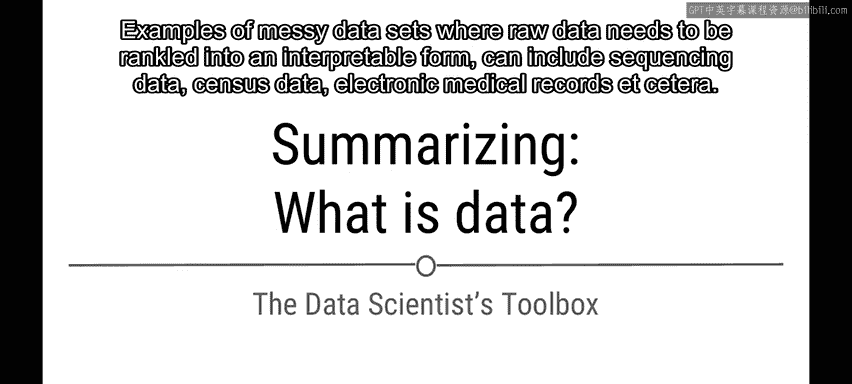

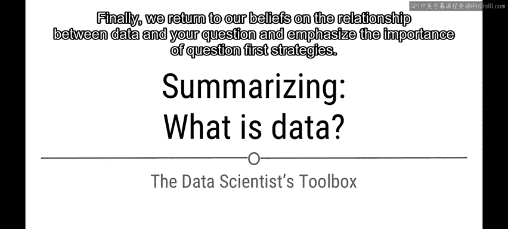

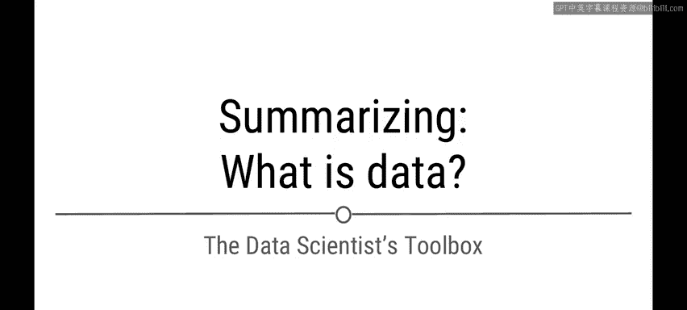

最后，我们回到了关于数据与问题之间关系的信念，并强调了**问题优先策略**的重要性。你可能拥有所有你希望得到的数据，但如果你没有一个问题作为起点，这些数据就毫无用处。