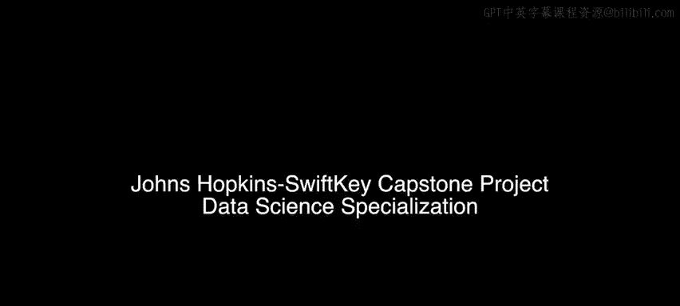

# 课程10：数据科学毕业项目 🎓

## 概述

在本节课中，我们将要学习约翰霍普金斯大学数据科学专项课程的毕业项目。这是整个专项课程的最终实践环节，旨在模拟真实数据科学家的工作体验。

大家好，欢迎来到约翰霍普金斯大学数据科学专项课程的毕业项目。至此，你们已经完成了专项课程中的所有九门课程。这是一个最终的实践体验，你们可以真正展示所学到的知识。

我们非常激动地看到，有如此多的学员成功完成了全部九门课程。我们对专项课程所获得的积极反响感到无比振奋。

## 毕业项目目标

上一节我们介绍了课程背景，本节中我们来看看毕业项目的核心目标。

这个毕业项目旨在模拟成为一名真实数据科学家的体验。

因此，你可能会遇到在前面的课程中未曾见过的新型数据。

但你可以运用所学的全部技能来解决这个新问题，并真正展示你的创造力和独立性。

## 课程支持与指导

在整个毕业项目中，我们确实希望模拟数据科学家的真实工作状态。

但我们不会在整个课程中让你独自摸索。杰夫·布莱恩和我将为你提供帮助。

我们还会邀请其他专家参与课程，在项目过程中为你提供指导，并在你遇到困难时给予帮助。

以下是项目期间你将获得的几种支持形式：

*   主讲教师的定期指导与答疑。
*   领域专家的针对性建议。
*   来自课程社区的协作与讨论。

## 项目完成与反馈

当你完成毕业项目后，我们非常希望听到你的反馈，了解这个项目对你的职业发展有何帮助。

因此，如果你愿意，可以在推特或其他社交媒体上给我们发送消息，让我们知道。这有助于我们持续改进这个项目。

祝你在毕业项目中好运。

## 总结

本节课中我们一起学习了约翰霍普金斯大学数据科学专项课程毕业项目的目标、设计理念以及你将获得的指导与支持。这个项目是你综合运用所学技能、展现创造力的舞台，我们期待看到你的精彩表现。