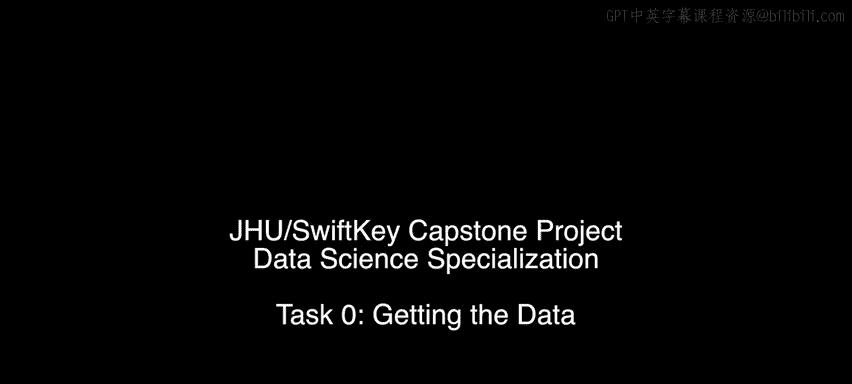

# 课程10：数据科学毕业项目 🎓 | 任务0：理解问题与获取数据

在本节课中，我们将开始数据科学专项课程的毕业项目。我们将首先介绍项目的整体目标，并完成第一个任务：获取数据并理解项目背景。

## 概述：项目目标与领域

毕业项目的基本目标是构建一个**英语文本的预测模型**。这属于**自然语言处理**和**文本挖掘**领域。

如果你还不熟悉这个领域，建议你花些时间进行研究，阅读相关模型和方法。这对于你在整个毕业项目中开发自己的解决方案将非常有帮助。

## 任务0的两个目标

任务0主要包含两个目标。

以下是任务0的具体目标列表：
1.  **从指定网站获取数据**。
2.  **熟悉项目的背景知识**。

我们已在任务描述中提供了一些有用的链接作为起点，但你完全可以自行进行更深入的研究。

## 任务执行建议

上一节我们明确了任务目标，本节中我们来看看具体如何执行。

关于获取数据，请下载并打开数据文件，确保你能正常访问它。关于背景学习，请利用提供的资源并自行探索自然语言处理的基础知识。

## 总结与支持

本节课中，我们一起学习了毕业项目的起始步骤：理解文本预测问题所属的自然语言处理领域，并明确了任务0的两个核心目标——获取数据与熟悉背景。

项目周期内，助教工程师会随时提供帮助，解答你可能遇到的问题。

祝你学习顺利，我们下次再见。