# 约翰霍普金斯大学数据科学课程1：《数据科学家工具》｜P4：获取帮助 🆘

在本节课中，我们将要学习作为一名数据科学家，当你遇到问题并需要帮助时，可以采取的有效策略。解决问题是数据科学的核心技能，因此掌握寻求帮助的方法至关重要。

## 为什么需要学习寻求帮助？🤔

上一节我们介绍了课程背景，本节中我们来看看为什么这些技能如此重要。

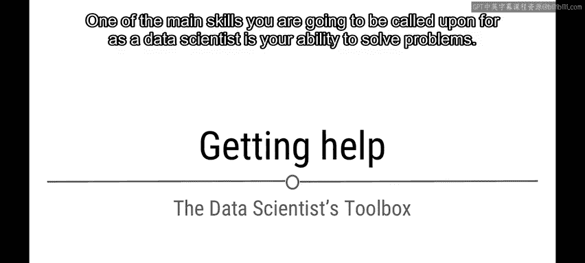

首先，本课程与传统课堂不同，可能同时有数千名学生参与，教授无法随时为每个人提供即时帮助。因此，你需要掌握在大型在线课程中获取帮助的策略。

其次，解决问题通常是数据科学家的核心技能之一。数据科学是一个新兴领域，你可能是第一个遇到某个特定问题的人。你需要具备解决对你乃至整个社区而言都是新问题的能力。

最后，故障排除和寻找解决方案是一项极佳的、可迁移的技能。它不仅对数据科学家的工作有益，而且任何职业都涉及大量问题解决。能够有效思考问题并寻求帮助，对你未来的任何职业道路都有好处。

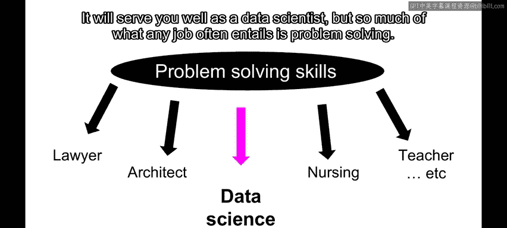

## 在向他人求助之前 🛠️

在开始向他人求助之前，你可以先尝试自己解决。很多时候，最快的答案是你自己找到的。

以下是你可以采取的初步步骤：

*   **查阅手册或帮助文件**：对于数据分析问题，你的第一站应该是阅读相关手册或帮助文件。例如，在R中，你可以尝试输入 `?command_name` 来获取帮助。如果你在论坛上发布一个手册中已有答案的问题，你可能会收到“阅读手册”的回复，这并非获取答案的最佳方式。
*   **使用搜索引擎**：在谷歌等搜索引擎上搜索相关问题。
*   **搜索相关论坛**：数据科学问题的常见论坛包括 Stack Overflow 和 Cross Validated。此外，本课程也有专门的课程论坛，这是一个极佳的资源。
*   **避免重复提问**：在向任何论坛提问前，请务必使用论坛的搜索功能，确认你的问题没有被问过。
*   **查找教程和FAQ**：在搜索时，注意寻找给你带来麻烦的命令或程序的教程、常见问题解答或示例文档。这些资源非常有用，可以为你指明下一步搜索的方向，甚至直接展示如何操作。

## 处理编码问题 💻

随着课程深入和使用R语言，你可能会遇到编码问题和错误。以下是一些应对策略。

根据我的经验，编码问题通常分为两类：**命令执行失败并返回错误信息**，或者**命令有输出但结果不符合预期**。这两类问题有不同的处理策略。

### 情况一：遇到错误信息

如果你遇到错误信息，请先保持冷静。你输入命令后，可能会看到满屏的红色错误提示，这令人沮丧。但花点时间检查命令中的拼写错误，然后仔细阅读错误信息，几乎能解决所有问题。

**错误信息是为了帮助你**，是计算机在告诉你哪里出错了。如果其他方法都失败了，你几乎可以肯定，世界上有其他人遇到过同样的错误，并且已经在论坛上提问过。答案就在那里。

### 情况二：输出结果不符合预期

另一方面，如果你得到了输出结果，但不符合预期，请思考输出结果与你期望的有何不同。考虑命令实际上做了什么，以及它为什么会那样做，而不是你想要的。

大多数此类问题是因为你提供的命令指示程序做了一件事，而它确实准确地执行了，只是你让它做的事并非你真正想要的。这类问题往往最令人沮丧，因为你离成功很近却又很远。它们能很好地锻炼你像计算机程序一样思考。

## 向他人求助 👥

好了，你已经做了所有应该做的尝试来独立解决问题。现在，是时候请“外援”了。

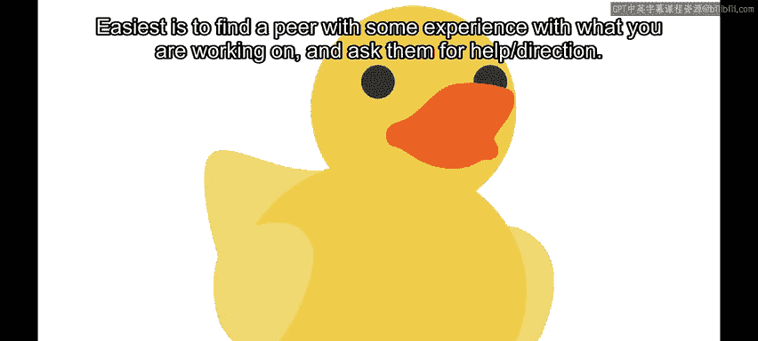

*   **向有经验的同伴求助**：最简单的方法是找一位对你正在处理的问题有经验的同伴寻求帮助或指点。这通常很棒，因为解释者在教你时能巩固自己的理解，而你也能亲眼看到他们如何解决问题。在本课程中，你的同伴可以是同学，你们可以通过课程论坛互动。请再次确认你的问题没有被问过。
*   **橡皮鸭调试法**：在本课程之外，你可能没有太多精通数据科学的朋友。这时，“橡皮鸭调试法”就派上用场了。这是世界各地独立程序员的一个长期传统。在《程序员修炼之道》一书中有一个故事：遇到难题的程序员会向橡皮鸭解释他们的问题，而在解释的过程中，他们自己就找到了解决方案。维基百科解释得很好：许多程序员都有过向别人（甚至可能是不懂编程的人）解释编程问题的经历，然后在解释问题的过程中突然想到了解决方案。在描述代码应该做什么，并观察它实际做了什么时，两者之间的任何不一致都会变得明显。所以，下次你被难住时，拿出你的洗澡玩具吧。

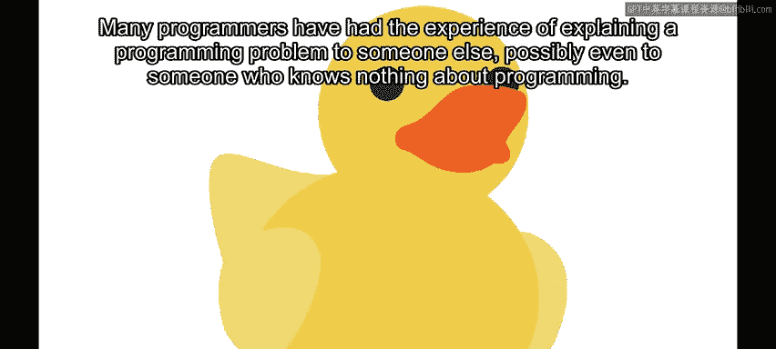

## 在论坛上提问 📝

你已经尽了最大努力：搜索了又搜索，与同伴讨论过，尝试了所有可能的方法来独立解决，但仍然卡住了。是时候在相关论坛上发布你的问题了。

在发布问题之前，你需要考虑如何最好地提问以获得有用的答案。

以下是提问时需要包含的细节：

*   **具体问题**：说明你试图回答的非常具体的问题。
*   **已采取的步骤**：描述你在故障排除中已经采取的步骤。
*   **重现步骤**：提供重现问题的详细步骤。
*   **示例数据**：提供供故障排除者使用的样本数据。
*   **目标与预期输出**：说明你的目标和期望的输出。
*   **实际输出**：详细说明你实际得到的输出是什么。如果出现错误信息，一定要在帖子中提到。
*   **环境信息**：提供相关的操作系统或软件版本信息，这对潜在的问题解决者通常很有帮助。

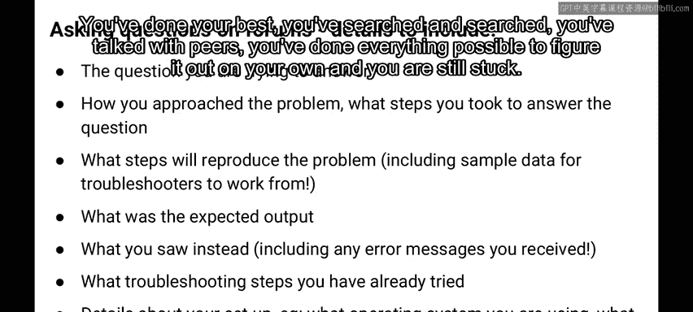

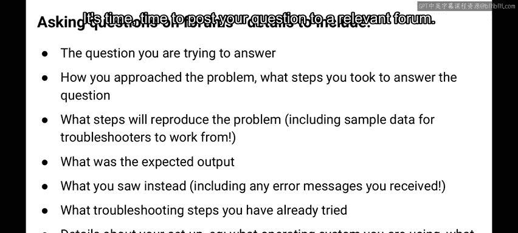

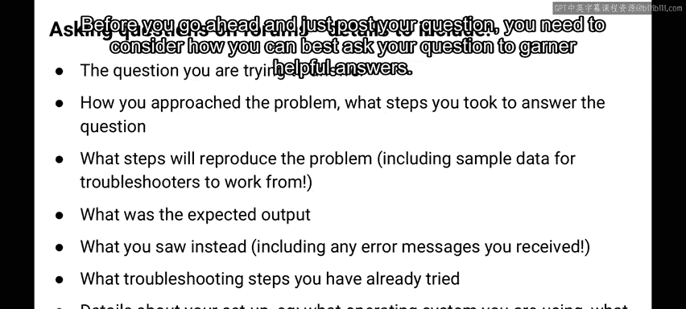

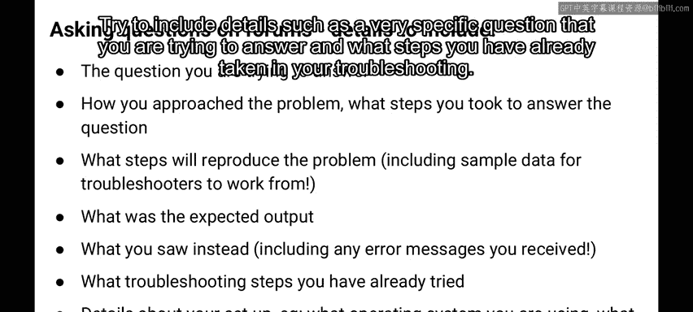

### 如何撰写有效的标题

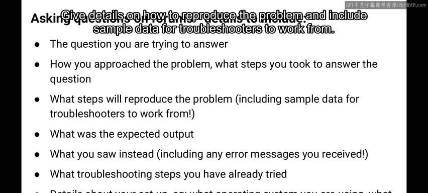

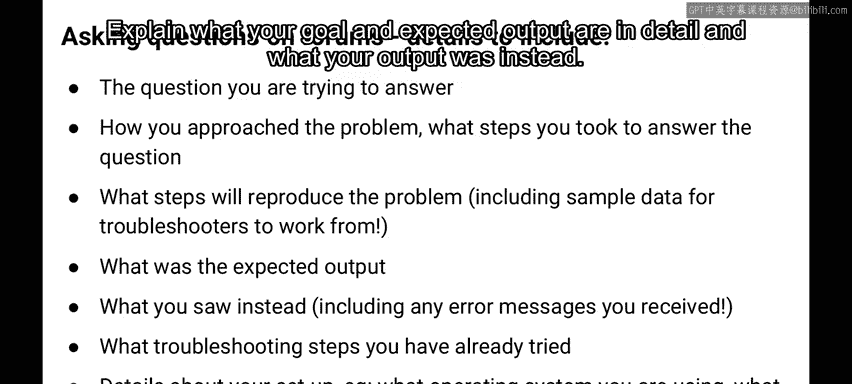

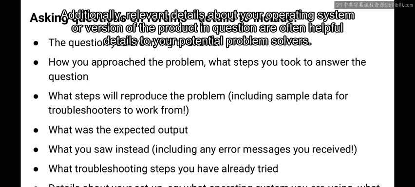

帖子最重要的细节之一是**标题**。它向他人传达了你遇到的麻烦。

为帖子起标题是一门艺术。标题不具体，就无法给潜在的帮助者提供足够的信息，他们不知道问题是什么，也就无法判断是否能帮助你。

相反，你需要提供一些关于你遇到问题的细节。回答“你在做什么”和“问题是什么”是两个你需要提供的关键信息。这样，论坛上的人才能确切知道发生了什么，并判断自己是否能提供帮助。

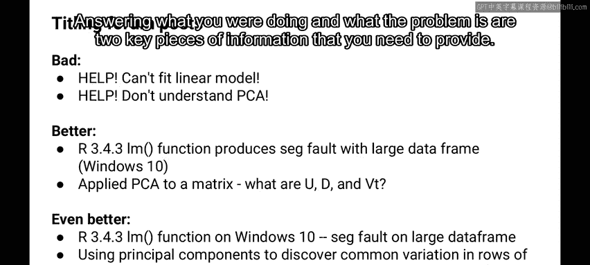

使用专注于你试图获得帮助的**非常具体的核心问题**的标题。这向人们表明你正在寻找一个非常具体的答案。问题越具体，通常得到答案的速度就越快。

## 论坛礼仪与注意事项 📚

遵循到目前为止提到的所有技巧，将有助于你在论坛上发帖并遵守论坛礼仪。你是在请求帮助，希望别人抽出时间来帮助你，因此你需要有礼貌。

通常，礼貌体现在提出具体问题、自己先进行一些故障排除，并为潜在的问题解决者提供轻松获取所需信息的途径。

将其中一些“该做”和“不该做”的事项规范化，你可以得到一些指导原则。

**在发帖前，请确保：**

1.  在合适的论坛提问，并阅读论坛发帖指南。
2.  描述你的目标，并对问题及你迄今为止的解决步骤进行明确、详细的解释。
3.  提供描述和复现问题所需的最少信息，不要用无关的细节困扰他人。
4.  最后，最重要的两点：一是要有礼貌，这些人是在帮助你；二是确保跟进你的帖子并发布解决方案。这不仅是对帮助你的人的感谢，也对后来遇到相同问题的其他人有帮助。

**同样，也有一些明确的“不该做”的准则：**

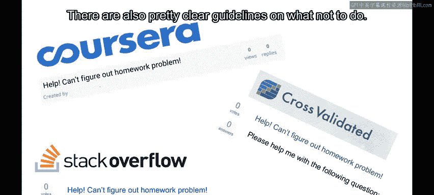

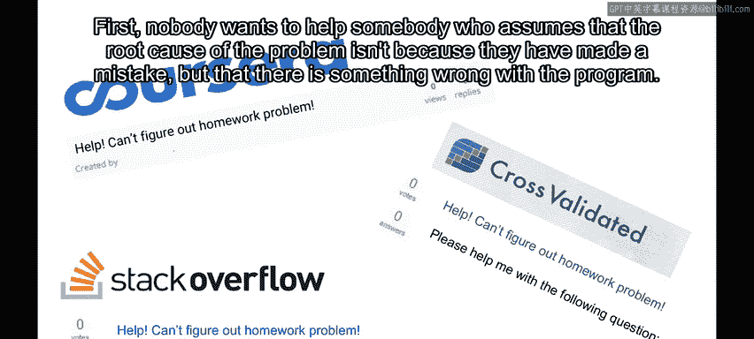

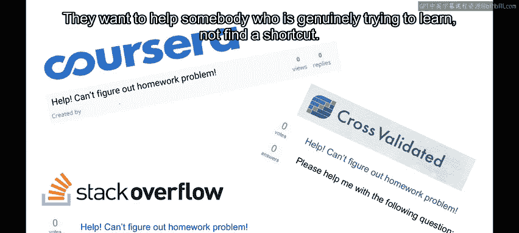

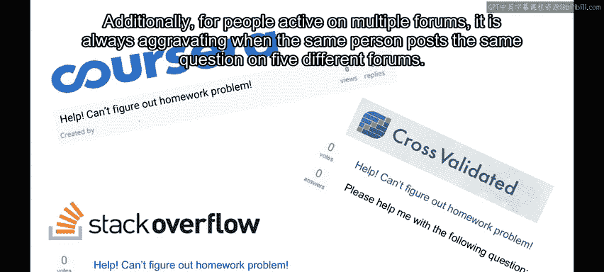

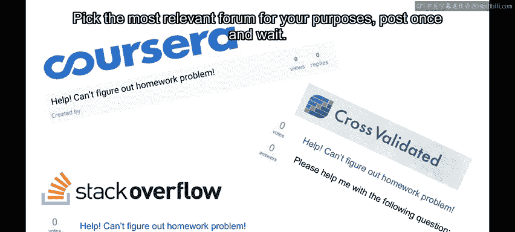

1.  没有人愿意帮助那些认为问题的根源不是自己犯了错，而是程序有问题的人。（剧透警告：几乎总是因为你犯了错。）
2.  同样，没有人愿意替你完成作业。他们想帮助的是真正想学习的人，而不是寻找捷径的人。
3.  对于活跃在多个论坛上的人来说，当同一个人在五个不同的论坛上发布相同的问题，或者同一个问题在同一论坛上被反复发布时，总是令人恼火。要有耐心，选择最相关的论坛，发布一次，然后等待。

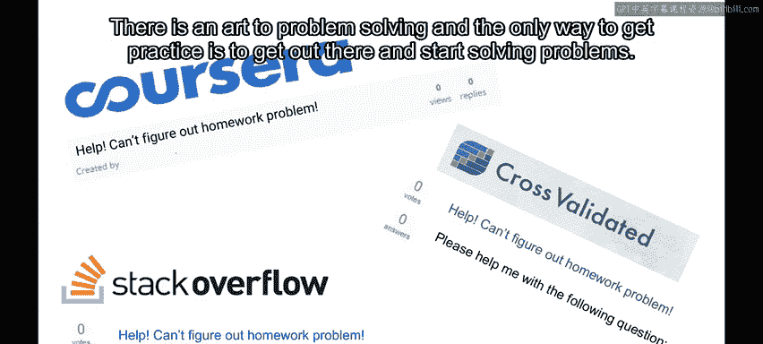

## 总结 📋

本节课中，我们一起学习了在遇到问题时如何有效地获取帮助。这对本课程很重要，对你作为数据科学家的未来也同样重要。

我们首先探讨了在求助前可以使用的策略，包括阅读手册、查看帮助文件、搜索谷歌和适当的论坛。我们还介绍了一些你可能遇到的常见编码问题以及可以自行采取的初步步骤，包括特别注意错误信息，以及将代码行为与你的目标进行比较。

一旦用尽了这些选项，我们转向向他人求助。我们可以向同伴寻求帮助，或者向我们可靠的橡皮鸭（无论是真正的橡皮鸭还是不知情的同事）解释我们的问题。我们的课程论坛也是你们与许多同伴交流的绝佳资源。

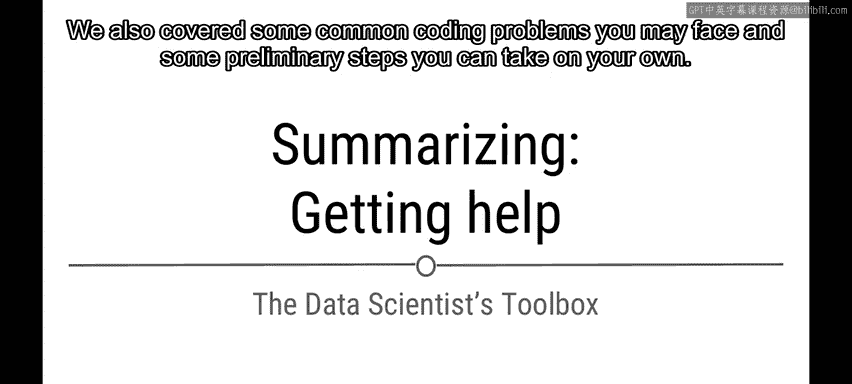

如果所有方法都失败了，我们可以在论坛上发帖，无论是在本课程中还是在像 Stack Overflow 这样的其他论坛上，提出非常具体且可复现的问题。在这样做之前，请务必熟悉论坛礼仪。保持礼貌对任何人都没有坏处，做一个论坛的好公民。

**解决问题是一门艺术，而获得实践的唯一方法就是走出去，开始解决问题。开始行动吧！**