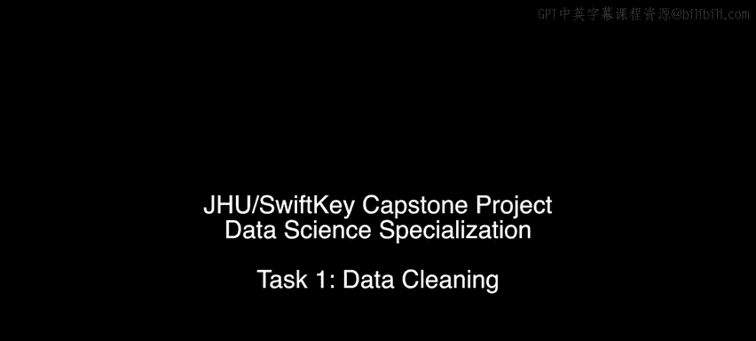

# 数据科学毕业课程（约翰霍普金斯大学）｜课程10：P5 - 任务1介绍：获取和清理数据 📊➡️🧹

在本节课中，我们将要学习数据科学项目流程中的第一个核心任务：获取原始数据并进行初步清理。我们将重点关注文本数据的处理，特别是**分词**与**不雅内容过滤**这两个基本目标。

---

## 概述

我们已经获得了数据，并且学习了自然语言处理与文本挖掘的相关知识。现在，是时候开始深入探索这些数据了。

本节的核心在于，我们需要将一大段文本分割成我们称之为“词语”的单元。在这个过程中，你将面临一系列挑战。

---

## 任务目标与挑战

上一节我们介绍了项目的背景，本节中我们来看看任务1的具体目标与需要克服的困难。

任务的两个基本目标是：
1.  **分词**
2.  **不雅内容过滤**

其基本思路是，你需要能够接收一批文本，并将其分割成词语。为了实现这一点，你必须处理以下几个问题：

以下是你在处理过程中必须考虑的几个关键问题：
*   **标点符号的处理**：例如，如何处理句号、逗号、引号等。
*   **数字、大写与小写字母的考量**：例如，“Apple”和“apple”是否应视为同一个词。
*   **拼写错误的应对**：因为人们可能会错误地拼写单词。

---

## 策略与决策

在编写解决方案代码时，你必须构思一个最优策略来处理所有这些问题。你需要权衡性能与准确性。

请记住，在这个过程中你将不得不做出大量决策。什么是最佳决策并不总是显而易见的，因为可能并不存在唯一正确的答案。

然而，作为一名数据科学家，为了推动项目前进，你必须做出这些艰难的决定。所以，不要犹豫，做出决策、思考你认为的最佳方案、以及用户可能从软件中获得什么，这正是你的职责所在。

---

## 总结

本节课中，我们一起学习了数据清理初始阶段的核心任务：**分词**与**内容过滤**。我们明确了处理文本数据时会遇到的典型挑战，并认识到在数据科学实践中做出合理决策的重要性。

现在，开始深入探索数据吧，我们非常期待你能构建出怎样的解决方案。