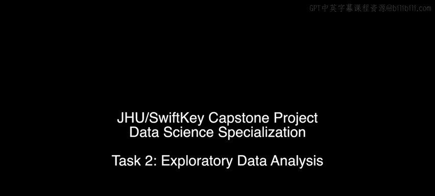

# 数据科学毕业课程（约翰霍普金斯大学）｜课程10：P8 任务2介绍 - 探索性数据分析 📊

在本节课中，我们将要学习项目中的第二个核心任务：探索性数据分析。我们将了解其基本目标、关键问题，以及为何在分析前进行思考至关重要。

## 任务目标与关键问题

上一节我们介绍了项目的整体框架，本节中我们来看看第二个具体任务——探索性数据分析。

其基本目标是**理解数据集的各项统计特性**，以便为后续构建一个良好的预测模型打下基础。这里有两个关键问题需要考虑：
1.  某些**单词**在数据中出现的频率如何？
2.  某些**单词对**在数据中一起出现的频率如何？

在考虑了这些基本问题之后，你可以转向更复杂的问题，例如：**三个单词的组合**是如何一起出现的？

## 分析前的思考 🤔

在开始深入挖掘数据之前，我建议你花点时间进行一些思考。

思考很重要，因为它能帮助你**建立对数据的预期**。这一点至关重要，因为当你对数据有预期时，你就能知道哪些特征或观察结果是**出乎意料的**。

这些意外情况可能是数据中的**错误或异常**，也可能是你必须考虑的**非常有趣的特征**。

当然，你最初的预期可能是错误的。但是，当你查看数据并观察结果时，你可以逐步**校准和修正**你的预期。

关键在于，如果你对数据没有任何预期，那么当你开始查看数据时，一切看起来都可能是正确的，从而难以区分数据中哪些是有用的，哪些是无用的。

## 总结

本节课中我们一起学习了探索性数据分析任务。这是为项目开发预测模型的关键步骤，因此我鼓励你花时间真正地、深入地了解你的数据。通过建立预期并验证观察，你可以更有效地识别数据的模式和异常，为后续建模奠定坚实基础。