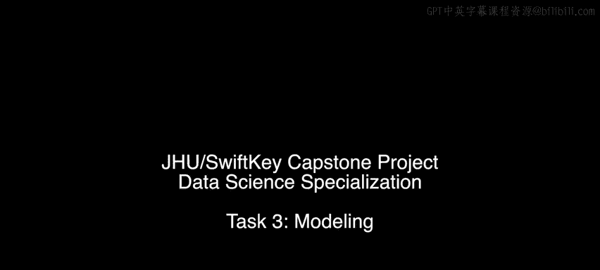

# 数据科学毕业课程（约翰霍普金斯大学）｜课程10：任务3介绍 - 建模 📊

在本节课中，我们将要学习课程项目的第三个核心任务：为数据开发一个统计模型。这个任务是整个项目的基石，其成果将直接决定项目的质量。

## 任务概述

这个任务的核心目标是构建一个**N元语法模型**。该模型能够根据用户输入的前一个、两个或三个单词，来预测下一个最可能出现的单词。

## 模型构建的核心挑战

上一节我们明确了任务目标，本节中我们来看看构建模型时会遇到的主要挑战。模型将基于数据集中观察到的单词组合进行预测。然而，即使用户拥有海量数据集，也总会遇到一些从未出现过的单词组合。因此，我们必须设计一种方法来处理这些未知情况。

任务描述中提供了一些链接，可以帮助你开始思考如何解决这些问题。当然，我们也鼓励你进行自主研究，探索更多解决方案。

## 模型评估与性能考量

在着手构建模型之前，还需要考虑两个关键方面。

以下是需要牢记的两个要点：
*   首先，你需要思考一种方法来评估模型的性能，**衡量其在预测单词时的准确性**。
*   其次，你需要关注算法的整体性能，确保它能在合理的时间内运行，并且**不会占用过多内存等计算资源**。

## 课程总结

本节课中，我们一起学习了项目任务三——建模阶段的核心要求。我们明确了构建Ngram模型的目标，探讨了处理未知词汇组合的挑战，并指出了模型评估与性能优化的重要性。祝你在本次任务中顺利，我们期待看到你的创意成果。