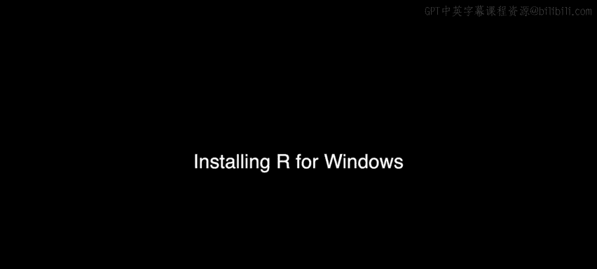
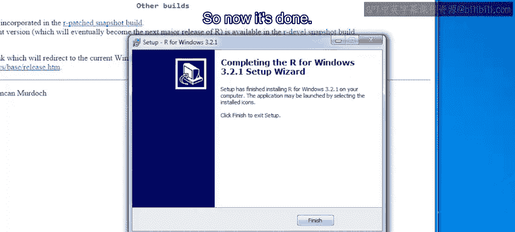
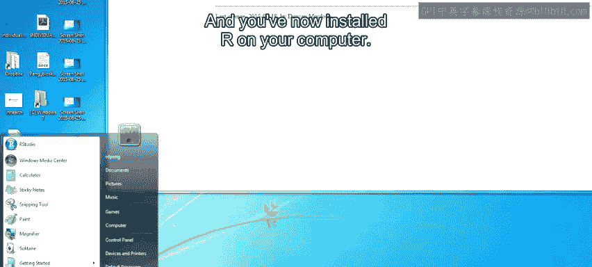
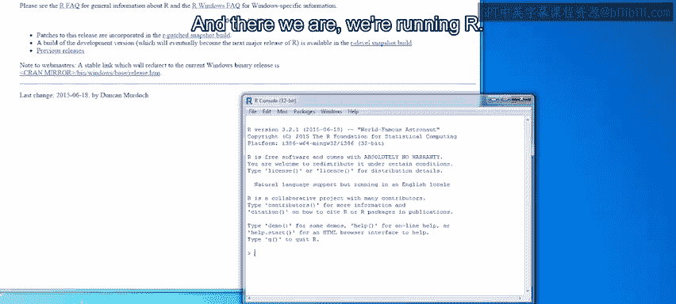

# 002：在Windows上安装R 💻

在本节课中，我们将学习如何在Windows操作系统上安装R语言环境。这是一个面向初学者的逐步指南，我们将从访问官方网站开始，直到成功运行R。

---

## 概述

安装R是开始数据科学和统计分析的第一步。对于Windows用户，这个过程涉及从官方网络下载安装程序，并按照向导完成设置。下面我们将详细介绍每一个步骤。

## 安装步骤详解

上一节我们概述了安装R的重要性，本节中我们来看看具体的安装过程。整个过程可以分为几个清晰的步骤。

以下是安装R的核心步骤列表：

1.  **打开网页浏览器**：启动你常用的浏览器（如Chrome、Firefox等）。
2.  **访问CRAN网站**：在浏览器地址栏中输入网址，访问“综合R档案网络”（Comprehensive R Archive Network， CRAN）。
3.  **选择Windows版本**：在CRAN主页顶部，找到并点击“Windows”版本的链接。
4.  **下载基础安装程序**：在Windows子页面中，点击“base”链接以下载R的安装程序。
5.  **运行安装程序**：下载完成后，找到并双击运行下载的`.exe`文件。
6.  **选择安装语言**：在安装向导中，从列表中选择你偏好的语言（例如英语）。
7.  **同意许可协议**：阅读并同意GNU通用公共许可证（GPL）。
8.  **选择安装位置**：通常保持默认的安装目录即可，直接点击“下一步”。
9.  **选择安装组件**：对于大多数用户，默认选项（安装32位和64位版本）是最佳选择。
10. **自定义启动选项**：
    *   **界面类型**：在MDI（多文档界面）和SDI（单文档界面）之间选择。SDI模式会让控制台和图形窗口分开，操作可能更灵活。
    *   **帮助文件格式**：在更美观的HTML帮助和纯文本帮助之间选择。
    *   **网络连接**：除非有特殊需求，否则保持默认的“标准”网络设置。
11. **创建快捷方式**：建议勾选在开始菜单创建快捷方式。也可以选择是否在桌面创建图标。
12. **完成安装**：点击“安装”开始将文件复制到计算机。安装完成后，点击“完成”。
13. **启动R**：通过桌面图标或开始菜单快捷方式双击运行R，验证安装是否成功。

## 关键选项说明

在自定义安装步骤中，你会遇到几个重要选项。理解它们有助于你配置更适合自己习惯的R环境。

*   **CRAN**：这是下载R及其扩展包（package）的官方主站。其网址公式为：`https://cran.r-project.org/`。
*   **MDI vs SDI**：这是关于R图形用户界面（GUI）的布局选择。在代码中，这个选择会影响窗口的弹出行为，但核心的R语言功能完全一致。
*   **GPL许可证**：R是在GNU通用公共许可证下发布的开源软件，这意味着你可以自由地使用、研究和分发它。

## 总结

本节课中我们一起学习了在Windows系统上安装R的完整流程。我们首先通过浏览器访问CRAN官网，然后下载并运行安装程序，接着逐步配置了语言、安装路径、界面风格等选项，最后成功启动R。现在你的计算机已经准备好了R编程环境，可以开始后续的数据科学学习之旅了。

---

