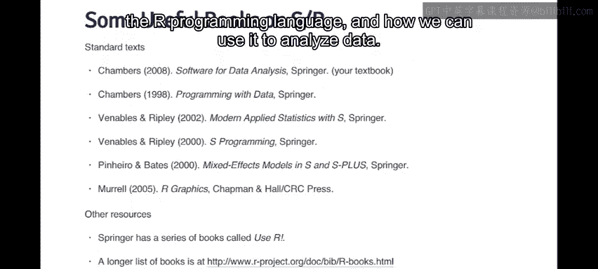

# 007：R编程概述与历史 📚

在本节课中，我们将学习R统计编程环境的概览及其简要发展历史。我们将了解R是什么、它从何而来、它的核心特性、优缺点以及相关的学习资源。

## 什么是R？🤔

R本质上是一种S语言的方言。这引出了下一个问题：什么是S？

S语言是由约翰·钱伯斯在现已不存在的贝尔实验室开发的。它始于1976年，最初是作为一个内部统计分析环境，供贝尔实验室的研究人员分析数据使用。早期版本通过一系列Fortran库来实现需要重复执行的统计例程。直到大约第三个版本，S语言才加入了统计建模功能。

1988年，该系统用C语言重写，以提高跨系统的可移植性，并开始接近我们今天使用的系统。这个版本（版本3）的标志性著作是约翰·钱伯斯和特雷弗·哈斯蒂合著的《Statistical Models in S》（有时被称为“白皮书”），它记录了该版本语言的所有统计分析功能。S语言的第4版于1998年发布，这也是我们今天大致仍在使用的版本。本课程的参考书《Programming with Data》（有时被称为“绿皮书”）由约翰·钱伯斯撰写，它记录了S语言的第4版。

因此，R是S语言的一个实现，而S语言最初是在贝尔实验室开发的。

## S语言的发展历程 🕰️

接下来，我们简要回顾一下S语言的发展历程。

1993年，贝尔实验室授予一家名为Statsci（后成为Insightful公司）的公司独家许可，以开发和销售S语言。2004年，Insightful公司以200万美元从朗讯科技（贝尔实验室的后身）完全收购了S语言，成为其所有者。2006年，阿尔卡特收购了朗讯科技。

Insightful公司开发了一个名为S+的产品，它是S语言的一个实现，并加入了许多高级功能，例如图形用户界面等。2008年，Insightful公司被TIBCO以2500万美元收购。至今，TIBCO仍在各种商业分析产品中开发S+。

尽管经历了多次公司收购，S语言的基本原理自1998年以来并未发生根本性改变。1998年的语言与今天我们使用的语言在表面上看起来非常相似。值得一提的是，S语言在1998年获得了计算机协会软件系统奖，这是一项非常崇高的荣誉。

## S语言的设计哲学 💡

在一份名为《The Stages in the Evolution of S》的文档中，S语言的创始人约翰·钱伯斯阐述了其设计的关键原则。

其核心理念是创建一个交互式环境，让用户无需认为自己是在“编程”。随着需求变得清晰和用户熟练度的提高，他们应该能够平滑地过渡到编程，此时语言和系统方面会变得更加重要。S语言以及后来的R语言的基本思想是，人们可以首先在一个交互式环境中使用它来分析数据、进行基本操作，而无需了解编程或语言的复杂细节。当他们需要更高级的功能时，可以自然地过渡到学习编程和开发自己的工具。这种设计促进了从“用户”到“程序员”的转变。

## R的诞生与发展 🚀

现在，让我们回到R本身。R是一个相对较新的发展。

R于1991年由罗斯·伊哈卡和罗伯特·杰特曼在新西兰创建。他们在1996年发表于《Journal of Computational and Graphical Statistics》的论文中讨论了开发R的经验。1993年，R首次向公众发布。1995年，马丁·马赫勒说服罗斯和罗伯特使用GNU通用公共许可证（GPL）来授权R，这使R成为了我们所说的“自由软件”。1996年，建立了两个主要的邮件列表：R-help（用于提问）和R-devel（用于开发工作讨论）。1997年，R核心小组形成，其中包含了许多来自S+开发团队的成员。该小组控制着R的主要源代码。

以下是R的一些主要特性：
*   **语法类似S**：这使得S+用户可以轻松过渡到R。
*   **语义与S表面相似但内在不同**：我们将在后续课程中详细讨论。
*   **跨平台性**：R几乎可以在任何标准计算平台或操作系统上运行（Mac、Windows、Linux等）。
*   **活跃开发**：有年度主要版本发布和频繁的错误修复版本。
*   **模块化设计**：R的核心软件非常精简，功能通过模块化的包来实现。用户可以按需安装。
*   **强大的图形功能**：R的图形功能非常复杂，为用户提供了高度的控制力。
*   **从交互式工作到编程的平滑过渡**：如前所述，它既适合交互式工作，也包含强大的编程语言。
*   **活跃的用户社区**：邮件列表和Stack Overflow等平台上有非常活跃的讨论。
*   **免费与自由**：R既是免费的（无需付费），也是自由软件（遵循GPL许可证）。

## 自由软件的四项基本自由 🆓

R作为自由软件，遵循自由软件基金会定义的四项基本自由：
*   **自由0**：出于任何目的运行程序的自由。
*   **自由1**：研究程序如何工作，并为其适应个人需要而修改的自由。
*   **自由2**：重新分发副本以帮助他人的自由。
*   **自由3**：改进程序，并向公众发布改进版本以使整个社区受益的自由。

## R的局限性 ⚠️

当然，R也有一些局限性：
*   **基于较老的技术**：其基础源于40年前的理念，例如对动态或3D图形的内置支持有限（尽管现在已有许多优秀的扩展包）。
*   **功能依赖用户贡献**：如果没有人实现你喜欢的统计方法，那么你需要自己实现或雇人实现。没有公司客服热线可以投诉或要求特定功能。
*   **内存限制**：R中操作的对象必须存储在计算机的物理内存中。如果数据对象大于可用内存，则无法加载和处理。虽然硬件进步缓解了部分问题，但在大数据时代，这仍可能是一个限制。
*   **并非万能**：R并不适合所有情况。了解这一点很重要。

## R的构成与扩展 📦

基本的R系统可以分为两个概念部分：
1.  **基础R系统**：从CRAN（Comprehensive R Archive Network）下载，包含`base`包（提供运行R所需的基础低层函数）以及其他一些核心包（如`utils`、`stats`、`datasets`、`graphics`等）。
2.  **扩展包**：除了基础系统，CRAN上还有大约数千个由全球用户和程序员开发的扩展包。这些包是用户贡献的，需要满足CRAN的质量标准（如提供文档、通过测试）。此外，还有Bioconductor项目专门为基因组和生物数据分析提供的R包，以及开发者个人网站上的众多包。

## 学习资源与经典书籍 📖

在学习R的过程中，你可以参考以下文档和书籍：
*   **官方文档**：`An Introduction to R`（入门指南）、`Writing R Extensions`（开发包指南）、`R Data Import/Export`（数据导入导出）、`R Installation and Administration`（安装与管理）、`R Internals`（内部原理，非常技术性）。
*   **经典书籍**：约翰·钱伯斯的《Software for Data Analysis》和《Programming with Data》；比尔·维纳布尔斯和布莱恩·里普利的《Modern Applied Statistics with S》和《S Programming》；保罗·默雷尔的《R Graphics》；以及Springer出版社的“Use R!”系列丛书。

## 总结 ✨

本节课中，我们一起学习了R编程语言的概览和历史。我们了解到R是S语言的自由软件实现，其设计哲学强调从交互式使用平滑过渡到编程。R具有跨平台、模块化、图形功能强大、社区活跃且完全免费自由等优点，同时也存在基于较老技术、功能依赖社区、受内存限制等局限性。庞大的扩展包生态系统和丰富的学习资源使其成为数据科学领域不可或缺的工具。

从下一个视频开始，我们将深入探讨R编程语言的细节，学习如何使用它来分析数据。