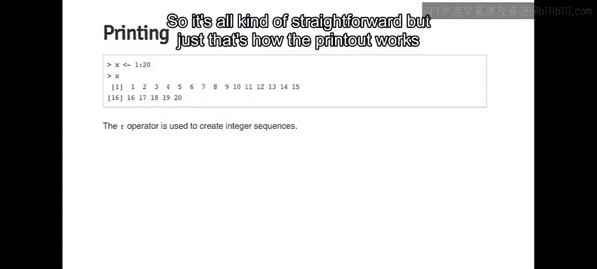

# 009：R控制台输入与求值


在本节课中，我们将学习如何在R控制台中输入表达式，以及R如何对这些表达式进行求值。我们将介绍赋值操作符、对象的创建、表达式的语法规则，以及R的自动打印功能。

---

## 表达式与赋值操作符

上一节我们介绍了R控制台的基本界面，本节中我们来看看如何向其中输入内容并进行计算。在R提示符下输入的内容被称为**表达式**。

例如，符号 `<-` 看起来像一个左箭头，它实际上由小于号 `<` 和连字符 `-` 组成。这个符号被称为**赋值操作符**。赋值操作符的作用是将一个值赋给一个符号。

在下面的第一个表达式中，我创建了一个名为 `x` 的符号，并将值 `1` 赋给它。我使用赋值操作符来完成这个操作。因此，`x <- 1` 是一个R表达式。

```r
x <- 1
```

在下一个表达式中，我将打印这个值。`print` 是一个函数，我将符号 `x` 传递给它。当我打印 `x` 时，我得到它的值，在这个例子中是 `1`。

```r
print(x)
```

需要理解的另一点是，`x` 也被视为一个R对象，它是一个只有一个元素的数值对象。实际上，它是一个第一个元素为数字 `1` 的数值向量。

---

## 自动打印与对象类型

在第三个表达式中，你只需在提示符后输入 `x` 并按回车键，就会打印出 `x` 的值。这被称为**自动打印**。这是另一种打印对象的方式，无需显式调用 `print` 函数。

```r
x
```

在这个表达式中，我创建了一个名为 `msg` 的新符号，并为其分配了字符串值 `"hello"`。现在，这是一个字符向量，其第一个元素是字符串 `"hello"`。如果需要，我可以向这个向量添加其他元素，但它们都必须是字符类型。

```r
msg <- "hello"
```

---

## 表达式语法与注释

语言的语法决定了表达式是否正确或完整。例如，如果我仅输入 `x <-` 而没有输入其他内容，这便不是一个完整的表达式。当我按回车键时，什么也不会发生，因为R在等待表达式完成。

此外，这里有一个井号 `#`。这个符号表示其右侧的所有内容都是**注释**。R引擎将忽略该符号右侧的任何内容。因此，你可以在代码中添加注释或给自己的笔记，R会忽略这些注释。

```r
# 这是一个注释，R会忽略它
x <- 5 # 这是行内注释
```

---

## 表达式的求值与自动打印

一旦你在提示符下输入了一个语法有效且完整的表达式并按回车键，R引擎就会对该表达式进行**求值**，然后返回该表达式的结果。

有时，当你对一个表达式求值时，什么也不会发生，因为没有需要显示的内容。例如，在第一个表达式中，当我说 `x` 被赋值为 `5` 时，我创建了一个名为 `x` 的对象，它是一个第一个元素为 `5` 的数值向量。当我按回车键时，什么也没有显示。

```r
x <- 5
```

但现在，当我输入 `x` 并按回车键时，它会打印出值 `5`。这就是自动打印。当你只输入一个对象名并按回车键时，R默认会自动打印该对象的值。这与对该对象调用 `print` 函数的效果相同。

```r
x
```

你可能会注意到，当我打印对象 `x` 时，数字 `5` 前面有一个 `[1]`。这表示你看到的数字 `5` 是该向量的**第一个元素**。当我们查看更长的向量时，这一点会更有意义。

---

## 序列与向量打印

对于打印，你会看到这里我创建了一个名为 `x` 的对象，它是序列 `1` 到 `20`。我使用的冒号操作符 `:` 用于创建序列。当我说 `1:20` 时，它会创建一个从 `1` 到 `20` 的序列。

```r
x <- 1:20
```

现在，当我自动打印 `x` 时，你会看到一个更长的向量。这是一个整数向量。打印输出的第一行旁边有一个 `[1]`，因为那是第一个元素。第二行旁边有一个 `[16]`，因为该行的第一个元素是这个向量的第16个元素。这一切都很直观，这就是打印输出的工作原理。

```r
x
```

---

## 总结



本节课中我们一起学习了R控制台的基本操作。我们介绍了如何输入**表达式**，使用 `<-` 进行**赋值**，以及创建数值和字符向量。我们理解了表达式的**语法**完整性以及如何使用 `#` 添加**注释**。最重要的是，我们探讨了R的**求值**过程和**自动打印**功能，包括打印向量时索引 `[1]` 的含义。这些是开始用R进行编程和计算的基础步骤。