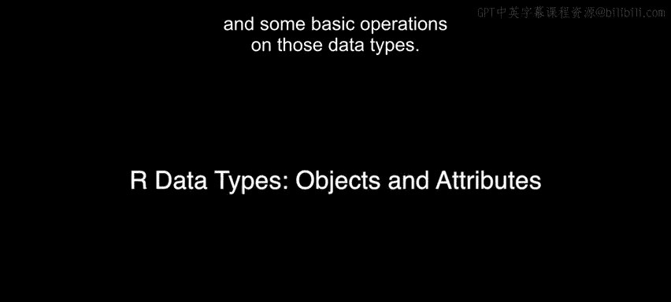
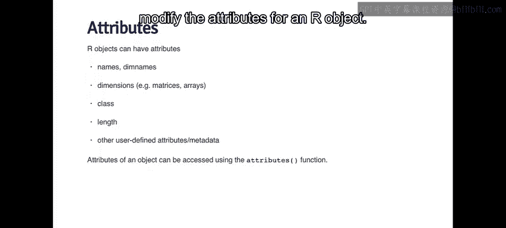

# 010：R对象与属性 🧱



在本节课中，我们将深入探讨R语言的核心细节，特别是R中使用的不同数据类型，以及对这些数据类型的一些基本操作。

## 概述 📋

我们将从理解R语言的基本构建块——“对象”开始，然后学习五种基本的原子类对象。接着，我们会了解向量和列表这两种重要的数据结构，并探讨数字在R中的特殊处理方式。最后，我们将学习对象的“属性”，这是存储对象元数据的关键机制。

## R中的对象

在R语言中，所有被操作和遇到的事物都被称为**对象**。对象可以包含各种不同类型的数据，但R中的一切都是对象。

## 五种基本原子类

R有五种基本的原子类对象。这些是底层或基础的对象类别，它们是：
*   **字符型**：用于存储文本。
*   **数值型**：用于存储实数或小数。
*   **整型**：用于存储整数。
*   **复数型**：用于存储复数。
*   **逻辑型**：用于存储`TRUE`或`FALSE`。

## 向量与列表

R中最基本的对象是**向量**。一个向量包含多个相同类型对象的副本。例如，可以有一个字符型向量或一个整型向量。

标准向量有一个关键限制：**不能混合不同类型**。你不能创建一个同时包含字符和数值，或数值和整数的向量。向量中的所有元素必须属于同一类别。

当然，任何伟大的规则都有例外。有一种特殊的向量可以包含不同类别的对象，这就是**列表**。

列表在形式上表现为一个向量（一个对象序列），但其每个元素可以是不同类别的对象。例如，一个列表可以包含一个字符、一个数值和一个逻辑值。列表的一个元素本身可以是一个列表，甚至是一个数据框。正是这种灵活性使得列表非常有用。列表是“向量元素必须同类”这一通用规则的一个例外。

你可以使用`vector()`函数创建一个空向量。这个函数有两个基本参数：
*   第一个参数是对象的**类别**，即你希望向量中包含的对象类型。
*   第二个参数是向量的**长度**。

```r
# 创建一个长度为5的数值型空向量
empty_vector <- vector("numeric", length = 5)
```

## 数字的特殊值

在R中，数字通常被视为**数值型**对象。几乎所有数字都被当作双精度实数处理。即使你输入`1`或`2`，R也将其视为数值对象。

有一种方法可以明确指定一个整数，即使用大写字母`L`作为后缀。例如，输入`1`会得到一个数值对象，而输入`1L`则会明确得到一个整数对象。

```r
class(1)   # 返回 "numeric"
class(1L)  # 返回 "integer"
```

这个区别目前可能不重要，但后续会变得重要。

R中还有一些特殊的数字值：
*   **`Inf`**：代表**无穷大**。它是一个实数，可以用于计算。例如，`1 / 0` 得到 `Inf`，`1 / Inf` 得到 `0`。也存在 `-Inf`（负无穷大）。
*   **`NaN`**：代表**未定义的值**，意为“非数字”。例如，`0 / 0` 的结果是未定义的，因此会返回 `NaN`。`NaN` 也可以被视为一种缺失值，我们稍后会更多讨论缺失值。

## 对象的属性

R中的每个对象都附带**属性**。并非所有对象都必须有属性，但属性可以成为R对象的一部分。

以下是一些最常见的属性类型：
*   **名称** 或 **维度名称**：为对象元素或维度命名。
*   **维度**：例如，矩阵有行和列两个维度；多维数组则有更多维度。
*   **类别**：每个对象都有一个类别。例如，数值对象的类别是`"numeric"`，整数对象的类别是`"integer"`。
*   **长度**：对于向量，长度就是其中元素的数量。
*   **其他用户定义的属性或元数据**：你可以使用各种属性函数为对象单独定义这些信息。

有一个通用的函数叫`attributes()`，它允许你设置或修改R对象的属性。

```r
# 为一个向量设置名称属性
x <- c(1, 2, 3)
attributes(x) # 初始时可能为NULL
names(x) <- c("a", "b", "c")
attributes(x) # 现在会显示$names属性
```

## 总结 🎯



本节课我们一起学习了R语言的基础构建模块。我们了解到R中一切皆为**对象**，并认识了五种**基本原子类**（字符、数值、整型、复数、逻辑型）。我们探讨了**向量**（存储同类元素）和**列表**（可存储异类元素）这两种关键数据结构。我们还学习了数字在R中的处理方式，包括特殊值`Inf`和`NaN`。最后，我们介绍了**属性**的概念，它是存储对象元数据（如名称、维度、类别）的重要机制，是理解和操作复杂对象（如矩阵和数据框）的基础。掌握这些概念是进一步学习R编程的关键第一步。