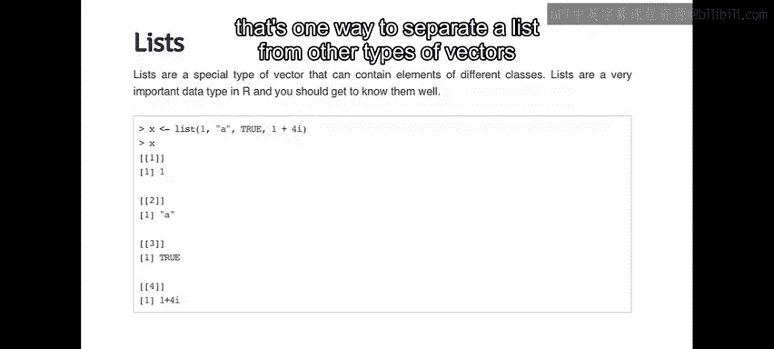

# 011：数据类型 - 向量与列表 📊


在本节课中，我们将学习R语言中两种重要的数据结构：**向量**和**列表**。我们将了解如何创建它们，它们之间的核心区别，以及R如何处理不同类型数据的组合。理解这些基础概念对于后续的数据操作至关重要。

## 向量：使用`c()`函数创建

上一节我们介绍了向量的概念，本节中我们来看看如何使用`c()`函数创建向量。`c`代表“连接”，这个函数可以将多个元素组合成一个向量。

以下是使用`c()`函数创建不同类型向量的示例：

*   **数值向量**：`x <- c(0.5, 0.6)` 创建一个长度为2的数值向量，元素为0.5和0.6。
*   **逻辑向量**：`y <- c(TRUE, FALSE)` 或 `y <- c(T, F)` 创建一个逻辑向量。`T`和`F`是`TRUE`和`FALSE`的简写。
*   **字符向量**：`z <- c("a", "b", "c")` 创建一个字符向量。
*   **整数向量**：`a <- 9:29` 使用冒号运算符创建一个整数序列向量。
*   **复数向量**：`c <- c(1+0i, 2+4i)` 创建一个复数向量，其中`i`表示虚部。

## 向量：使用`vector()`函数创建

除了`c()`函数，我们还可以使用`vector()`函数来创建指定类型和长度的向量。

例如，`x <- vector("numeric", length = 10)` 会创建一个长度为10的数值向量。默认情况下，数值向量会用0进行初始化。

## 向量的隐式强制转换

当我们在一个向量中混合不同类型的元素时会发生什么？R遵循“最小公分母”原则，会自动将向量中的所有元素强制转换为最通用的类型，而不会报错。

以下是不同类型混合时的转换规则：

*   **数值 + 字符**：`y <- c(1.7, "a")` 结果为字符向量 `c("1.7", "a")`。字符类型是更通用的类型。
*   **逻辑 + 数值**：`z <- c(TRUE, 2)` 结果为数值向量 `c(1, 2)`。在R中，`TRUE`转换为1，`FALSE`转换为0。
*   **字符 + 逻辑**：`a <- c("a", TRUE)` 结果为字符向量 `c("a", "TRUE")`。

需要注意这种隐式转换，因为它可能在不知不觉中改变数据的类型。

## 向量的显式强制转换

上一节我们讨论了隐式强制转换，本节中我们来看看如何显式地将对象从一种类型转换为另一种类型。我们可以使用一系列以`as.`开头的函数。

例如，`as.numeric()`用于转换为数值型，`as.character()`用于转换为字符型。

让我们看一个例子。假设有一个整数序列向量 `x <- 0:6`。

*   `as.numeric(x)` 将其显式转换为数值型向量。
*   `as.logical(x)` 将其转换为逻辑型向量。转换规则是：**0转换为`FALSE`，任何非零值转换为`TRUE`**。
*   `as.character(x)` 将每个数字转换为对应的字符串。
*   `as.complex(x)` 将其转换为复数，虚部为0。

并非所有转换都能成功。无意义的转换会产生`NA`（缺失值）。

例如：
*   `x <- c("a", "b", "c")`
*   `as.numeric(x)` 会得到一个包含三个`NA`的向量，并产生一条警告信息。
*   `as.logical(x)` 同样会得到`NA`。

## 列表：可容纳不同数据类型的向量

接下来我们要介绍的数据类型是**列表**。列表是一种特殊的向量，它的关键特性在于：**列表中的每个元素可以是完全不同类型的对象**。这使得列表非常适合打包和传递各种类型的数据，在R中非常有用且常见。

以下是创建一个列表的示例：

```r
x <- list(1, "a", TRUE, 1 + 4i)
```

这个列表`x`包含了四个元素：一个数值、一个字符、一个逻辑值和一个复数。当我们打印列表时，它的显示方式与向量不同：

```
[[1]]
[1] 1

[[2]]
[1] "a"

[[3]]
[1] TRUE

[[4]]
[1] 1+4i
```

请注意，列表的元素用**双括号`[[]]`** 进行索引，而普通向量的元素用单括号`[]`索引。这是区分列表和其他向量的一个重要视觉特征。

---



本节课中我们一起学习了R语言中**向量**和**列表**的创建与操作。我们掌握了使用`c()`和`vector()`函数创建向量的方法，理解了当向量中包含不同类型数据时发生的**隐式强制转换**规则，以及如何使用`as.`系列函数进行**显式类型转换**。最后，我们认识了**列表**这一灵活的数据结构，它能够容纳不同类型的元素，并通过双括号进行索引。这些是构建更复杂R程序的基础模块。