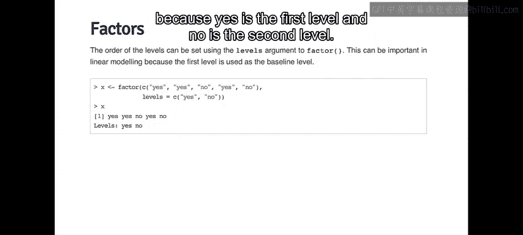

# 013：数据类型 - 因子 📊


在本节课中，我们将要学习R语言中一种特殊的数据类型——**因子**。因子是用于表示分类数据的向量，它在统计分析，特别是建模函数中扮演着关键角色。

## 什么是因子？🔍

上一节我们介绍了向量，本节中我们来看看因子。因子是一种特殊的向量，专门用于表示**分类数据**。它主要分为两种类型：**无序因子**和**有序因子**。

*   **无序因子**：用于存储没有内在顺序的分类标签。例如，性别（男/女）。
*   **有序因子**：用于存储有顺序或等级的分类标签，但它们本身不是数值。例如，大学职称（助理教授、副教授、正教授）。

你可以将因子理解为一个带有标签的整数向量。例如，一个表示“高”、“中”、“低”的因子，在R内部可能用数字1、2、3来代表这三个类别。

## 为什么因子很重要？💡

因子之所以重要，主要有以下两个原因：

1.  **建模函数**：像 `lm()`（线性模型）和 `glm()`（广义线性模型）这类建模函数会特殊处理因子变量，这对于后续的数据分析至关重要。
2.  **自描述性**：使用带有明确标签（如“男”、“女”）的因子，远比使用含义模糊的整数向量（如1，2）更直观、更易于理解。这能有效避免数据解读错误。

## 如何创建因子？🛠️

我们可以使用 `factor()` 函数来创建因子。该函数的输入通常是一个字符向量。

以下是创建因子的示例代码：

```r
# 创建一个包含“是”和“否”的因子
x <- factor(c("yes", "yes", "no", "yes", "no"))
print(x)
```

运行上述代码，输出结果会显示因子的值以及它的**水平**。水平就是这个因子所有可能的类别。

## 因子的内部结构 🧩

虽然我们通常将因子视为分类标签的集合，但了解其内部表示有助于深入理解。在R中，因子本质上是一个带有“水平”属性的整数向量。

我们可以使用 `unclass()` 函数来查看因子剥离“类”属性后的底层结构：

```r
# 查看因子x的内部整数表示
unclass(x)
```

此操作会显示每个标签在底层对应的整数值（例如，“否”可能对应1，“是”对应2）。不过，在日常使用中，你通常无需关心这些内部编码，直接将其当作分类标签处理即可。

## 设置因子的水平顺序 ⚙️

因子水平的顺序有时非常重要，特别是在统计建模中，第一个水平常被默认为**基线水平**。R默认按字母顺序排列水平。

例如，一个包含“yes”和“no”的因子，由于“n”在字母表中排在“y”前面，因此“no”会成为基线水平。如果这不是你想要的，你可以使用 `levels` 参数来明确指定水平的顺序：

```r
# 明确指定“yes”为第一个水平（基线水平）
x <- factor(c("yes", "yes", "no", "yes", "no"),
            levels = c("yes", "no"))
print(x)
```

现在，因子的水平属性中，“yes”排在第一位，成为了基线水平。

## 总结 📝

本节课中我们一起学习了R语言中的**因子**数据类型。我们了解到：
*   因子是用于表示分类（无序或有序）数据的特殊向量。
*   因子对于统计建模至关重要，并且因其自描述性而优于简单的整数编码。
*   使用 `factor()` 函数创建因子，并可以通过 `levels` 参数控制水平的顺序，这在设定统计模型的基线时非常有用。



掌握因子的概念和操作，是进行高效R语言数据分析和建模的重要一步。