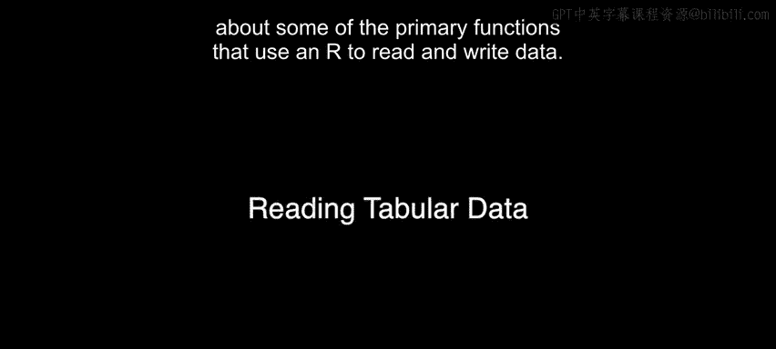
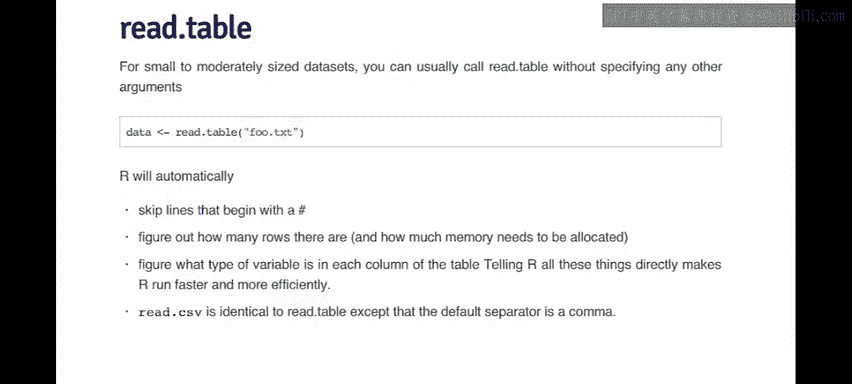

# 018：读取表格数据 📊

在本节课中，我们将学习如何在R中读取和写入数据。R提供了多种函数来处理不同类型的数据文件，我们将重点介绍几个最常用的函数，特别是用于读取表格数据的函数。

## 读取数据的主要函数

R中有几个核心函数用于将数据读入工作环境。以下是其中最重要的几个：

*   **`read.table`** 和 **`read.csv`**：这两个函数用于读取表格数据，是R中最常用的数据读取函数。它们读取以行和列格式存储数据的文本文件，并返回一个R中的数据框（data frame）。
*   **`readLines`**：此函数用于读取文本文件的行。它可以读取任何类型的文件，并将内容以字符向量的形式返回。
*   **`source`**：这个函数很重要，用于读取R代码文件。例如，如果你将函数或其他R代码写入一个文件，`source`函数会将这些代码全部读入R。
*   **`dget`**：此函数也用于读取R代码文件，但专门用于读取那些已被“反解析”（d-parsed）成文本文件的R对象。我们稍后会对此进行更多讨论。
*   **`load`** 和 **`unserialize`**：这两个函数用于将二进制对象读入R。

与读取函数对应的写入函数有：`write.table`、`writeLines`、`dump`、`dput`、`save`和`serialize`。它们与各自的读取函数配对使用。

## 详解 `read.table` 函数

`read.table` 是R中最常用的数据读取函数。理解其参数的含义和工作方式至关重要。

以下是 `read.table` 函数的主要参数：

*   **`file`**：第一个参数很明显，是文件名或连接名。通常你提供一个字符串，即计算机中某个文件的路径。
*   **`header`**：这是一个逻辑标志，指示第一行是否为标题行。例如，如果第一行包含所有变量名，那么它就不是实际数据，而是一行标签。你需要告诉 `read.table` 第一行是否包含变量名，还是直接就是数据。
*   **`sep`**：代表分隔符（separator）。它是一个字符串，指示列是如何分隔的。例如，如果文件由逗号分隔，那么分隔符就是逗号。有时文件可能由分号、制表符或空格分隔，你需要告诉 `read.table` 分隔符是什么。
*   **`colClasses`**：这是一个字符向量，其长度与数据中的列数相同。该向量指示数据中每一列的类别。例如，第一列是数值型，第二列是逻辑型，第三列是因子型等。这个参数不是必需的，但它可以告诉 `read.table` 每列数据的类别。
*   **`nrows`**：数据中的行数。这个参数不是必需的，但可以使用。
*   **`comment.char`**：这是一个字符串，指示注释字符是什么。默认是井号（`#`），该符号右侧的所有内容都会被忽略。你可以指定其他字符作为注释字符，以该注释字符开头的文件行将被忽略。
*   **`skip`**：从开头跳过的行数。有时文件开头可能有一些标题信息或非数据区域，你想直接跳过这些部分。你可以告诉 `read.table` 函数跳过前10行或前100行，然后才开始读取数据。
*   **`stringsAsFactors`**：此参数默认为 `TRUE`。其核心问题是：你是否希望将字符变量编码为因子（factor）。默认情况下，每当 `read.table` 遇到看起来是字符变量的数据列时，它会假定你希望将其作为因子变量读入。如果你不希望将其作为因子变量读入，可以将 `stringsAsFactors` 设置为 `FALSE`。

对于小型到中型数据集（随着计算机性能日益提升，“小型”和“中型”的定义也在不断扩大），你通常可以只使用文件名而不指定其他参数来调用 `read.table`。例如，你可以写 `read.table("foo.txt")`，它会自动处理不同列的类型、行数等。它会自动跳过以注释符号开头的行，并判断表中每列变量的类型。如果你愿意，也可以指定所有这些参数，这样做通常是为了让程序运行得更快、更高效。但对于中小型数据集，这样做优势不大，因为默认方式已经相当快速高效。

## `read.csv` 函数

`read.csv` 函数与 `read.table` 完全相同，但有一个关键区别：`read.csv` 的默认分隔符是逗号，而 `read.table` 的默认分隔符是空格。`read.csv` 对于读取CSV文件非常有用。CSV代表“逗号分隔值”，通常是从Microsoft Excel等电子表格程序中导出的格式。CSV是一种非常常见的格式，大多数电子表格类程序都能理解。

`read.csv` 的另一个特点是它总是将 `header` 参数默认设置为 `TRUE`。

## 总结

本节课我们一起学习了在R中读取数据的基础知识。我们介绍了几个核心函数，特别是用于读取表格数据的 `read.table` 和 `read.csv`。我们详细探讨了 `read.table` 函数的关键参数，如文件路径、标题行、分隔符、列类别等，并了解了如何根据数据文件的特性来设置这些参数。我们还比较了 `read.table` 和 `read.csv` 的异同，后者是专门为读取逗号分隔文件而设计的便捷函数。掌握这些函数是进行数据分析和处理的第一步。