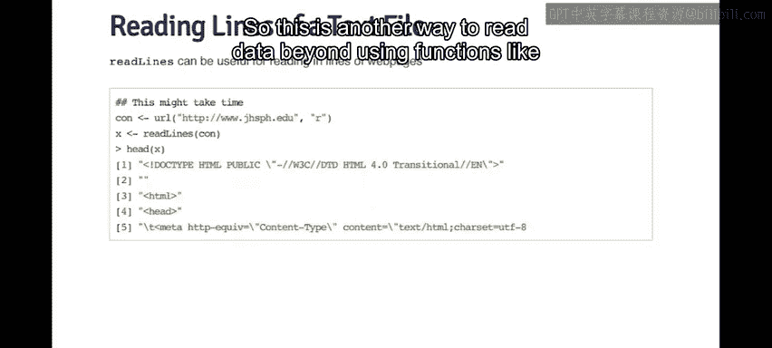
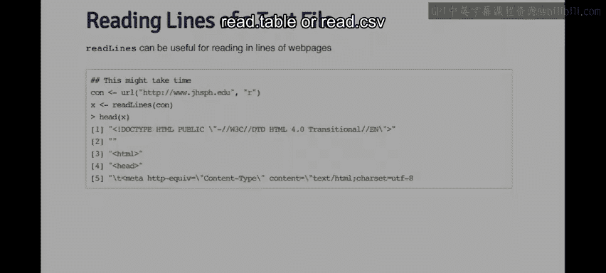

# 021：与外部世界的接口 🔌


在本节课中，我们将学习R语言如何与外部世界进行数据交互，特别是通过“连接”这一抽象机制来读取和写入文件、网页等外部资源。理解连接的概念能让你更灵活地处理各种数据源。

## 连接的概念

上一节我们介绍了R中基本的数据结构，本节中我们来看看R如何与外部数据源通信。连接是一个抽象接口，它封装了与不同类型外部对象（如文件、网页）建立通信的机制。这意味着无论数据来自本地文件还是网络，你都可以使用相似的函数来读取。

核心函数是 `file()`，它用于打开一个到标准未压缩文件的连接。其基本语法为：
```r
con <- file("文件名", open = "模式")
```
其中 `open` 参数指定模式，例如 `"r"` 表示读取，`"w"` 表示写入，`"a"` 表示追加。对于二进制文件，则使用 `"rb"`、`"wb"` 或 `"ab"`。

## 读取文件连接

大多数读取数据的函数（如 `read.table()`）在后台会自动创建并管理文件连接。但直接使用连接能带来更多控制权。

以下是使用连接读取文件的典型步骤：
1.  使用 `file()` 函数打开一个到文件的连接。
2.  使用如 `read.csv()` 的函数通过该连接读取数据。
3.  使用 `close()` 函数关闭连接。

例如，以下代码展示了完整过程：
```r
con <- file("food.txt", "r")
data <- read.csv(con)
close(con)
```
实际上，这等价于直接调用 `read.csv("food.txt")`。在简单读取整个文件时，通常无需显式操作连接。

## 连接的高级用法

然而，连接在需要部分读取文件或处理特殊数据源时非常有用。例如，你可以使用 `readLines()` 函数逐行读取文本文件。

以下是一个读取压缩文件前10行的示例：
```r
con <- gzfile("words.gz")  # 打开一个到gzip压缩文件的连接
first_10_lines <- readLines(con, 10)  # 读取前10行
close(con)
print(first_10_lines)
```
这里，`gzfile()` 函数专门用于打开gzip压缩文件的连接。对应的，`bzfile()` 用于处理bzip2压缩的文件。

类似地，`writeLines()` 函数可以将一个字符向量的每个元素作为一行文本写入文件。

## 读取网页数据

连接不仅限于文件，还可以指向网络资源。`url()` 函数用于创建到网页的连接。

以下示例演示了如何读取一个网页的HTML内容：
```r
con <- url("https://www.jhsph.edu", "r")  # 创建到网页的连接
web_content <- readLines(con)  # 读取网页内容
close(con)
head(web_content)  # 查看前几行（通常是HTML代码）
```
这种方法为从网络获取数据提供了除 `read.table()` 等函数外的另一种灵活途径。

## 总结





本节课中我们一起学习了R语言中“连接”的核心概念。我们了解到连接是一个强大的抽象接口，它统一了访问文件、压缩文件乃至网页等外部数据源的方式。虽然许多高级函数在后台处理了连接细节，但直接使用 `file()`、`gzfile()` 和 `url()` 等函数能让你在需要部分读取或处理特殊数据源时拥有更精细的控制。掌握连接机制将大大增强你处理各种外部数据的能力。