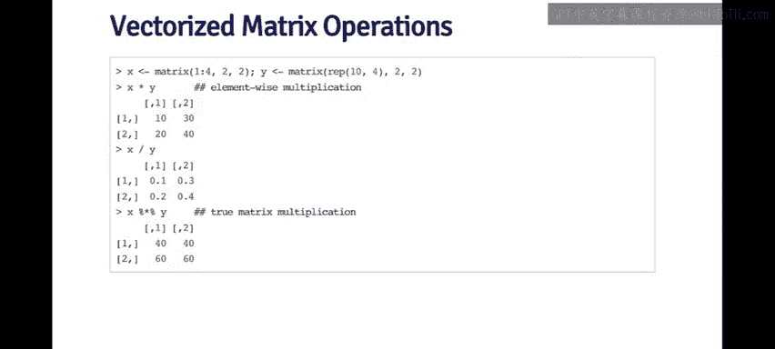

# 027：向量化操作 🧮


在本节课中，我们将要学习R语言中一个非常强大且实用的特性：向量化操作。这个特性使得R语言在命令行操作和代码编写上都非常便捷，能够让我们避免编写大量循环代码，从而简化数据处理过程。

## 概述

向量化操作是R语言的核心特性之一，它允许我们对整个向量或矩阵执行并行计算，而无需显式地编写循环。许多其他计算语言，如MATLAB，也具备类似的功能。掌握向量化操作能显著提高代码的效率和可读性。

## 什么是向量化操作？

上一节我们介绍了向量化操作的概念，本节中我们来看看它的具体含义。向量化操作的核心思想是并行计算。例如，当我们希望对两个向量进行加法运算时，R会自动将两个向量中对应位置的元素相加，而无需我们手动遍历每个元素。

假设我们有两个向量`x`和`y`：
```r
x <- 1:4  # 向量 [1, 2, 3, 4]
y <- 6:9  # 向量 [6, 7, 8, 9]
```
如果我们想将它们相加，在R中可以直接使用加号：
```r
x + y
```
这个操作会并行地将`x[1]`与`y[1]`相加，`x[2]`与`y[2]`相加，依此类推。结果将是向量`[7, 9, 11, 13]`。

## 向量化逻辑运算

除了算术运算，比较运算符也可以进行向量化操作。例如，我们可以检查向量`x`中哪些元素大于2：
```r
x > 2
```
这个操作会返回一个逻辑向量，其中每个元素表示`x`中对应位置的元素是否大于2。结果将是`[FALSE, FALSE, TRUE, TRUE]`。

以下是其他常用的向量化逻辑运算示例：
*   `x >= 2`：判断哪些元素大于或等于2。
*   `y == 8`：判断`y`中哪些元素等于8。

## 向量化算术运算

所有基本的算术运算，如乘法（`*`）、除法（`/`）、加法（`+`）和减法（`-`），在R中默认都是向量化的。这意味着当我们对两个向量使用这些运算符时，R会自动执行元素间的并行计算。

## 矩阵的向量化操作

向量化操作同样适用于矩阵。但需要注意的是，对矩阵直接使用`*`或`/`进行的是**元素间**的运算，而非线性代数中的矩阵乘法或求逆。

假设我们有两个2x2的矩阵：
```r
x <- matrix(1:4, 2, 2) # 矩阵 [1, 3; 2, 4]
y <- matrix(1, 2, 2)    # 全1矩阵 [1, 1; 1, 1]
```
*   `x * y`：这是元素间乘法，结果矩阵的每个元素是`x`和`y`对应位置元素的乘积。
*   `x / y`：这是元素间除法。

如果需要进行真正的**矩阵乘法**，必须使用专门的运算符 `%*%`：
```r
x %*% y # 执行矩阵乘法
```

## 总结



本节课中我们一起学习了R语言的向量化操作。我们了解到，向量化允许我们对整个数据结构（如向量和矩阵）执行并行计算，从而避免了编写繁琐的循环代码。我们学习了如何对向量进行算术和逻辑运算，并特别区分了矩阵的元素间运算与真正的矩阵乘法（使用`%*%`运算符）。对于习惯其他编程语言（需要手动循环）的学习者来说，掌握向量化思维是编写简洁高效R代码的关键。在后续课程中，我们将更频繁地运用这一强大特性。