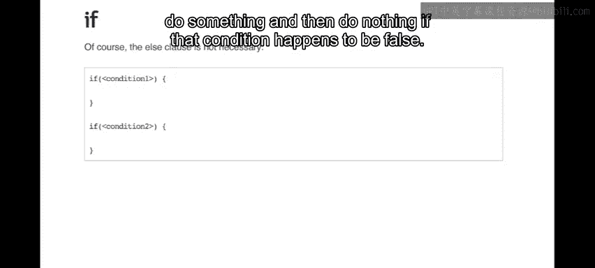

# 030：控制结构 if-else


在本节课中，我们将学习R语言中一个基础且重要的控制结构：`if-else`。它允许程序根据逻辑条件的真假，执行不同的代码路径。

## 概述

`if-else`结构是编程中进行条件判断的核心工具。通过它，我们可以让程序具备“思考”能力，根据不同的情况做出不同的反应。本节将详细介绍其语法、用法和一些灵活的变体。

## if-else 结构详解

上一段我们提到了条件判断的概念，本节中我们来看看其具体语法。`if`与可选的`else`结合，允许你测试逻辑条件，并根据该条件是`TRUE`还是`FALSE`，让R程序执行相应的操作。

典型的构造是：如果条件为真，则执行一段代码；否则（`else`），执行另一段代码。

```r
if (condition_is_true) {
  # 执行某些操作
} else {
  # 执行其他操作
}
```

`else`部分是可选的。你可以只有一个`if`语句，仅在条件为真时执行操作。如果你需要在条件为假时执行替代操作，则可以添加`else`部分。

## 处理多个条件

有时你需要测试不止一种可能的情况。这时，你可以使用`else if`来串联多个条件。

以下是使用`if`、`else if`和`else`的完整结构示例：

```r
if (condition1) {
  # 条件1为真时执行
} else if (condition2) {
  # 条件2为真时执行
} else {
  # 所有条件均为假时执行
}
```

在这样的结构中，可以包含任意数量的`else if`条件，但最终的`else`（如果存在）必须位于末尾。

## R语言中if-else的两种写法

R语言中`if-else`的写法与其他一些语言略有不同，主要有两种形式。

第一种是较为标准的形式，在结构内部根据条件为变量赋值：

```r
if (x > 3) {
  y <- 10
} else {
  y <- 0
}
```

第二种写法更为简洁，它将整个`if-else`构造视为一个表达式，并将其结果直接赋值给变量：

```r
y <- if (x > 3) {
  10
} else {
  0
}
```

这种写法有时有助于理解，因为它明确表示整个`if-else`结构的目的就是为变量`y`分配一个值。

## 简化与连续判断

正如前面提到的，`else`子句并非必需。你可以只测试条件并在其为真时执行操作，若条件为假则什么都不做。

此外，如果你需要，也可以连续测试多个独立的条件，而不必使用`else if`链。

## 总结



本节课我们一起学习了R语言中的`if-else`控制结构。我们掌握了其基础语法，了解了如何使用它进行简单的二选一判断，以及通过`else if`处理多个条件。我们还学习了R语言中特有的、将`if-else`作为表达式直接赋值的简洁写法。这是编写具有逻辑判断能力程序的基础。