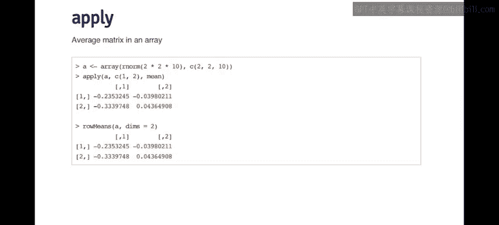

# 043：循环函数apply 🌀


在本节课中，我们将学习R语言中另一个重要的循环函数：`apply`。我们将了解它的基本用法、参数含义，以及如何用它来高效地对数组（特别是矩阵）的行或列进行计算。

---

## 概述

`apply`函数是R中用于在数组的“边缘”（通常是行或列）上评估（计算）某个函数的循环函数。它可以帮助我们避免编写冗长的`for`循环，使代码更简洁。本节将详细介绍`apply`的工作原理、参数设置，并通过实例展示其常见用法。

---

## `apply`函数的基本语法与参数

`apply`函数的基本语法结构如下：

```r
apply(X, MARGIN, FUN, ...)
```

以下是各参数的含义：
*   **`X`**： 一个数组，最常见的是矩阵（二维数组）。
*   **`MARGIN`**： 一个整数向量，指定要保留的维度。对于矩阵，`1`表示保留行（对每行应用函数），`2`表示保留列（对每列应用函数）。
*   **`FUN`**： 要应用的函数，可以是内置函数（如`mean`, `sum`），也可以是自定义的匿名函数。
*   **`...`**： 传递给函数`FUN`的其他参数。

上一节我们介绍了`apply`函数的参数构成，本节中我们来看看它的核心工作机制。

`apply`的核心思想是“保留与折叠”。`MARGIN`参数指定了你希望**保留**的维度，而其他未被指定的维度则会被**折叠**（即通过函数`FUN`进行汇总计算）。例如，对一个矩阵（维度为`[行， 列]`）应用`apply`时：
*   设置`MARGIN = 2`，意味着保留第二维（列），折叠第一维（行）。函数会对**每一列的所有行**进行计算，结果是一个长度等于列数的向量。
*   设置`MARGIN = 1`，意味着保留第一维（行），折叠第二维（列）。函数会对**每一行的所有列**进行计算，结果是一个长度等于行数的向量。

---

## 基础应用：计算行与列的统计量

让我们通过一个具体例子来理解`apply`的用法。首先，我们创建一个20行10列的随机矩阵：

```r
x <- matrix(rnorm(200), 20, 10)
```

以下是`apply`函数的几种基础应用场景：

**1. 计算每列的平均值**
我们希望保留列，对行进行折叠（求平均）。因此`MARGIN`设为`2`。

```r
apply(x, 2, mean)
```
这段代码会返回一个长度为10的向量，每个元素是原始矩阵对应列所有数值的平均值。

**2. 计算每行的总和**
我们希望保留行，对列进行折叠（求和）。因此`MARGIN`设为`1`。

```r
apply(x, 1, sum)
```
这段代码会返回一个长度为20的向量，每个元素是原始矩阵对应行所有数值的总和。

---

## 性能优化：使用行/列专用函数

对于求和、求均值这类简单且常见的操作，R提供了更高效的专用函数。它们经过高度优化，执行速度远快于使用`apply`。

以下是这些专用函数：
*   **`rowSums(x)`**, **`rowMeans(x)`**： 分别计算矩阵`x`的每行总和与平均值。
*   **`colSums(x)`**, **`colMeans(x)`**： 分别计算矩阵`x`的每列总和与平均值。

因此，在需要计算行或列的和与均值时，**应优先使用这些专用函数**。

---

## 进阶应用：传递额外参数与处理数组

`apply`的强大之处在于可以应用任何函数，并传递额外参数。

**1. 计算每行的分位数**
假设我们想计算矩阵`x`每一行的第25和第75百分位数。我们将使用`quantile`函数，它需要通过`...`参数传递`probs`参数来指定要计算的分位数。

```r
apply(x, 1, quantile, probs = c(0.25, 0.75))
```
这段代码的执行过程是：对矩阵`x`的每一行（`MARGIN = 1`）应用`quantile`函数，并将`probs = c(0.25, 0.75)`这个参数传递给它。结果会是一个2行20列的矩阵，每一列对应原始矩阵一行的两个分位数。

**2. 处理多维数组**
`apply`不仅限于矩阵，它可以处理任意维度的数组。例如，我们创建一个2x2x10的三维数组（可以理解为10个2x2矩阵堆叠在一起）：

```r
a <- array(rnorm(2 * 2 * 10), c(2, 2, 10))
```

现在，我们想对这10个矩阵在第三维上取平均，得到一个平均后的2x2矩阵。这意味着我们要保留第一和第二维（`MARGIN = c(1, 2)`），折叠第三维。

```r
apply(a, c(1, 2), mean)
```
这段代码会返回一个2x2的矩阵，它是原始数组中所有10个2x2矩阵对应位置元素的平均值。

对于这种在多个维度上求平均的操作，也可以使用`rowMeans`函数的扩展形式，通过设置`dims`参数来实现：

```r
rowMeans(a, dims = 2)
```
`dims = 2`表示对前两个维度之后的所有维度（即第三维）进行平均。

---

## 关于`apply`性能的说明

你可能会听到一种说法：“使用`apply`比使用`for`循环更好或更快”。**这种说法在现代R语言中并不准确**。在很久以前的旧版本S语言中或许成立，但现在并非如此。使用`apply`的主要优势在于**减少代码量**，使代码更清晰、更易读。优秀的程序员总是追求简洁（“懒惰”），尤其是在命令行进行探索性数据分析时，减少敲击次数能极大提升效率。

---

## 总结

本节课中我们一起学习了`apply`函数：
1.  `apply`是用于在数组指定维度上应用函数的循环工具。
2.  其核心参数`MARGIN`决定了保留和折叠的维度。
3.  对于简单的行/列求和与求均值，应优先使用`rowSums`、`colMeans`等优化函数。
4.  可以通过`...`参数向`FUN`函数传递额外参数，实现复杂计算。
5.  `apply`可应用于任意维度的数组。
6.  使用`apply`的主要目的是编写更简洁、更易读的代码，而非追求性能提升。



通过掌握`apply`，你可以更优雅地处理需要对数据子集进行重复计算的任务。