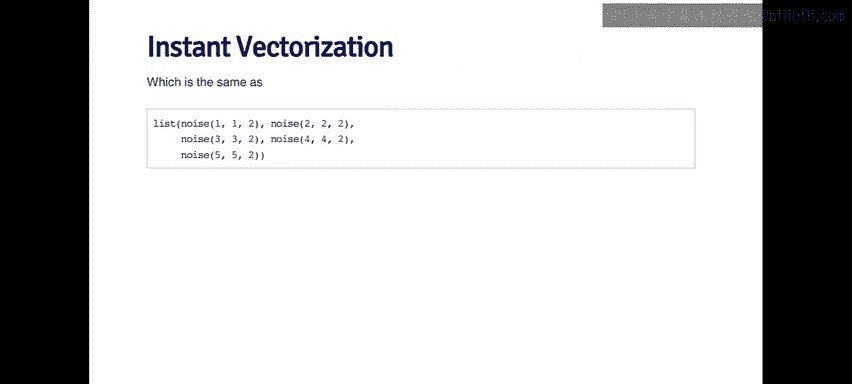

# 044：循环函数 mapply 🌀


在本节课中，我们将要学习R语言中的另一个循环函数：`mapply`。`mapply`是`lapply`和`sapply`的多元版本，它允许我们并行地对多个列表或向量应用一个函数。这对于需要同时处理多组参数的情况非常有用。

上一节我们介绍了`lapply`和`sapply`，它们主要用于对单个列表或向量的元素应用函数。本节中我们来看看当函数需要多个参数，并且这些参数分别来自不同的列表时，该如何处理。

## 理解 `mapply` 函数

`mapply` 的核心思想是**并行地**对一组不同的参数应用一个函数。`lapply`和`sapply`只能处理单个对象（如一个列表），而`mapply`可以接受多个列表作为输入，并将函数同时应用到这些列表的对应元素上。

其基本语法结构如下：
```r
mapply(FUN, ..., MoreArgs = NULL, SIMPLIFY = TRUE)
```
*   `FUN`：要应用的函数。
*   `...`：一个或多个列表（或向量），这些参数将被并行地传递给`FUN`。函数`FUN`必须至少能接受与`...`中对象数量一样多的参数。
*   `MoreArgs`：一个列表，包含要传递给`FUN`的其他固定参数。
*   `SIMPLIFY`：逻辑值，与`sapply`中的参数类似，用于控制是否尝试简化结果。

## `mapply` 的基本用法

以下是`mapply`的一个简单示例。假设我们想创建一个列表，其中包含4个1、3个2、2个3和1个4。

手动创建这个列表的代码如下：
```r
list(rep(1, 4), rep(2, 3), rep(3, 2), rep(4, 1))
```

使用`mapply`可以更简洁地实现同样的效果：
```r
mapply(rep, 1:4, 4:1)
```
在这行代码中：
*   `FUN`是`rep`函数（重复函数）。
*   第一个参数集`1:4`对应`rep`函数的`x`参数（要重复的值）。
*   第二个参数集`4:1`对应`rep`函数的`times`参数（重复的次数）。
*   `mapply`会并行地执行`rep(1, 4)`、`rep(2, 3)`、`rep(3, 2)`和`rep(4, 1)`，并返回结果列表。

## 使用 `mapply` 向量化函数

`mapply`的一个强大用途是“向量化”一个原本不支持向量输入的函数。

让我们定义一个简单的函数`noise`，它生成指定数量、均值和标准差的正态分布随机数：
```r
noise <- function(n, mean, sd) {
    rnorm(n, mean, sd)
}
```
如果我们用一组参数调用它，例如`noise(5, 1, 2)`，它会正常工作，生成5个均值为1、标准差为2的随机数。

但是，如果我们尝试传递向量参数，例如`noise(1:5, 1:5, 2)`，它并不会按我们的预期工作（即分别生成1个、2个...5个随机数，且均值分别为1、2...5）。相反，它会将整个向量`1:5`作为`n`参数，导致错误或非预期结果。

这时，`mapply`就能派上用场：
```r
mapply(noise, 1:5, 1:5, 2)
```
这行代码等价于手动执行：
```r
list(
    noise(1, 1, 2),
    noise(2, 2, 2),
    noise(3, 3, 2),
    noise(4, 4, 2),
    noise(5, 5, 2)
)
```
`mapply`并行地将三组参数`(1,1,2)`、`(2,2,2)`...传递给`noise`函数，从而实现了我们想要的向量化操作，高效地得到了五组不同参数下的结果。

## 总结

本节课中我们一起学习了`mapply`函数。它是`lapply`函数家族的多元扩展，允许我们并行地对多个列表或向量的对应元素应用一个函数。关键点在于：
1.  `mapply`用于处理需要多组参数的函数应用场景。
2.  它通过`...`参数接受多个输入对象，并将它们并行地传递给函数。
3.  它可以非常方便地将一个不支持向量输入的函数“向量化”，使其能够一次性处理多组参数，从而避免编写冗长的循环代码。



掌握`mapply`能让你在处理需要同时操作多列或多组数据的任务时，写出更简洁、更高效的R代码。