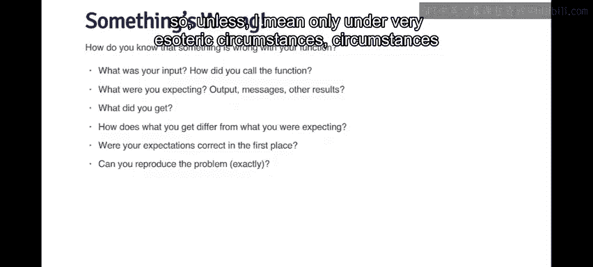

# 047：调试工具 🔧


在本节课中，我们将要学习R语言内置的调试工具。这些工具是R基础环境的一部分，无需额外安装任何包。它们对于在发现问题后，找出问题所在非常有用。


## 如何发现问题？🚨


首先，我们需要知道如何判断代码是否出现了问题。R语言会通过几种不同类型的指示来告诉你可能存在问题。这些指示的严重程度大致可以分为三个等级。


以下是R中三种主要的指示类型：


1.  **消息**：这是一种非常温和的通知。它可能只是一个诊断性的消息，告诉你发生了某些事情，但通常不会影响函数的执行。消息会直接打印到屏幕上，函数会继续运行。消息由 `message()` 函数生成。
2.  **警告**：警告表示发生了预期之外的事情，但这不一定是致命问题。很多时候，你可以选择忽略警告。当警告发生时，函数会继续执行，但会在函数执行完毕后，在控制台显示警告信息。警告由 `warning()` 函数生成。
3.  **错误**：错误是致命问题。它会立即停止函数的执行。错误由 `stop()` 函数生成。


此外，还有一个更高级的概念叫做“条件”。消息、警告和错误都属于“条件”。理论上，你甚至可以创建自定义的条件类型，但这超出了本课程的范围。


## 示例解析 📝


上一节我们介绍了三种指示类型，本节中我们来看看具体的例子。


一个典型的警告例子是计算负数的对数：
```r
log(-1)
```
执行这段代码，你会得到一个返回值 `NaN`（非数字），并且在函数执行完毕后，会看到一条警告信息：“NaNs produced”。这种情况有时是可以接受的，例如当你对一系列数字取对数，其中一些是负数，而你并不在意时。


现在，我们来看一个自定义的函数示例。以下是一个非常简单的函数，它检查输入值并打印相应的消息：
```r
printmessage <- function(x) {
    if(x > 0)
        print("x is greater than zero")
    else
        print("x is less than or equal to zero")
    invisible(x)
}
```
这个函数会检查输入 `x` 是否大于0，并打印相应的消息。函数最后使用了 `invisible(x)`。


这里需要解释一下 `invisible()` 函数。通常，在命令行执行一个函数时，R会自动打印函数体中最后一个表达式的返回值。`invisible()` 的作用是阻止这种自动打印行为。它仍然会返回对象，但不会显示在控制台上。例如，`load()` 函数就使用了 `invisible()` 来返回加载的对象名，而不将其打印出来。


## 调试的核心问题 ❓


当我们认为一个函数“出错”时，实际上意味着结果与我们的预期不符。有时这很明显，比如出现了错误信息；但有时却不明显，比如函数没有报错，但输出的结果却不是我们想要的。


在调试函数时，你需要系统地回答以下几个关键问题。以下是你在调试过程中需要理清的核心问题列表：


*   **你实际向函数输入了什么？** 仔细检查你传递给函数的参数是什么，而不是你以为你传递了什么。
*   **你期望得到什么输出？** 清晰地表达你的预期至关重要，无论是向自己还是向他人求助。
*   **你实际得到了什么输出？** 实际结果与你的期望有何不同？
*   **你的期望本身是否正确？** 有时问题可能出在你的预期上，函数的行为可能本来就是正确的。
*   **你能重现这个问题吗？** 这是调试中最重要的一点。如果你无法稳定地重现问题，就很难找到根源并修复它。


能够重现问题非常关键，因为你需要向他人（或未来的自己）展示问题是如何产生的。对于依赖随机数、网络请求或并行计算等外部状态的问题，重现可能会比较困难。但在大多数仅涉及本地计算的情况下，你应该能够找到重现问题的步骤。


## 总结 📚




本节课中我们一起学习了R语言内置的调试基础。我们了解了R发出问题信号的三种方式：消息、警告和错误。我们通过示例代码观察了它们的行为，并学习了 `invisible()` 函数的作用。最后，我们探讨了调试的核心思路，即通过回答一系列关于输入、输出和预期的问题来定位错误，并强调了能够稳定重现问题是有效调试的前提。掌握这些基础概念，将为你后续使用更高级的调试工具打下坚实的基础。