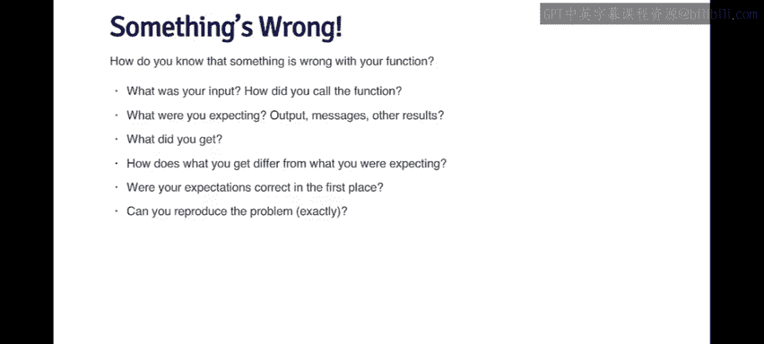
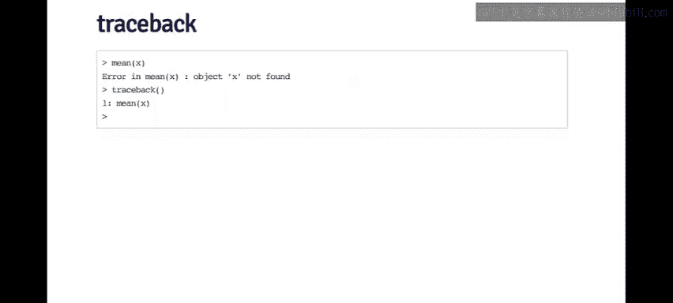

# 048：调试工具 - 基本工具



在本节课中，我们将学习R语言内置的五种基本调试工具。这些工具能帮助你定位和修复代码中的错误，使调试过程更加高效。

## 概述

调试是编程中不可或缺的一部分。R语言提供了一系列内置函数来辅助调试，即使你之前可能从未使用过它们。接下来，我们将逐一介绍这些工具及其用途。

## 基本调试工具

以下是R语言提供的五种基本调试函数，它们能帮助你深入理解代码执行过程并定位错误。

### 1. `traceback` 函数

`traceback` 函数用于打印函数调用栈。当你调用一个函数，而该函数又调用其他函数时，如果错误发生在深层嵌套中，`traceback` 能显示错误发生前的一系列函数调用，帮助你定位错误源头。

**示例**：
```r
traceback()
```

### 2. `debug` 函数

`debug` 函数是最常用的调试工具之一。它允许你将一个函数标记为调试模式。此后，每次执行该函数时，程序会在第一行暂停，进入浏览器模式，让你可以逐行执行代码，观察每一步的状态。

**示例**：
```r
debug(my_function)
```

### 3. `browser` 函数

`browser` 函数与 `debug` 相关，但更灵活。你可以在代码中的任意位置插入 `browser()` 调用。当执行到该行时，程序会暂停，允许你从此处开始逐行调试。这在需要跳过函数开头部分直接调试中间代码时特别有用。

**示例**：
```r
browser()
```

### 4. `trace` 函数

`trace` 函数允许你在不直接编辑函数代码的情况下插入调试代码。这对于调试他人编写的代码（如R包或基础R中的函数）非常方便。通常，插入的代码是调用 `browser` 函数，调试完成后可以轻松关闭跟踪。

**示例**：
```r
trace("my_function", browser)
```

### 5. `recover` 函数

`recover` 函数是一个错误处理函数。默认情况下，R遇到错误后会停止执行并返回控制台。但设置 `recover` 后，错误发生时程序会暂停在错误位置，并显示函数调用栈。你可以浏览不同层级的函数调用，检查数据状态，从而更精确地定位问题。

**示例**：
```r
options(error = recover)
```

## 调试策略与建议

除了使用上述工具，另一种常见的调试方法是插入 `print` 或 `cat` 语句来输出变量值。这种方法简单直接，尤其适合初学者。例如，如果你想知道第42行变量 `x` 的值，可以直接打印它。

然而，这种方法的一个缺点是需要在调试后手动删除所有打印语句，对于长代码可能比较繁琐。尽管如此，它仍然是一种有效的调试手段。

有些开发者反对使用调试器，认为它可能导致编码习惯松散，因为开发者可能依赖调试器而不是仔细思考代码逻辑。虽然调试器是强大的工具，但养成良好的编码习惯同样重要。建议先仔细设计和编写代码，遇到问题时再使用调试工具。

## 总结



本节课我们一起学习了R语言的五种基本调试工具：`traceback`、`debug`、`browser`、`trace` 和 `recover`。每种工具都有其独特的用途，能帮助你在不同场景下高效定位和修复代码错误。掌握这些工具将显著提升你的调试能力，使编程过程更加顺畅。