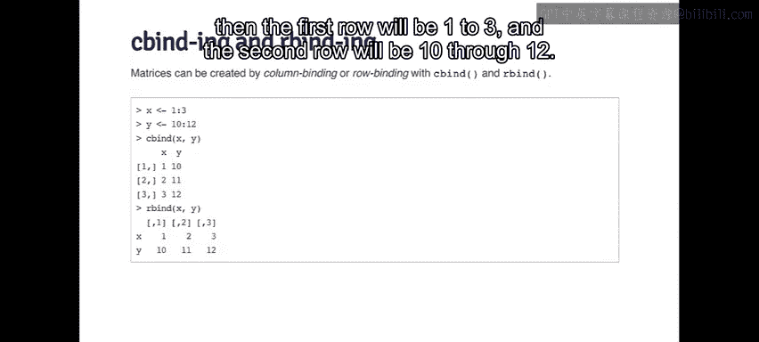

# 课程2：R编程｜P12：数据类型 - 矩阵 📊


在本节课中，我们将要学习R语言中的一种重要数据结构：矩阵。我们将了解矩阵的本质、创建矩阵的多种方法以及其基本属性。

---

## 矩阵的本质

上一节我们介绍了向量，本节中我们来看看矩阵。矩阵是R中一种特殊的向量，它并非一个独立的对象类别，而本质上是一个拥有“维度”属性的向量。

这个维度属性是一个长度为2的整数向量，其中第一个数字代表矩阵的行数，第二个数字代表矩阵的列数。

**公式表示：**
`dim(matrix) = c(n_rows, n_columns)`

---

## 创建矩阵的方法

有多种方式可以创建矩阵，以下是几种常见的方法。

### 1. 使用 `matrix()` 函数

`matrix()` 函数可以直接创建一个矩阵，你可以指定其行数和列数。

```r
# 创建一个2行3列的空矩阵（填充NA值）
M <- matrix(nrow = 2, ncol = 3)
print(M)
```

运行上述代码，你会看到一个2行3列的矩阵，其元素均为`NA`。方括号`[ , ]`中的数字用于标识行和列的位置。

### 2. 通过为向量添加维度属性

你可以先创建一个向量，然后通过`dim()`函数为其赋予维度属性，从而将其转换为矩阵。

```r
# 创建一个1到10的向量
m <- 1:10
# 将其维度设置为2行5列
dim(m) <- c(2, 5)
print(m)
```

这种方式创建的矩阵，其元素是按列填充的。

### 3. 通过列绑定与行绑定

通过组合多个向量来创建矩阵是另一种常见方式，这可以通过`cbind()`（列绑定）和`rbind()`（行绑定）函数实现。

以下是具体操作步骤：

```r
# 创建两个向量
x <- 1:3
y <- 10:12

# 使用cbind进行列绑定（结果矩阵的列由x和y组成）
cbind(x, y)

# 使用rbind进行行绑定（结果矩阵的行由x和y组成）
rbind(x, y)
```

---

## 矩阵的填充顺序

理解矩阵的填充顺序至关重要。在R中，矩阵是按列填充的。这意味着，当你提供一个向量来构建矩阵时，元素会先填满第一列，然后依次填充第二列、第三列，以此类推。

例如，用序列1到6创建一个2行3列的矩阵：

```r
matrix(1:6, nrow = 2, ncol = 3)
```

其填充过程如下：
1.  第一列填入1和2。
2.  第二列填入3和4。
3.  第三列填入5和6。

---

## 检查矩阵属性

创建矩阵后，你可以使用以下函数检查其属性：

*   `dim()`：返回矩阵的维度（行数和列数）。
*   `attributes()`：返回对象的属性列表，对于矩阵，你会看到`$dim`属性。

```r
M <- matrix(1:6, nrow=2, ncol=3)
dim(M) # 输出: [1] 2 3
attributes(M) # 输出: $dim [1] 2 3
```

---

## 总结



本节课中我们一起学习了R语言中的矩阵。我们了解到矩阵是具有维度属性的向量，掌握了使用`matrix()`函数、为向量设置`dim`属性以及通过`cbind()`和`rbind()`函数创建矩阵的多种方法。同时，我们明确了矩阵按列填充的特性，并学会了使用`dim()`和`attributes()`函数来查看矩阵的基本属性。矩阵是数据组织和计算的基础，在后续的数据分析中会经常用到。