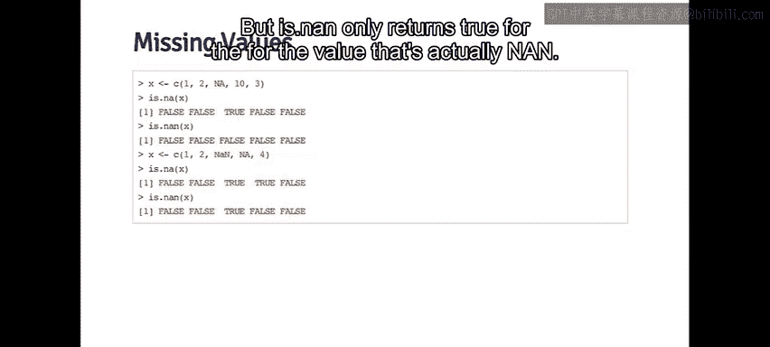

# 课程2：R编程 🧑‍💻 | P14：数据类型 - 缺失值


在本节课中，我们将要学习R语言中一个特殊的数据类型：缺失值。我们将了解缺失值的两种表示方式，以及如何检测和处理它们。

---

## 概述

到目前为止，我们尚未详细讨论一种特殊的对象类型：缺失值。在R语言中，缺失值通常用 `NA` 或 `NaN` 表示。理解它们的区别以及如何识别它们，对于数据清洗和分析至关重要。

上一节我们介绍了不同的数据类型，本节中我们来看看如何处理数据中不完整或未定义的部分。

---

## 缺失值的类型与表示

R语言中的缺失值主要有两种表示法：
*   **`NA`**：用于表示大部分情况下的缺失值。
*   **`NaN`**：特指“非数字”，用于表示未定义的数学运算结果（例如 `0/0`）。

`NA` 值本身也可以带有数据类型。这意味着你可以有**缺失的整数值**、**缺失的字符值**或**缺失的数值**等。因此，尽管它们看起来都是 `NA`，但其底层的数据类型可能不同。

一个重要的关系是：**所有 `NaN` 值都被视为 `NA`（即缺失），但反之则不成立**。一个 `NA` 值不一定是 `NaN`。

---

## 如何检测缺失值

R提供了专门的函数来检测这些缺失值。

以下是检测缺失值的两个核心函数：

1.  **`is.na()`**：用于测试对象中的元素是否为 `NA`（缺失值）。
2.  **`is.nan()`**：用于测试对象中的元素是否为 `NaN`。

让我们通过例子来理解它们的工作方式。

---

## 实践示例

### 示例1：检测向量中的 `NA`

首先，我们创建一个包含 `NA` 的数值向量。

```r
x <- c(1, 2, NA, 10, 3)
```

当我们对向量 `x` 调用 `is.na()` 函数时，它会返回一个逻辑向量。

```r
is.na(x)
```

这个逻辑向量指示了原向量 `x` 中每个元素是否缺失。在我们的例子中，只有第三个元素是 `NA`，所以结果是：

```
[1] FALSE FALSE  TRUE FALSE FALSE
```

`TRUE` 所在的位置就指明了缺失值的位置。

如果我们对同一个向量调用 `is.nan()` 函数：

```r
is.nan(x)
```

由于这个向量中没有 `NaN` 值，所以返回的结果全部是 `FALSE`。

```
[1] FALSE FALSE FALSE FALSE FALSE
```

### 示例2：区分 `NA` 与 `NaN`

现在，我们创建一个同时包含 `NA` 和 `NaN` 的向量。

```r
y <- c(1, 2, NA, NaN, 4)
```

让我们同时使用两个函数进行检测：

```r
is.na(y)
is.nan(y)
```

对于 `is.na(y)`，它会将 `NA` 和 `NaN` 都识别为缺失值，因此结果为：

```
[1] FALSE FALSE  TRUE  TRUE FALSE
```

对于 `is.nan(y)`，它只识别真正的 `NaN` 值，因此结果为：

```
[1] FALSE FALSE FALSE  TRUE FALSE
```

这个例子清楚地展示了 `is.na()` 与 `is.nan()` 的区别：`is.na()` 的检测范围更广，包含了 `NaN`。

---

## 总结



本节课中我们一起学习了R语言中缺失值的核心概念。我们了解到：
1.  `NA` 是通用的缺失值标识，而 `NaN` 特指无效的数学运算结果。
2.  可以使用 `is.na()` 函数来查找数据中的任何缺失值（包括 `NaN`）。
3.  如果需要专门查找 `NaN`，则应使用 `is.nan()` 函数。
4.  理解 `所有NaN都是NA，但并非所有NA都是NaN` 这一关系对正确处理数据非常重要。


掌握缺失值的识别是数据预处理的基础步骤，它能帮助我们在进行分析前，清晰地了解数据的完整性。