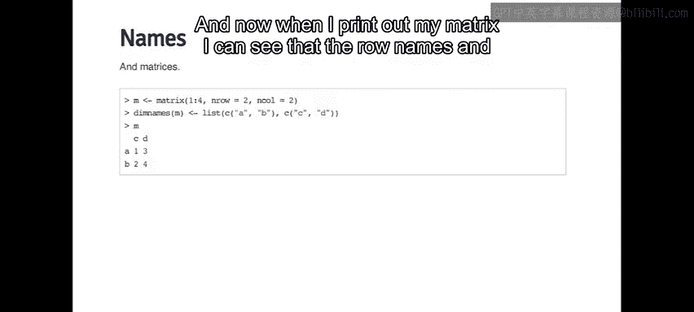

# 课程2：《R编程》｜P16：15_数据类型 名称属性 🏷️


在本节课中，我们将学习R语言中一个非常实用的特性：为对象元素赋予名称。这个特性不仅适用于数据框，也适用于向量、列表和矩阵。通过为元素命名，我们可以编写出更易读、更自描述的代码。

## 概述

R中的对象（如向量、列表、矩阵）可以拥有名称属性。这允许我们为每个元素分配一个标签，从而使数据结构的意义更加清晰，代码更易于理解和维护。

## 为向量添加名称

上一节我们介绍了R的基本数据类型，本节中我们来看看如何为这些数据结构的元素赋予名称。

首先，创建一个没有名称的整数序列向量：

```r
x <- 1:3
names(x)
```
执行`names(x)`会返回`NULL`，因为向量`x`目前没有名称属性。

我们可以使用`names()`函数为向量的每个元素分配名称：

```r
names(x) <- c("foo", "bar", "norf")
x
names(x)
```
现在，打印`x`会显示一个带有名称的向量：`foo: 1, bar: 2, norf: 3`。执行`names(x)`则会返回我们刚刚指定的名称向量：`"foo" "bar" "norf"`。

## 为列表添加名称

列表同样可以拥有名称。以下是创建带名称列表的方法：

```r
x <- list(a = 1, b = 2, c = 3)
x
```
在这个例子中，我们使用`list()`函数创建列表，并直接在参数中为每个元素命名（`a = 1`）。打印列表`x`时，会同时显示元素的名称及其对应的值。

## 为矩阵添加维度名称

矩阵的名称属性被称为维度名称。以下是创建并命名矩阵的步骤：

首先，创建一个2x2的矩阵：

```r
m <- matrix(1:4, nrow = 2, ncol = 2)
```
然后，使用`dimnames()`函数为行和列命名。该函数接受一个列表，列表的第一个元素是行名向量，第二个元素是列名向量：

```r
dimnames(m) <- list(c("a", "b"), c("c", "d"))
m
```
执行后，矩阵`m`的行将被标记为`a`和`b`，列将被标记为`c`和`d`。

## 总结

本节课我们一起学习了R语言中名称属性的应用。我们掌握了：

1.  使用`names()`函数为**向量**的元素添加名称。
2.  在创建时直接为**列表**的元素命名。
3.  使用`dimnames()`函数为**矩阵**的行和列设置维度名称。



为对象元素命名是一个简单的操作，却能极大地提升代码的可读性和自描述性，是编写高质量R代码的重要习惯。