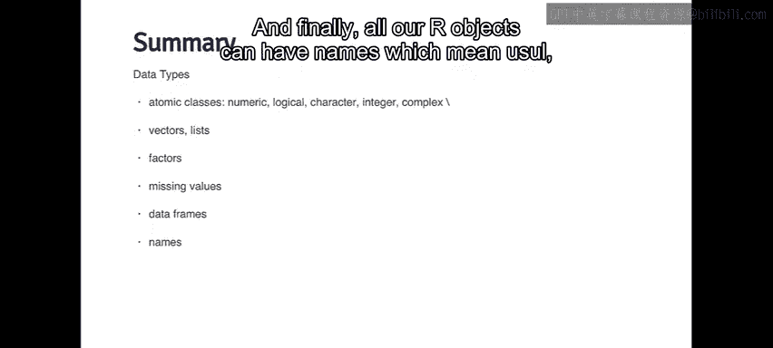

# 📊 课程2：《R编程课程》｜P17：R语言基础数据类型教程

在本节课中，我们将学习R语言中的基础数据类型。理解这些类型是进行有效数据操作和分析的第一步。我们将从最简单的原子向量开始，逐步介绍更复杂的数据结构，如列表、因子和数据框。


## 🔢 原子向量类

上一节我们概述了课程内容，本节中我们来看看R中最基本的数据结构：原子向量。原子向量是R中存储数据的基本单位，它们要求所有元素属于同一类别。

以下是R中主要的原子向量类别：

*   **数值型（numeric）**：用于存储实数，例如 `3.14` 或 `2.718`。
*   **字符型（character）**：用于存储文本字符串，例如 `"Hello"` 或 `"World"`。
*   **整数型（integer）**：用于存储整数值，在R中通常通过在数字后加`L`来指定，例如 `5L`。
*   **复数型（complex）**：用于存储复数，例如 `1 + 4i`。

## 🔗 列表：可容纳不同类的向量

我们了解了原子向量要求元素类型一致。然而，列表（list）是一个重要的例外。列表是一种特殊的向量，它可以容纳不同类别的元素，这使其成为存储异构数据的强大工具。

## 📊 因子：编码分类数据

在数据分析中，我们经常需要处理分类变量。R使用因子（factor）来高效地表示和存储分类数据，无论是有序的还是无序的。

## ⚠️ 缺失值：NA与NaN

真实数据集常常存在信息缺失的情况。R使用特定的值来表示这些缺失信息。

*   **`NA`**：代表“不可用”（Not Available），用于表示任何类型数据中的缺失值。
*   **`NaN`**：代表“非数字”（Not a Number），是数值计算中产生未定义结果时的特殊值，例如 `0/0`。

## 📈 数据框：存储表格数据

为了处理类似电子表格的二维表格数据，R提供了数据框（data frame）。这是R中最常用、最重要的数据结构之一。数据框的每一列都是一个向量，但不同列可以属于不同的类。

## 🏷️ 命名对象

最后，R中的对象（如向量、列表和数据框的组成部分）都可以被赋予名称。这有助于创建自描述性更强的数据，使代码更易读。

例如，可以为一个数值向量命名：
```r
# 创建一个带命名的向量
temperatures <- c(Beijing = 25, Shanghai = 28, Guangzhou = 30)
```



---

本节课中我们一起学习了R语言的基础数据类型。我们从要求元素类型一致的**原子向量**（数值、字符、整数、复数）开始，认识了可以混合类型的**列表**。接着，我们了解了用于表示分类数据的**因子**，以及表示缺失信息的`NA`和`NaN`。然后，我们介绍了用于存储表格数据的核心结构——**数据框**。最后，我们看到了如何为对象**命名**以增强可读性。掌握这些基础类型是后续进行数据操作、分析和可视化的关键。