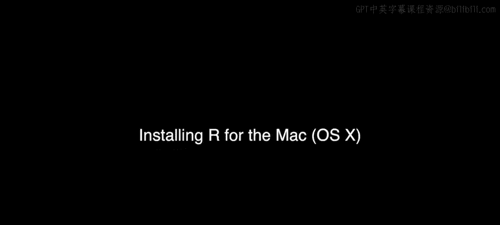
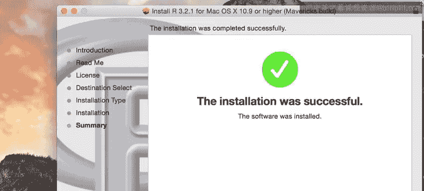

# 课程一：在Mac上安装R 🍎

在本课程中，我们将学习如何在苹果Mac电脑上安装R语言环境。整个过程非常简单，只需几个步骤即可完成。

## 概述

R是一种用于统计计算和图形的编程语言。要开始使用R，首先需要在你的计算机上安装它。本节将指导你完成在Mac操作系统上安装R的完整过程。

## 安装步骤

以下是安装R的具体步骤。

首先，打开你的网页浏览器。

然后，访问CRAN（The Comprehensive R Archive Network）网站。这是R语言的综合归档网络，提供了针对不同平台的下载选项。

我们需要下载适用于Mac平台的版本。

点击“Download R for (Mac) OS X”链接。

在下载页面中，找到最新的版本。你会看到一个名为“R-x.x.x.pkg”的包文件，点击它开始下载。

下载过程可能需要几分钟，具体时间取决于你的网络连接速度。请耐心等待。

下载完成后，找到下载的文件，通常位于“下载”文件夹中。双击“.pkg”文件以启动安装程序。

安装程序将启动并引导你完成所有必要的步骤。点击“继续”按钮。

接下来，你会看到关于即将安装内容的描述。再次点击“继续”。

随后是软件许可协议。R使用GNU通用公共许可证（版本2）。请阅读协议后，点击“同意”。

现在，点击“安装”按钮。系统可能会要求你输入管理员密码以授权安装。请输入密码并确认。

安装程序将开始将文件复制到你的计算机上。

安装完成后，点击“关闭”按钮。

## 验证安装

现在，R已经安装到你的“应用程序”文件夹中。

要找到它，可以打开“访达”（Finder），进入“应用程序”文件夹。文件通常按字母顺序排列，向下滚动找到“R”并点击它。

至此，你已成功在电脑上安装了R。现在，你可以直接使用它，或者根据喜好安装一个图形界面，例如RStudio。

## 总结

在本节课中，我们一起学习了在Mac电脑上安装R语言环境的完整流程。我们了解了如何从CRAN官网下载安装包，并逐步执行安装步骤，直至成功将R添加到应用程序中。现在，你的R编程环境已经准备就绪，可以开始后续的学习和使用了。