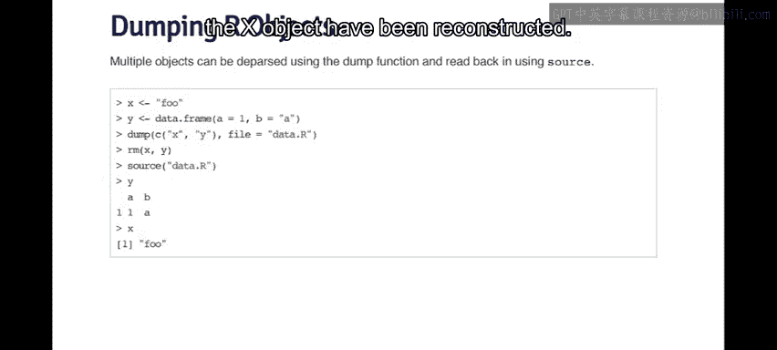

# 课程2：R编程｜P20：19_文本数据格式 📝

在本节课中，我们将学习R语言中除CSV和普通文本文件之外的两种文本数据格式。我们将探讨`dump`和`dput`函数如何保存数据，以及`source`和`dget`函数如何读取这些数据。这些格式不仅能存储数据本身，还能保留数据的元信息，如变量类型，这为数据交换和长期存储提供了便利。

---

## 超越表格格式的数据存储

上一节我们介绍了常见的表格数据格式。本节中我们来看看其他类型的文本数据格式。除了表格格式、CSV文件或普通文本文件，你还可以使用其他格式保存数据。

这些同样是文本格式，但它们与我们之前讨论的表格数据略有不同。用于写出数据的两个主要函数是`dump`和`dput`。

这些格式背后的理念是：它们虽然是文本格式，但其结构并不完全像表格，因为它们包含了更多的元数据。例如，关于每个对象中数据类型的元信息。

---

## 文本格式的优势与用途

以下是使用`dump`或`dput`这类机制存储或读取数据的优势：

首先，它仍然是文本格式，这很有用。同时，它包含了元数据，因此你无需在每次读取时重新指定。因为如果元数据不随数据集本身传递，在数据转移到其他地方时可能会丢失。如果你忘记了元数据（例如不同列的数据类型），就必须从头开始重建。这是使用`dump`或`dput`等函数从R输出数据的一个优势。

相应地，用于读取通过`dump`或`dput`输出的数据的函数是`source`和`dget`。

---

## 文本格式的通用优点

通常，文本格式是存储数据的优秀格式，因为它们具有多种不同的优势。

首先，它们是可编辑的。如果你想，可以编辑它们。虽然我不建议这样做，因为我们需要保证结果的可复现性。但如果文件损坏，你至少可以查看文件，尝试恢复。因此，如果你打算长期存储数据，文本格式的寿命可能更长一些。有时，使用文本格式有助于避免潜在的损坏问题。

其次，如果你使用像Subversion或Git这样的版本控制程序来跟踪文档之间的变更，文本格式通常表现更好。这类程序对文本数据的处理比对二进制数据更有用，从而能更有意义地跟踪变更。

文本格式遵循了Unix哲学的一般原则，即用文本来存储各种数据。

---

## 文本格式的缺点

文本格式的一个缺点是空间效率往往不高，它们会占用大量空间，因此通常需要进行压缩。

---

## `dput`函数详解

`dput`函数接受一个任意的R对象（除了一些较特殊的类型），并生成一些R代码，这些代码本质上可以在R中重建该对象。

例如，我创建了一个小型数据框，它有两列，第一列名为`a`，第二列名为`b`。然后我对这个数据框使用`dput`。如果你直接调用`dput`，它只会将结果输出到控制台。你可以看到它构造了一些R代码。

例如，它创建了一个包含这两个元素的列表。你可以看到每个元素都包含了其中的数据，并且名称也嵌入其中。它包含了行名，以及对象的类别（本例中是数据框）。因此，所有的元数据，如行名、列名和类别，都包含在输出中。

当然，你通常不会希望将其打印到控制台，这没什么用。你可能希望将其保存到文件中。

你可以使用`dput`函数将对象保存到文件。之后，你可以使用`dget`函数将其读入R。当你使用`dget`读取对象时，你会得到这个对象，并看到你基本上重建了之前的对象。

因此，`dput`函数本质上是编写用于重建R对象的R代码。

---

## `dump`函数与`dget`的区别

`dump`函数与`dget`很相似。然而，区别在于`dget`只能用于单个R对象，而`dump`可以用于多个R对象。

具体操作是：向`dump`传递一个包含对象名称的字符向量。例如，我创建了两个对象，一个叫`x`，另一个叫`y`。当我调用`dump`时，参数是这些对象的名称（即`x`和`y`），并指定一个我想要存储这些对象的文件。之后，如果我想，可以删除它们。

但是，要将这些对象读回R，我可以在那个文件上调用`source`函数。你会看到`y`对象和`x`对象已经被重建。

---

## 总结

本节课中，我们一起学习了R语言中两种特殊的文本数据格式及其对应的函数。我们了解了`dput`和`dump`函数如何通过生成包含元数据的R代码来保存数据，以及`dget`和`source`函数如何读取这些数据以重建对象。我们还探讨了文本格式在可编辑性、版本控制和长期存储方面的优势，同时也指出了其占用空间较大的缺点。掌握这些工具能让你更灵活地处理R中的数据存储与交换任务。