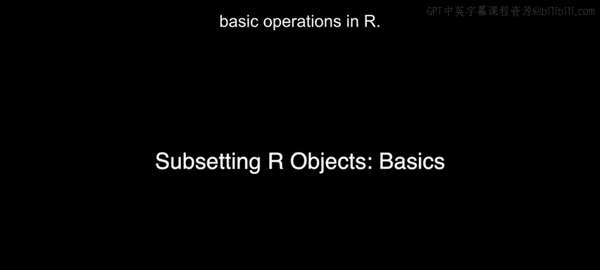
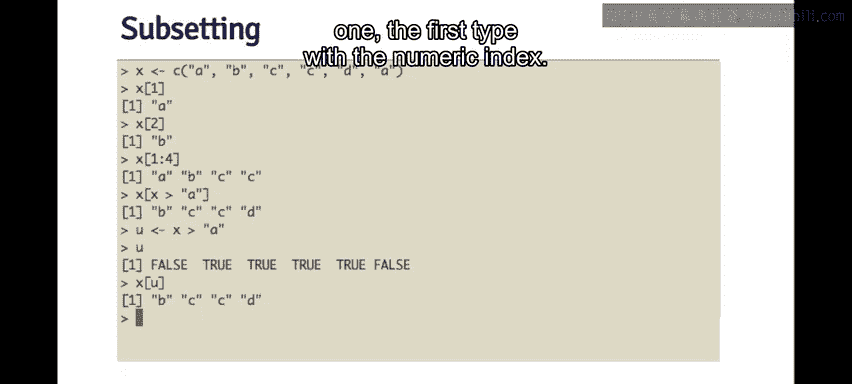

# 课程2：R编程 🧑‍💻｜P22：子集基础

在本节课中，我们将学习R语言中一个非常核心的操作：如何从对象中提取子集。我们将介绍三种不同的子集操作符，并通过具体示例演示它们的使用方法和区别。



上一节我们介绍了R的基本数据类型和操作，本节中我们来看看如何从这些数据对象中提取我们需要的部分。

---

## 子集操作符概述

R语言提供了三种主要的操作符来提取对象的子集：
*   单方括号 `[`
*   双方括号 `[[`
*   美元符号 `$`

理解它们之间的区别对于高效使用R至关重要。

## 单方括号 `[` 操作符

单方括号操作符的核心原则是：**它总是返回一个与原始对象类别相同的对象**。

这意味着，如果你对一个向量使用`[`，返回的仍然是一个向量；如果你对一个列表使用`[`，返回的仍然是一个列表。此外，单方括号操作符可以用于选择对象中的**多个元素**。

以下是使用单方括号的几种常见方式：

### 使用数值索引

数值索引是最直接的子集提取方式，通过指定元素的位置来获取数据。

```r
# 创建一个字符向量
x <- c("a", "b", "c", "c", "d", "a")

# 提取第一个元素
x[1]
# 返回: "a" (一个字符向量)

# 提取第二个元素
x[2]
# 返回: "b"

# 提取一个序列（第1到第4个元素）
x[1:4]
# 返回: "a" "b" "c" "c"
```

### 使用逻辑索引

逻辑索引通过一个TRUE/FALSE向量来筛选元素，只有对应位置为TRUE的元素会被提取出来。

```r
# 提取所有大于字母"a"的元素
# 字母在R中有字典序，'b', 'c', 'd'等都大于'a'
x[x > "a"]
# 返回: "b" "c" "c" "d"

# 先创建一个逻辑向量
u <- x > "a"
# u的内容: FALSE TRUE TRUE TRUE TRUE FALSE

# 然后用这个逻辑向量来提取子集
x[u]
# 返回: "b" "c" "c" "d"
```

---

## 双方括号 `[[` 与美元符号 `$` 操作符

上一节我们介绍了单方括号，本节中我们来看看另外两个用于提取列表或数据框元素的专用操作符。

双方括号 `[[` 和美元符号 `$` 主要用于从**列表（list）**或**数据框（data frame）**中提取元素。它们与单方括号的关键区别在于：
*   **`[[` 和 `$` 只能用于提取单个元素。**
*   它们返回的对象**不一定**是列表或数据框，而是该元素本身的类型。

### 双方括号 `[[` 操作符

列表可以包含不同类型的元素（例如，第一个元素是数值向量，第二个是数据框）。当使用`[[`提取列表中的一个元素时，返回的是该元素本身，而不是一个包含该元素的列表。

```r
# 假设有一个列表mylist，其第一个元素是一个向量
mylist[[1]] # 返回的是那个向量本身
```

### 美元符号 `$` 操作符

美元符号 `$` 用于按**名称（name）**提取列表或数据框中的元素。对象中的元素可以被命名，这样我们就可以通过直观的名字来引用它们。

```r
# 假设数据框df中有一列名为“age”
df$age # 返回名为“age”的那一列数据（通常是一个向量）
```

`$`的语义与`[[`类似，提取出的元素类别可能与原始对象不同。

---

## 课程总结

本节课中我们一起学习了R语言中子集提取的基础知识。我们掌握了三种操作符：
1.  **单方括号 `[`**：用于提取一个或多个元素，并保持原对象类别。
2.  **双方括号 `[[`**：用于从列表或数据框中提取单个元素，返回该元素本身。
3.  **美元符号 `$`**：用于按名称从列表或数据框中提取单个元素。



理解数值索引和逻辑索引的使用，以及这三种操作符的区别，是进行有效数据操作和分析的重要第一步。