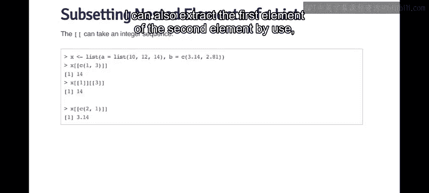
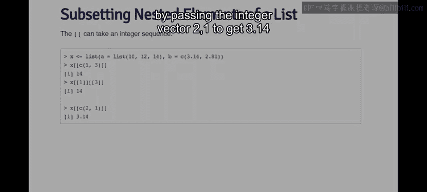

# 课程23：列表的子集操作 📚


在本节课中，我们将学习如何在R语言中对列表进行子集操作。列表是一种可以包含不同类型元素的数据结构，因此其子集操作与向量或矩阵略有不同。我们将重点介绍单括号`[]`、双括号`[[]]`和美元符号`$`这三种操作符的区别与用法。

---

## 列表子集操作的基本概念

列表的子集操作与向量不同，因为你可以使用双括号`[[]]`或美元符号`$`操作符，也可以使用单括号`[]`操作符。

假设我们有一个列表`x`，其第一个元素名为`foo`，是一个从1到4的序列；第二个元素名为`bar`，是数值0.6。这是一个包含两个元素的列表。

```r
x <- list(foo = 1:4, bar = 0.6)
```

---

## 单括号与双括号的区别

上一节我们介绍了列表的基本结构，本节中我们来看看如何使用单括号和双括号提取元素。

以下是使用单括号提取第一个元素的示例：

```r
x[1]
```

单括号操作符总是返回一个与原始对象类别相同的元素。因此，如果`x`是一个列表，那么`x[1]`也将是一个列表。返回的结果是一个包含名为`foo`的元素的列表，该元素是一个从1到4的序列。

现在，如果我们使用双括号：

```r
x[[1]]
```

返回的结果直接是从1到4的序列。两者的区别在于：第一个例子返回的是一个**包含序列的列表**，而第二个例子返回的是**序列本身**。这就是单括号和双括号操作符的主要区别。

---

## 使用美元符号提取元素

接下来，我们看看如何使用美元符号`$`来提取列表中的元素。

```r
x$bar
```

美元符号操作符会返回与名称`bar`相关联的元素。在这个例子中，它返回单个数值0.6。

我们也可以使用双括号操作符并传递一个字符串来实现相同的效果：

```r
x[["bar"]]
```

这与`x$bar`是等价的，都返回0.6。

如果我们使用单括号并传递名称：

```r
x["bar"]
```

这将返回一个包含`bar`元素的列表。记住，当对列表进行子集操作时，单括号总是返回一个列表。

使用名称提取元素的好处是，你不需要记住元素在列表中的位置。例如，如果你不记得`bar`是第一个还是第二个元素，你可以直接使用其名称，而不必依赖数字索引。

---

## 提取列表的多个元素

如果你想提取列表中的多个元素，则需要使用单括号操作符。

以下是提取第一个和第三个元素的示例：

```r
x[c(1, 3)]
```

这里我们传递一个数值向量`c(1, 3)`给单括号操作符，它会返回一个包含`foo`和`baz`元素的列表。注意，**你不能使用双括号或美元符号操作符来提取多个元素**。

---

## 双括号操作符的高级用法

双括号操作符与美元符号的一个不同之处在于，你可以使用双括号操作符来索引一个列表，其中索引本身是通过计算得到的。

假设我们有一个包含三个元素`foo`、`bar`和`baz`的列表，并且我们创建了一个变量`name`，其值为字符串`"foo"`。

```r
name <- "foo"
x[[name]]
```

注意，列表中并没有名为`name`的元素，但有一个名为`foo`的元素。当我们把变量`name`传递给双括号操作符时，它会返回与`foo`相关联的元素，因为`name`变量的值就是`"foo"`。

如果我们使用美元符号，它会字面地查找列表中名为`name`的元素，而这个元素并不存在。因此，要使用美元符号，你需要使用字面符号。

---

## 使用整数序列进行递归提取

双括号操作符可以接受一个整数序列，而不仅仅是单个数字。你可以将其视为递归进入列表。

假设我们有一个列表，其第一个元素`A`是另一个包含元素10、12和14的列表。

```r
y <- list(A = list(10, 12, 14), B = c(3.14, 2.81))
```

如果我们想提取数字14，它实际上是第一个元素的第三个元素。我们可以通过传递整数向量`c(1, 3)`给双括号操作符来实现：

```r
y[[c(1, 3)]]
```

这相当于先提取第一个元素，再提取该元素的第三个元素。

同样，我们可以提取第二个元素的第一个元素：

```r
y[[c(2, 1)]]
```

这将返回3.14。

---



## 总结



本节课中我们一起学习了R语言中列表的子集操作。我们介绍了单括号`[]`、双括号`[[]]`和美元符号`$`操作符的区别与用法。单括号总是返回一个列表，双括号返回列表中的实际元素，而美元符号则通过名称提取元素。我们还学习了如何提取多个元素，以及如何使用计算得到的索引和整数序列进行高级子集操作。掌握这些操作符将帮助你在处理复杂数据结构时更加得心应手。