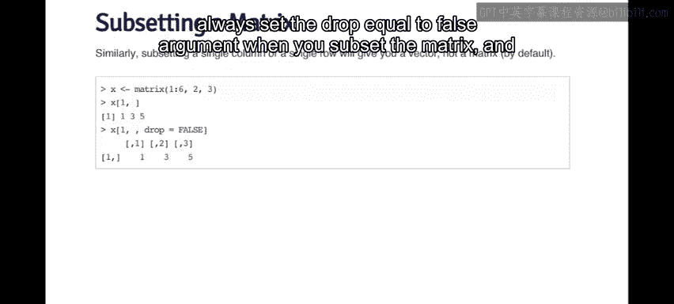
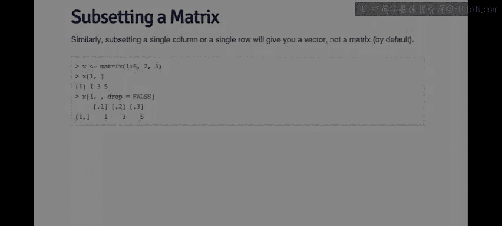

# 课程2：《R编程》｜P24：矩阵子集操作 🧮


在本节课中，我们将学习如何在R语言中对矩阵进行子集操作。我们将了解如何通过行索引和列索引提取矩阵中的特定元素、行或列，并探讨默认行为及其调整方法。

---

## 矩阵子集的基本语法

矩阵的子集操作遵循直观的规则：第一个索引代表行，第二个索引代表列。我们可以使用数字来指定这些索引。

例如，假设我们有一个矩阵 `x`，它是一个2行3列的矩阵，包含数字1到6：

```r
x <- matrix(1:6, nrow=2, ncol=3)
```

如果我们执行 `x[1, 2]`，这将提取第一行、第二列的元素，结果是数字 `3`。同理，`x[2, 1]` 将提取第二行、第一列的元素，结果是数字 `2`。

---

## 部分索引的使用

在对矩阵进行子集操作时，不一定总要同时指定两个索引。

以下是部分索引的用法示例：

*   **提取整行**：如果我们想提取矩阵的第一行，可以这样写：`x[1, ]`。这里的逗号后留空，表示“所有列”。结果将是一个包含元素 `1, 3, 5` 的向量。
*   **提取整列**：如果我们想提取矩阵的第二列，可以这样写：`x[, 2]`。这里的逗号前留空，表示“所有行”。结果将是一个包含元素 `3, 4` 的向量。

---

## 默认行为：维度的“降维”

默认情况下，当从矩阵中提取单个元素时，R会返回一个长度为1的向量，而不是一个1x1的矩阵。

之前我们提到，单方括号 `[ ]` 操作符通常返回与原始对象相同类的对象。但这里有一个看似例外的情况：提取矩阵的单个元素时，返回的不是矩阵，而是一个包含该数字的向量。

例如，`x[1, 2]` 返回的是数字 `3`，而不是一个包含 `3` 的1x1矩阵。这通常是符合预期的行为，但有时也可能引发问题。

---

## 控制维度：`drop` 参数

你可以通过为子集操作添加一个名为 `drop` 的额外参数来关闭上述默认行为。

默认情况下，`drop = TRUE`。这意味着R会“丢弃”或“降低”对象的维度。因此，你得到的是一个一维对象（向量），而不是二维对象（矩阵）。

然而，如果你想保留对象的原始维度，可以设置 `drop = FALSE`。

例如，`x[1, 2, drop = FALSE]` 将返回一个1x1的矩阵，其中包含元素 `3`。

---

## 对单行或单列应用 `drop` 参数

同样，默认情况下，当你提取单行或单列时，得到的也是一个向量，而不是一个矩阵。

例如，提取第一行 `x[1, ]`，你可能会期望得到一个1行3列的矩阵。但实际上，你得到的是一个包含元素 `1, 3, 5` 的向量。

这通常也是我们想要的结果。但如果你需要保留矩阵结构，同样可以在子集操作时设置 `drop = FALSE`。

例如，`x[1, , drop = FALSE]` 将返回一个1x3的矩阵，其元素为 `1, 3, 5`。

---



## 总结



本节课中，我们一起学习了R语言中矩阵的子集操作。我们掌握了使用行、列索引提取元素、行和列的基本方法。更重要的是，我们理解了R在子集操作时的默认“降维”行为，并学会了如何使用 `drop = FALSE` 参数来保留矩阵的原始维度结构，这在某些需要保持数据结构的编程场景中非常有用。