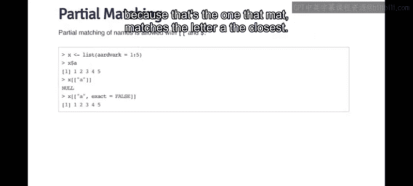

# 课程2：《R编程》｜P25：部分匹配 🎯


在本节课中，我们将学习R语言中一个非常实用的功能——部分匹配。这个功能能帮助你在命令行操作时节省大量输入时间，尤其适合快速交互式工作。

## 概述

部分匹配是R语言中一个便捷的工具，它能根据你提供的部分名称自动匹配到完整的对象名称。这个功能主要与双括号操作符和美元符号操作符一起使用。

## 部分匹配的工作原理

上一节我们介绍了列表的基本操作，本节中我们来看看如何利用部分匹配来简化这些操作。

部分匹配的核心思想是：当你只提供一个名称的开头部分时，R会自动查找并匹配列表中名称以此开头的元素。

### 美元符号操作符的默认行为

美元符号操作符默认支持部分匹配。以下是一个示例：

```r
x <- list(aardvark = 1:5)
```

假设我们有一个列表x，其中包含一个名为"aardvark"的元素，其值为1到5的序列。每次输入完整的"aardvark"可能会很繁琐。

```r
x$a
```

当你输入`x$a`时，R会自动查找名称以"a"开头的元素。在这个例子中，只有"aardvark"匹配，因此R会返回与该名称关联的对象，即序列1到5。

### 双括号操作符的不同行为

与美元符号操作符不同，双括号操作符默认要求精确匹配。

```r
x[["a"]]
```

当你使用`x[["a"]]`时，R会查找名称为"a"的精确匹配。由于列表中只有"aardvark"而没有"a"，所以返回`NULL`。

### 启用双括号的部分匹配

双括号操作符有一个额外的参数可以启用部分匹配功能。

```r
x[["a", exact = FALSE]]
```

通过设置`exact = FALSE`参数，双括号操作符也会进行部分匹配。这样，`x[["a", exact = FALSE]]`就会匹配到"aardvark"并返回序列1到5。

## 使用场景对比

以下是两种操作符在不同场景下的行为总结：

*   **交互式命令行工作**：美元符号操作符的部分匹配功能非常有用，可以快速访问对象
*   **编写程序函数**：双括号操作符的精确匹配更安全，可以避免意外的匹配错误

## 总结

本节课中我们一起学习了R语言中的部分匹配功能。我们了解到：

*   美元符号操作符默认支持部分匹配
*   双括号操作符默认需要精确匹配
*   可以通过`exact = FALSE`参数启用双括号的部分匹配
*   部分匹配在命令行操作中非常实用，但在编写正式程序时需谨慎使用



掌握部分匹配技巧能让你在R语言交互式环境中工作更加高效，同时也要注意在正式代码中保持明确性和准确性。