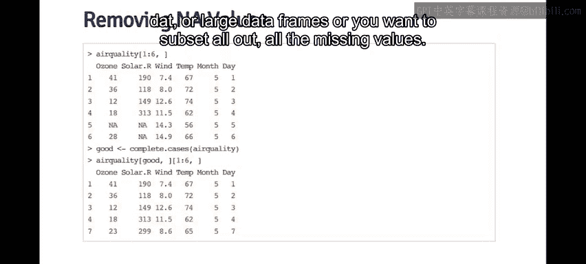

# 课程2：R编程 🧑‍💻 | P26：移除缺失值


在本节课中，我们将学习如何在R中识别并移除向量、矩阵和数据框中的缺失值（NA）。这是数据分析中一项非常常见的操作，因为现实数据通常包含大量缺失值。

上一节我们介绍了如何通过逻辑索引进行子集选择，本节中我们来看看如何利用这些技术来清理数据，移除缺失的观测值。

## 识别缺失值

首先，我们需要识别对象中的缺失值。`is.na()`函数可以生成一个逻辑向量，指示每个元素是否为NA。

以下是一个简单的向量示例：
```r
x <- c(1, 2, NA, 4, NA, 5)
```
我们使用`is.na()`函数来找出哪些元素是缺失的：
```r
bad <- is.na(x)
```
变量`bad`现在是一个逻辑向量。对于向量`x`，`bad`的值将是`FALSE, FALSE, TRUE, FALSE, TRUE, FALSE`，因为第三和第五个元素是NA。

## 移除缺失值

知道了哪些位置是缺失值后，我们就可以通过子集选择来移除它们。我们想要的是非缺失值。

我们可以使用感叹号`!`（在R中称为“非”运算符）来取反逻辑向量`bad`，从而选择出“好”的元素：
```r
good_elements <- x[!bad]
```
执行上述代码后，`good_elements`将只包含非缺失值：`1, 2, 4, 5`。

## 处理多个向量

在实际分析中，我们经常需要同时处理多个变量，并且希望只保留所有变量都完整的观测（即行）。

假设我们有两个向量：
```r
x <- c(1, 2, NA, 4, NA, 5)
y <- c("A", "B", NA, "D", NA, "F")
```
我们希望得到一个子集，其中`x`和`y`在同一位置上的值都不是NA。

这时，`complete.cases()`函数就非常有用。它可以接受多个向量（或一个数据框），并返回一个逻辑向量，指示哪些位置（或行）在所有输入中都是完整的。

以下是使用`complete.cases()`的方法：
```r
good_positions <- complete.cases(x, y)
```
`good_positions`向量将指示哪些索引位置在两个向量中都没有缺失值。对于我们的例子，结果是`TRUE, TRUE, FALSE, TRUE, FALSE, TRUE`。

然后，我们可以用这个逻辑向量来分别子集化每个向量：
```r
x[good_positions] # 返回 1, 2, 4, 5
y[good_positions] # 返回 "A", "B", "D", "F"
```

## 处理数据框

`complete.cases()`函数在处理数据框时尤其方便。它会检查数据框的每一行，并返回一个逻辑向量，指示该行是否在所有列上都没有缺失值。

以R内置的`airquality`数据集为例：
```r
# 查看前几行，其中包含NA值
head(airquality)
```
假设我们想要一个只包含完整行（没有任何NA值）的新数据框。

以下是操作步骤：
```r
# 找出完整的行
good_rows <- complete.cases(airquality)

# 使用逻辑索引子集化数据框，只保留完整行
airquality_complete <- airquality[good_rows, ]
```
现在，`airquality_complete`数据框中的所有行都不包含任何缺失值。

## 总结

本节课中我们一起学习了在R中处理缺失值的关键技术。

我们首先使用`is.na()`函数来识别缺失值的位置。接着，我们学习了如何通过逻辑取反和子集选择来从单个对象中移除这些缺失值。最后，我们探讨了`complete.cases()`这个强大函数，它可以高效地处理多个向量或整个数据框，帮助我们快速获取所有变量都完整的观测子集。



掌握这些技能对于数据清洗和准备至关重要，能确保后续分析的准确性和可靠性。