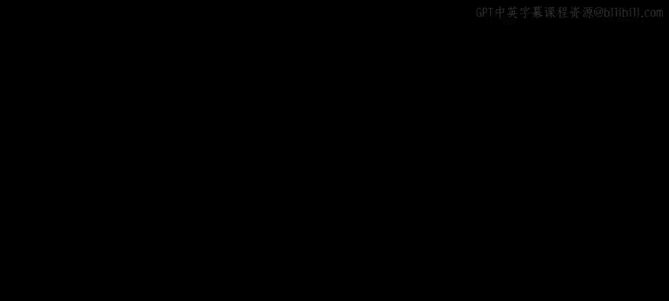

# 课程2：《R编程》｜P28：Swirl简介 🌀

在本节课中，我们将介绍一个名为Swirl的交互式学习工具，它可以帮助你在R控制台中循序渐进地学习R语言。

---

上一节我们介绍了R编程的基础环境，本节中我们来看看一个能提升学习效率的辅助工具——Swirl。

Swirl的全称是“Statistics with Interactive R Learning”，由约翰霍普金斯大学生物统计系的Nick Carchedi开发。这个系统允许你按照自己的节奏交互式地学习R语言。它会引导你完成一系列关于R语言不同方面的课程，你可以在学习过程中同步练习。

与先观看讲座、再完成作业的传统分段学习方式不同，Swirl让你能在R控制台中直接进行**有指导的实践**，而不是完全靠自己摸索。

以下是Swirl的主要特点：

*   它提供交互式课程，涵盖R语言的多个主题。
*   你可以在R控制台内边学边练，即时巩固知识。
*   学习进度由你自行掌控，适合不同基础的学习者。

我认为Swirl模块非常有用，鼓励你尝试学习。如果你决定完成它们，可以通过编程作业获得一些额外的加分。

不过，这些模块**完全不是强制要求**的，它们完全是可选的。因此，你无需担心必须完成它们，即使不做Swirl模块，你仍然可以在这门课程中取得优异的成绩。

尽管如此，我依然鼓励你尝试一下，我相信这会带来很多乐趣。

---

本节课中我们一起学习了Swirl这个交互式R学习工具。它通过在R控制台内提供引导式课程，帮助你更高效、有趣地练习和掌握R编程技能。你可以根据自己的需要选择是否使用它来辅助学习。