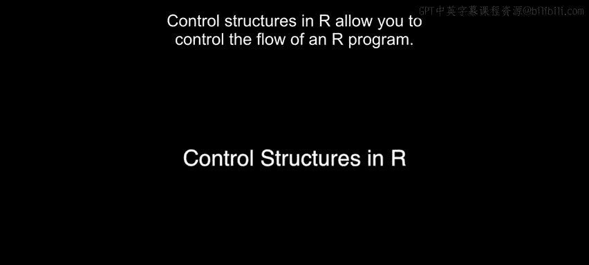
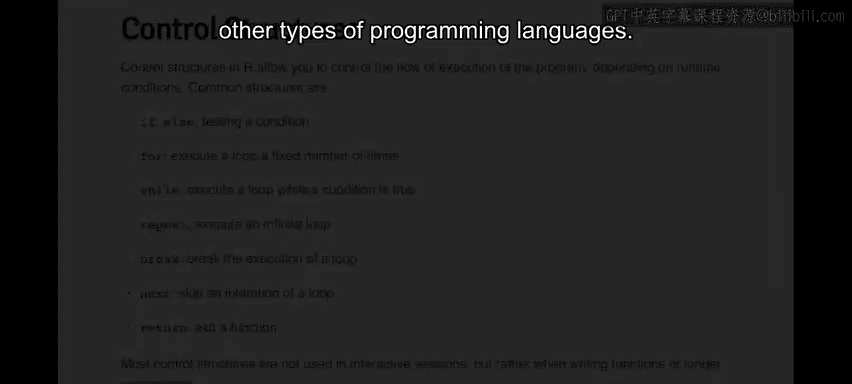
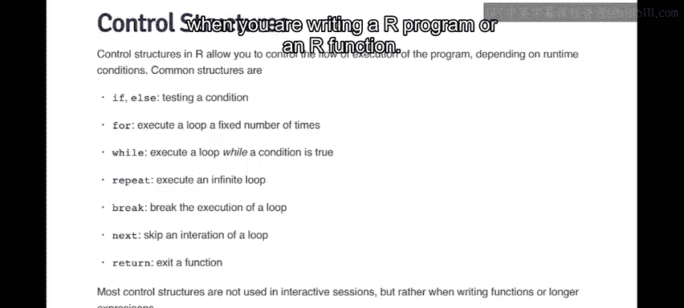

# 课程2：R编程 🧮｜第29讲：控制结构简介

在本节课中，我们将学习R语言中的控制结构。控制结构允许你控制R程序的执行流程，它们与其他编程语言中的控制结构非常相似。掌握这些结构是编写复杂R程序或函数的基础。

---

## 什么是控制结构？ 🔄

控制结构是编程中用于控制代码执行顺序的语句。在R中，它们使你能够根据条件执行不同的代码块，或者重复执行某些操作。

上一节我们介绍了R编程的基础，本节中我们来看看如何通过控制结构来管理程序流程。

---



## R中的基本控制结构



R提供了一系列基本的控制结构，用于测试逻辑条件、执行循环等。

以下是R中几种核心的控制结构：

*   **`if`-`else`**：用于测试逻辑条件，并根据条件的真假执行不同的代码块。
*   **`for`**：用于执行一个固定次数的循环。
*   **`while`**：当指定条件为真时，重复执行一个循环。
*   **`repeat`**：用于创建一个无限循环，通常需要与`break`语句配合使用来退出。
*   **`break`**：允许你跳出任何类型的循环。
*   **`next`**：跳过当前循环的剩余部分，直接进入下一次迭代。
*   **`return`**：用于退出一个函数，并可选择返回一个值。

这些控制结构通常不会在交互式会话（例如直接在R命令行中键入代码）中频繁使用。它们更多地被应用于编写完整的R程序或自定义函数时，以构建更有条理的代码格式。

---

## 核心概念示例

为了让概念更清晰，以下用简单的公式和代码描述两个核心结构：

**`if-else` 条件判断**
其逻辑可以表示为：
```
如果 (条件为真) {
  执行代码块A
} 否则 {
  执行代码块B
}
```
在R中的基本语法是：
```r
if (condition) {
  # 条件为真时执行的代码
} else {
  # 条件为假时执行的代码
}
```

**`for` 循环**
`for`循环遍历一个序列（如向量），对其中每个元素执行相同操作。
```r
for (value in sequence) {
  # 对每个value执行的代码
}
```

---

## 总结



本节课中我们一起学习了R语言控制结构的基础知识。我们了解了`if-else`、`for`、`while`、`repeat`、`break`、`next`和`return`等关键结构的作用，并知道了它们主要用于编写结构化的R程序或函数，而非简单的交互式命令。理解这些控制结构是迈向高效R编程的重要一步。