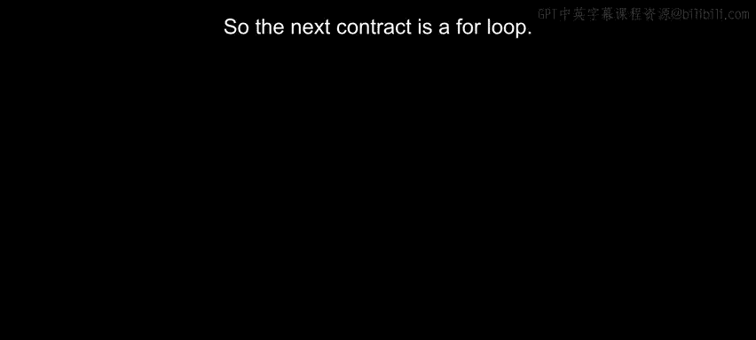
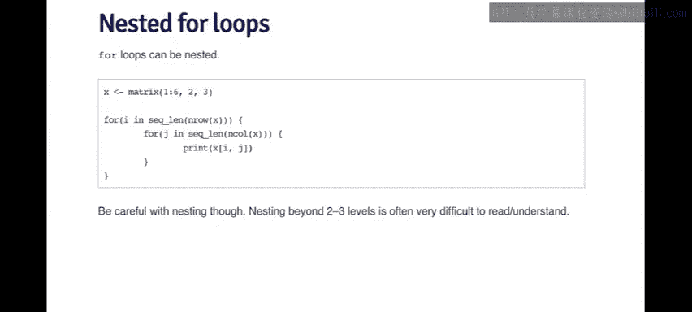

# 课程2：R编程 🖥️ | P31：控制结构 - for循环 🔄

在本节课中，我们将要学习R语言中一种最常用的循环控制结构：**for循环**。我们将了解其基本语法、多种使用方式以及嵌套循环的应用。

---

## for循环的基本概念



上一节我们介绍了条件语句，本节中我们来看看如何重复执行代码块。for循环的核心思想是使用一个**循环索引**（通常命名为`i`，也可使用`j`、`k`等），该索引会遍历一个序列（通常是整数序列）。在每次迭代中，循环体中的代码都会执行一次。

以下是一个简单的for循环示例，它遍历数字1到10并打印每个数字：

```r
for(i in 1:10) {
    print(i)
}
```

循环结束后，程序会继续执行后续的代码块。

---

## for循环的多种索引方式

R语言在如何索引不同类型的对象方面非常灵活。以下是几种等效的for循环写法，它们都用于遍历一个字符向量。

首先，我们创建一个向量：
```r
x <- c("a", "b", "c", "d")
```

以下是三种实现相同功能的for循环方式：

**1. 使用整数序列直接索引**
这是类似C语言等编程语言的常见写法。我们创建一个整数序列（1到4），然后用它来索引向量`x`的元素。
```r
for(i in 1:4) {
    print(x[i])
}
```

**2. 使用 `seq_along()` 函数生成序列**
`seq_along()` 函数接收一个向量作为输入，并生成一个与其长度相等的整数序列。这种方式更具通用性，因为序列长度基于变量`x`自动确定。
```r
for(i in seq_along(x)) {
    print(x[i])
}
```

**3. 直接遍历向量元素**
循环索引变量不一定必须是整数，它可以直接取自被遍历的向量本身。在这种情况下，索引变量`letter`在每次迭代中直接就是向量`x`中的一个元素。
```r
for(letter in x) {
    print(letter)
}
```

以上三种for循环都会依次打印出 “a”, “b”, “c”, “d”。

---

## for循环的简写语法

当循环体内只有一个表达式时，可以省略花括号 `{}`，将所有内容写在一行。这可以使代码更紧凑，但为了清晰起见，通常建议保留花括号。

```r
for(i in 1:4) print(x[i])
```

---

## 嵌套for循环

for循环可以嵌套使用，例如在一个循环内部再放置另一个循环。这在处理二维数据结构（如矩阵）时很常见，你可能需要遍历所有行和所有列。

假设我们有一个2行3列的矩阵：
```r
x <- matrix(1:6, 2, 3)
```

以下是遍历该矩阵所有元素的嵌套for循环：
```r
for(i in seq_len(nrow(x))) {
    for(j in seq_len(ncol(x))) {
        print(x[i, j])
    }
}
```

*   **外层循环**：使用 `seq_len(nrow(x))` 生成一个从1到矩阵行数的序列，索引变量`i`遍历每一行。
*   **内层循环**：使用 `seq_len(ncol(x))` 生成一个从1到矩阵列数的序列，索引变量`j`遍历每一列。
*   `seq_len(n)` 函数用于生成一个从1到`n`的整数序列。

**关于嵌套循环的注意事项**：虽然R语言理论上支持多层（三层或更多）嵌套循环，但这会使代码难以阅读和理解。如果遇到需要深层嵌套的情况，通常可以考虑使用函数式编程（例如`apply`族函数）来简化代码，提高可读性。

---

## 总结



本节课中我们一起学习了R语言中的**for循环**。我们掌握了其基本语法，了解了通过整数索引、`seq_along()`函数以及直接遍历元素等多种使用方式。我们还学习了嵌套循环的写法及其在遍历多维数据时的应用，并认识到应谨慎使用深层嵌套以保持代码清晰。for循环是进行重复性任务的基础工具，熟练掌握它将为后续的数据处理工作打下坚实基础。