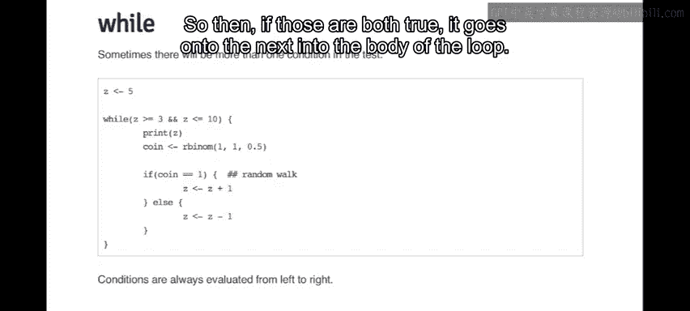

# 课程2：R编程｜P32：控制结构 - while循环 🔄


在本节课中，我们将要学习R语言中的另一个主要循环结构：`while`循环。我们将了解它的基本语法、工作原理、适用场景以及使用时的注意事项。

---

## 概述

`while`循环是R语言中基于逻辑表达式进行迭代的循环结构。只要指定的条件为真，循环体中的代码就会重复执行。理解其机制对于编写动态和条件驱动的程序至关重要。

## while循环的基本结构

上一节我们介绍了`for`循环，它通常用于已知迭代次数的情况。本节中我们来看看`while`循环，它更适合在迭代次数未知、仅由某个条件决定时使用。

一个基本的`while`循环结构如下：
```r
while (condition) {
  # 循环体：当条件为真时执行的代码
}
```
其核心思想是：`while`接受一个逻辑表达式，并根据该表达式的值来决定是否执行循环。

例如，下面是一个简单的`while`循环：
```r
count <- 0
while (count < 10) {
  print(count)
  count <- count + 1
}
```
这个循环初始化一个变量`count`为0。只要`count`小于10，它就会打印`count`的值，然后将`count`加1。一旦`count`的值达到10，循环停止，程序将继续执行后续代码。

`while`循环的优点是使代码意图更清晰易读。在这个例子中，可以很明显地看出，当`count`变量达到或超过10时，循环应该停止执行。

## 使用while循环的注意事项

然而，使用`while`循环时必须小心。从技术上讲，R语言中的`while`循环可能产生无限循环。你必须确保停止循环的条件最终能够被满足。

在上述简单例子中，循环最终停止执行是显而易见的。但在更复杂的代码中，有时很难判断`while`循环是否会结束。因此，通常使用像`for`循环这样对执行次数有明确上限的结构会更安全。

这并不是说你永远不应该使用`while`循环，只是在使用时需要格外谨慎。

## 在while循环中测试多个条件

与`if`语句类似，你可以在`while`循环中使用逻辑运算符来测试多个条件。

例如，下面的代码演示了一个包含随机过程的`while`循环：
```r
z <- 5
while (z >= 3 && z <= 10) {
  print(z)
  coin <- rbinom(1, 1, 0.5) # 模拟抛一枚公平的硬币
  if (coin == 1) {
    z <- z + 1
  } else {
    z <- z - 1
  }
}
```
这里，变量`z`初始化为5。`while`循环的条件是`z`大于等于3**且**小于等于10。只要`z`在3到10之间，循环就会继续。

在循环体内，代码会打印`z`的值，然后模拟抛一枚公平硬币。如果硬币结果是1，则给`z`加1；如果结果是0（或其他任何值），则从`z`中减1。这实现了一个简单的随机游走过程，`z`的值会根据抛硬币的结果上下波动。

在这个例子中，由于循环体内涉及随机数生成，因此更难判断`while`循环何时结束。`z`的值会上下波动，直到最终达到10，或达到（或小于）3。这种结构可能很有用，但必须注意防止循环运行时间过长。

## 关于条件评估的技术细节

在更技术性的层面上需要注意：当R测试像`z >= 3 && z <= 10`这样的复合表达式条件时，条件总是从左到右进行评估。

以下是评估步骤：
1.  首先检查`z >= 3`是否为真。
2.  如果为真，则继续检查下一个表达式`z <= 10`。
3.  如果两者都为真，程序则进入循环体执行。

这种从左到右的短路评估是R语言逻辑运算的标准行为。

---

## 总结



本节课中我们一起学习了R语言的`while`循环。我们了解了它的基本语法，即**`while (condition) { code }`**，它允许在条件为真时重复执行代码块。我们探讨了其提高代码可读性的优点，但也强调了可能引发无限循环的风险，因此使用时需确保退出条件最终能被满足。我们还学习了如何在循环中使用逻辑运算符组合多个条件，并了解了R语言从左到右评估复合条件的机制。记住，在迭代次数未知但取决于动态条件时，`while`循环是一个强大的工具。