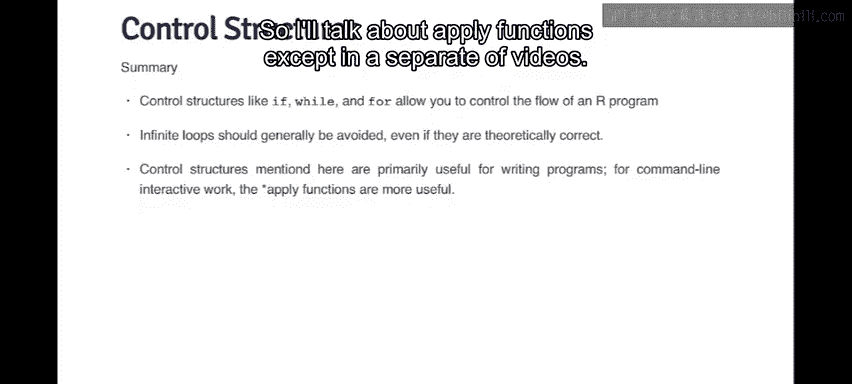

# 课程2：R编程 🧑‍💻｜第33课：控制结构 - repeat, next, break


在本节课中，我们将学习R语言中三种特殊的控制结构：`repeat`、`next`和`break`。这些结构用于控制循环的执行流程，对于编写灵活的程序逻辑至关重要。

---

## 🔁 repeat循环：无限循环的起点

上一节我们介绍了`for`和`while`循环，本节中我们来看看`repeat`循环。`repeat`是一个会启动**无限循环**的构造。它在R中并不常用，但在某些特定场景下有其用途。

退出`repeat`循环的唯一方式是调用`break`。显然，你必须在某个时刻调用`break`，否则程序将永远运行下去。

以下是一个简单的例子。我们初始化`x0`为1，并设置一个容差值`tol`为`1e-8`。然后，我们进入一个`repeat`循环，模拟一个不断计算新估计值`x1`的算法。如果新旧估计值之差的绝对值小于容差，我们就用`break`停止循环；否则，我们更新`x0`并继续下一次迭代。

```r
x0 <- 1
tol <- 1e-8

repeat {
  # 假设computeEstimate()是一个计算新估计值的函数
  x1 <- computeEstimate()
  
  if (abs(x1 - x0) < tol) {
    break
  } else {
    x0 <- x1
  }
}
```

这种模式常见于优化算法中，例如求解方程或寻找函数极值。算法会不断迭代，直到连续两次的估计值足够接近，这通常意味着算法正在收敛。

然而，`repeat`循环存在两个问题：
1.  它要求算法本身必须保证收敛，但并非所有算法都具备此属性。
2.  循环的运行时间难以预测，取决于容差和算法本身。理论上，它可能永远运行下去。

因此，尽管`repeat`在理论上是正确的构造，但在实践中通常不是好主意。更好的做法是使用有**硬性迭代次数上限**的`for`循环。这样，即使算法不收敛，循环也会在达到上限后停止，让你知道问题所在。

---

## ⏭️ next：跳过当前迭代

接下来我们看看`next`。`next`用于在**任何类型的循环**中跳过当前迭代，直接进入下一次迭代。

例如，假设我们有一个运行100次的`for`循环，但我们希望跳过前20次迭代，只对第21到100次迭代执行某些操作。我们可以使用`next`来实现。

```r
for (i in 1:100) {
  if (i <= 20) {
    next  # 跳过前20次迭代
  }
  # 只有当 i > 20 时，才会执行这里的代码
  # 执行你的操作...
}
```

在上面的代码中，当`i`小于等于20时，`next`语句会跳过循环体内剩余的所有代码，直接让`i`增加，开始下一次迭代。一旦`i`大于20，条件为假，程序就会执行循环体内的主要代码。

---

## 🚫 break 与 return：退出循环

我们已经见过`break`，它用于**完全退出**当前所在的循环（如`for`、`while`、`repeat`）。

此外，还有一个`return`函数。`return`的主要用途是**退出整个函数**，并返回一个指定的值。它也能中断程序的执行流。我们将在讲解函数时更详细地讨论`return`。

以下是三种语句的简单对比：
*   `next`: 跳过本次迭代，继续下一次。
*   `break`: 退出当前所在的整个循环。
*   `return`: 退出当前所在的整个函数。

---

## 📝 本节总结

本节课中，我们一起学习了R语言中三个控制循环流程的结构：
1.  **`repeat`**：创建一个无限循环，必须依靠`break`才能退出。需谨慎使用，避免不可预测的运行时间。
2.  **`next`**：在循环中跳过当前迭代，直接开始下一次迭代。
3.  **`break`**：立即退出当前所在的循环。

基本的控制结构（如`if`、`while`、`for`）允许你控制R程序的执行流。需要警惕的是，像`repeat`和设置不当的`while`这类可能产生无限循环的构造，应尽可能避免，即使它们在理论上是正确的，因为它们可能导致程序行为不可预测。



最后需要指出，本节介绍的循环结构在**编写程序**时非常有用。对于**命令行交互式工作**（例如探索数据），R提供了另一类更便捷的循环函数，它们通常名称中包含`apply`（如`lapply`、`sapply`）。我们将在后续课程中专门介绍这些`apply`函数。