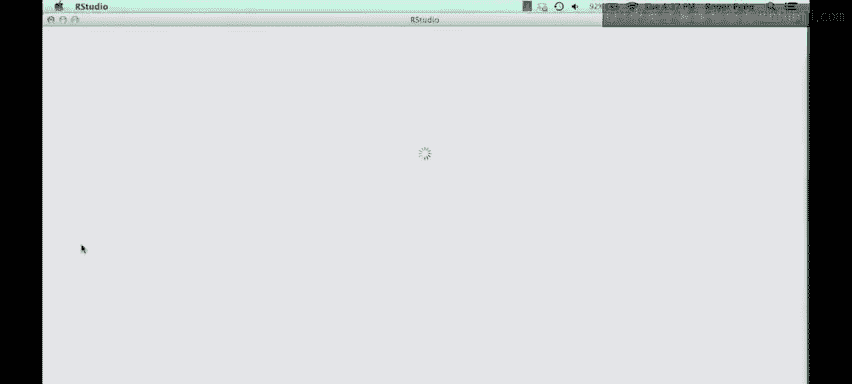
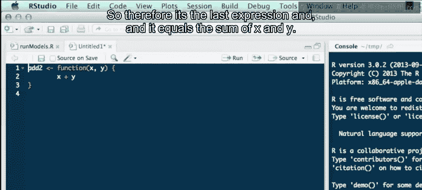
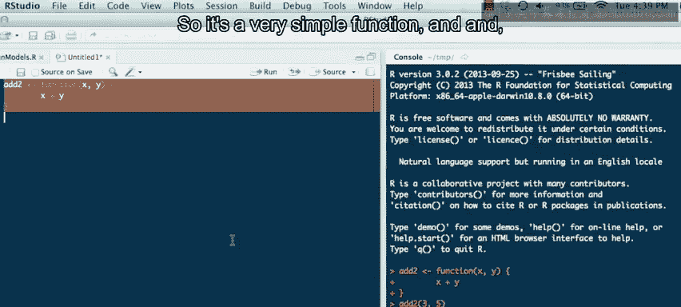
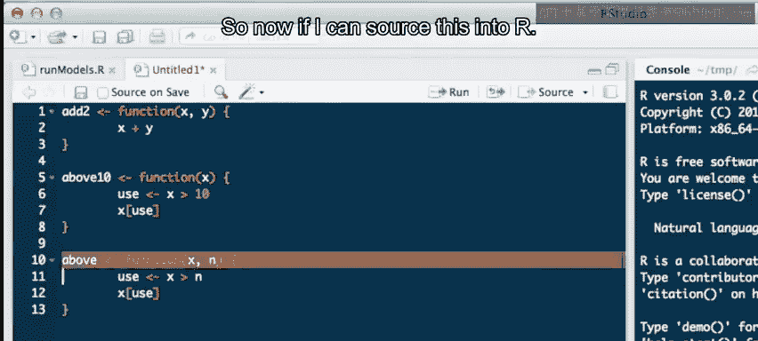
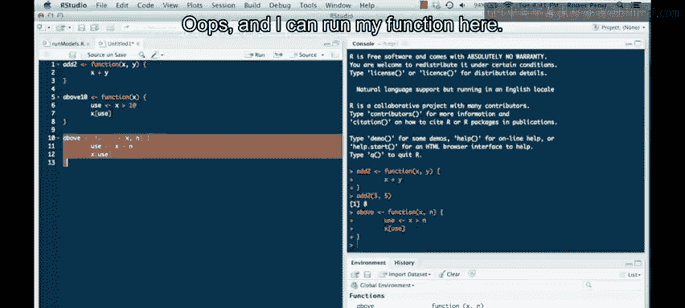
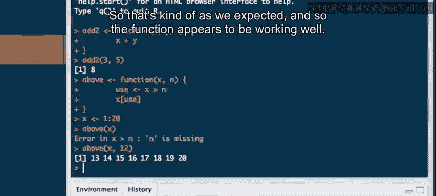
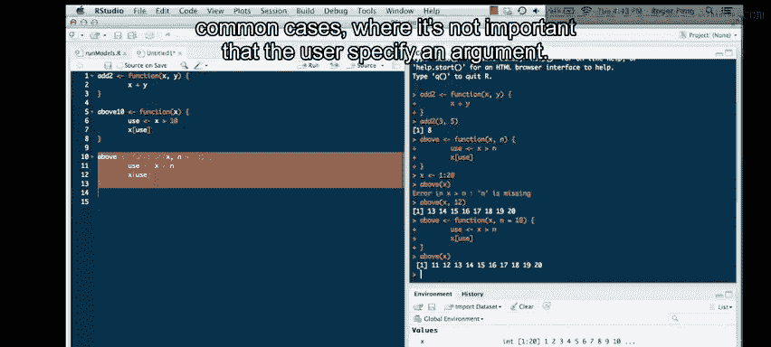
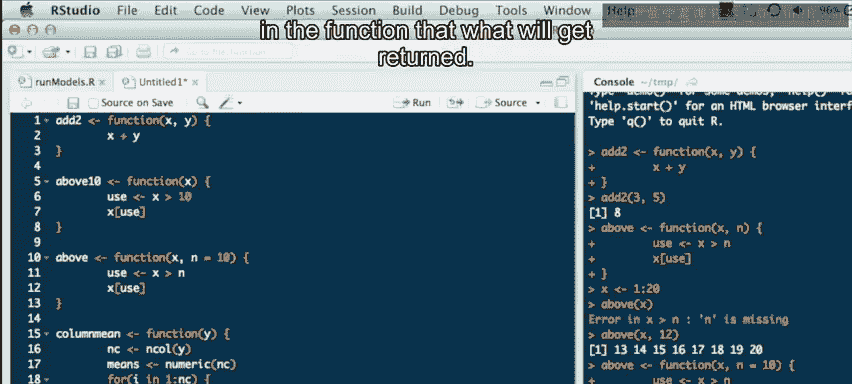
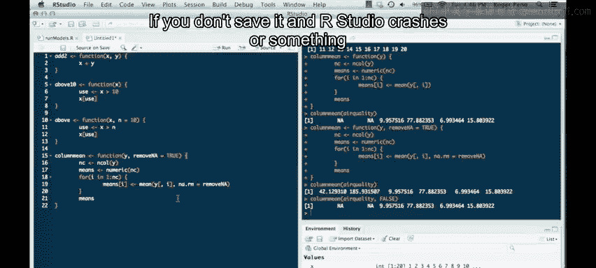

# 课程2：R编程 🧑‍💻｜P34：编写你的第一个R函数


## 概述

在本节课中，我们将学习如何在R中编写函数。函数在R编程中扮演着至关重要的角色，尤其是在进行数据分析和统计分析时，你会大量地使用和创建它们。本教程旨在帮助初学者，特别是那些对编程语言不太熟悉的朋友，迈出编写R函数的第一步。

---

## 1. 准备工作：在文本文件中编写函数

首先，我们需要知道在哪里编写函数。虽然可以在R的命令行中直接编写函数，但这通常不是最佳实践。更好的做法是将函数代码保存在一个独立的文本文件中。



上一节我们介绍了编写函数的环境，本节中我们来看看具体的操作步骤。

以下是开始编写前的准备步骤：

1.  打开RStudio。
2.  点击“File”菜单，选择“New File”，然后点击“R Script”。这将创建一个干净的脚本文件，用于存放我们的代码。
3.  将你的函数代码写在这个R脚本文件中。未来，你可能会将函数组织到更结构化的R包中，但目前我们专注于基础。

---

## 2. 第一个函数：两数相加

让我们从一个最简单的函数开始。这个函数接收两个数字，并返回它们的和。它虽然简单，但能清晰地展示R函数的基本语法：如何定义函数、指定参数以及返回值。

我们将这个函数命名为 `add_two`。

```r
add_two <- function(x, y) {
  x + y
}
```



代码解析：
*   `function(x, y)`：使用 `function` 指令定义函数，`x` 和 `y` 是它的两个参数。
*   `x + y`：这是函数体内的表达式，计算两个参数的和。
*   在R中，函数会自动返回最后一个表达式的值。这里只有一个表达式 `x + y`，所以它会被返回。



现在，我们可以在控制台运行这个函数：

```r
add_two(3, 5)
# 输出：[1] 8
```

恭喜！你已经成功编写并运行了你的第一个R函数。

---

## 3. 第二个函数：筛选向量中的元素

接下来，我们看一个稍复杂一点的函数。这个函数接收一个数值向量，并返回其中所有大于10的元素。

我们首先创建一个固定阈值为10的版本，函数名为 `above_10`。

```r
above_10 <- function(x) {
  use <- x > 10          # 创建一个逻辑向量，标记哪些元素大于10
  x[use]                 # 使用逻辑索引返回符合条件的元素
}
```

运行示例：
```r
x <- 1:20
above_10(x)
# 输出：[1] 11 12 13 14 15 16 17 18 19 20
```

---



### 3.1 使函数更通用：自定义阈值



上面的函数将阈值“10”写死了。为了让函数更灵活，我们可以添加一个参数 `n`，允许用户指定任意阈值。



```r
above <- function(x, n) {
  use <- x > n
  x[use]
}
```

运行示例：
```r
above(x, 12)
# 输出：[1] 13 14 15 16 17 18 19 20
```

---

### 3.2 设置默认参数

如果我们觉得阈值10是一个常用选项，可以将其设为默认值。这样用户在调用函数时，如果不指定 `n`，函数会自动使用10作为阈值，避免因缺少参数而报错。



```r
above <- function(x, n = 10) {  # 设置参数n的默认值为10
  use <- x > n
  x[use]
}
```

运行示例：
```r
above(x) # 不指定n，自动使用默认值10
# 输出：[1] 11 12 13 14 15 16 17 18 19 20
```

为常用参数设置默认值，可以使用户体验更友好。

---

## 4. 第三个函数：计算数据框每列的均值

现在，我们来编写一个更实用的函数。这个函数接收一个矩阵或数据框，并计算其中每一列的均值。这涉及到循环处理每一列，我们将使用 `for` 循环来实现。

函数命名为 `column_mean`。

```r
column_mean <- function(y) {
  nc <- ncol(y)                # 计算数据框的列数
  means <- numeric(nc)         # 初始化一个长度为列数的数值向量，用于存储结果
  for(i in 1:nc) {             # 循环遍历每一列
    means[i] <- mean(y[, i])   # 计算第i列的均值并存入结果向量
  }
  means                        # 返回均值向量
}
```

运行示例（使用R内置的 `airquality` 数据集）：
```r
column_mean(airquality)
# 输出可能包含NA，因为数据中有缺失值
```

---

### 4.1 处理缺失值（NA）



数据中经常存在缺失值（NA），直接计算均值会得到NA。我们可以为函数增加一个参数 `remove_na`，并将其传递给R内置的 `mean()` 函数，以控制是否在计算前移除缺失值。

```r
column_mean <- function(y, remove_na = TRUE) { # 添加参数，默认移除NA
  nc <- ncol(y)
  means <- numeric(nc)
  for(i in 1:nc) {
    # 将remove_na参数传递给mean函数
    means[i] <- mean(y[, i], na.rm = remove_na)
  }
  means
}
```

运行示例：
```r
column_mean(airquality)          # 默认移除NA，计算有效数据的均值
column_mean(airquality, FALSE)   # 不移除NA，包含NA的列会返回NA
```

通过添加参数，我们让函数的功能更加强大和可控。

---

## 5. 最后一步：保存你的工作

编写函数时，最重要的一步就是保存你的代码文件。在RStudio中，点击“File”菜单，选择“Save As...”，为你的文件命名（例如 `my_functions.R`），并确保文件扩展名为 `.R`。这样，你的所有工作就安全地保存在本地了。



---

## 总结

本节课中我们一起学习了R函数编写的基础知识：
1.  **环境**：在R脚本文件中编写函数是标准做法。
2.  **语法**：使用 `function()` 定义函数，在 `{}` 内编写函数体。
3.  **参数与返回值**：函数可以接收参数，并自动返回最后一个表达式的值。
4.  **默认参数**：可以为参数设置默认值，提升函数的易用性。
5.  **复杂逻辑**：函数体内可以包含条件判断、循环等复杂逻辑。
6.  **保存**：务必及时保存你的R脚本文件。

这些简单的函数是构建更复杂数据分析程序的基石。通过理解这些核心概念，你已经为后续的编程作业和实际数据分析项目打下了坚实的基础。