# 课程39：R编程中的优化示例与作用域规则应用 🚀


在本节课中，我们将学习如何将R语言的作用域规则与函数结合，应用于统计优化问题。我们将通过一个具体的例子，演示如何构建一个目标函数，并利用R的优化函数（如`optim`）来估计参数。

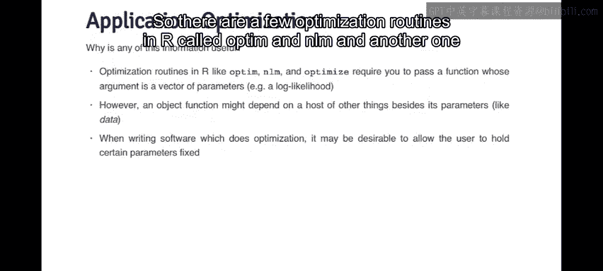

---


## 概述

上一节我们介绍了R语言中函数和作用域规则的基本概念。本节中，我们来看看这些概念如何在实际的统计优化问题中发挥作用。具体来说，我们将学习如何构建一个“构造函数”，该函数能创建一个包含数据和固定参数的目标函数，从而简化优化过程。

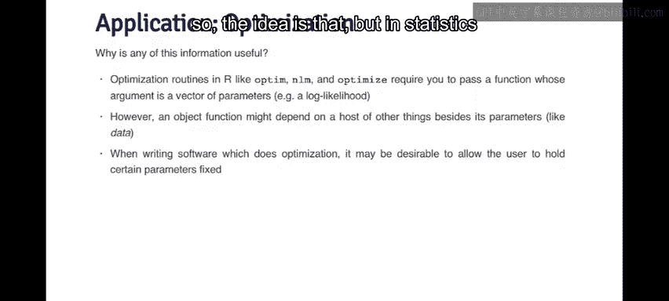


---


## 优化与作用域规则

R语言中有几个优化函数，例如`optim`、`nlm`和`optimize`。这些函数都需要你传入一个目标函数，该函数的参数是一个向量。在统计学中，我们经常需要最大化或最小化一个目标函数，例如对数似然函数。这个函数不仅依赖于待优化的参数，还依赖于数据等其他因素。

核心问题在于：如何以一种清晰、可读且用户友好的方式，编写一个同时依赖于参数、数据以及其他因素的目标函数？此外，在优化过程中，我们常常需要固定某些参数，只优化其他参数。

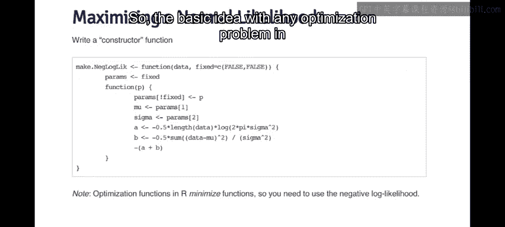


R语言词法作用域规则为解决这个问题提供了优雅的方案。基本思想是：创建一个“构造函数”，该函数能构建出目标函数。这个目标函数会将其所依赖的数据和其他变量“封装”在其定义环境中。这样，每次调用目标函数时，你只需要指定参数值，而无需重复传递数据和固定参数。


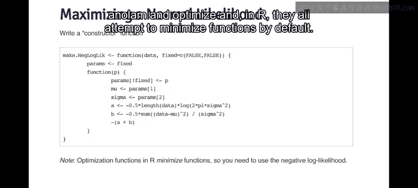


以下是构建一个负对数似然函数构造函数的示例代码。请注意，R中的优化函数默认是**最小化**目标函数，因此如果原始目标是最大化（如似然函数），我们需要取其负值。

```r
make.NegLogLik <- function(data, fixed = c(FALSE, FALSE)) {
    params <- fixed
    function(p) {
        params[!fixed] <- p
        mu <- params[1]
        sigma <- params[2]
        # 计算正态分布的负对数似然
        a <- -0.5 * length(data) * log(2 * pi * sigma^2)
        b <- -0.5 * sum((data - mu)^2) / (sigma^2)
        -(a + b)
    }
}
```


在这个构造函数中：
*   `data`：是用于拟合模型的数据。
*   `fixed`：是一个逻辑向量，指示两个参数（均值和标准差）中哪些需要被固定。
*   它返回一个内部函数，该内部函数的唯一参数`p`是待优化的参数向量。


---


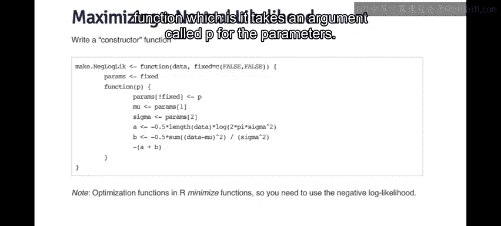


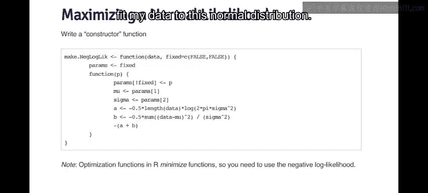

## 应用示例：正态分布参数估计

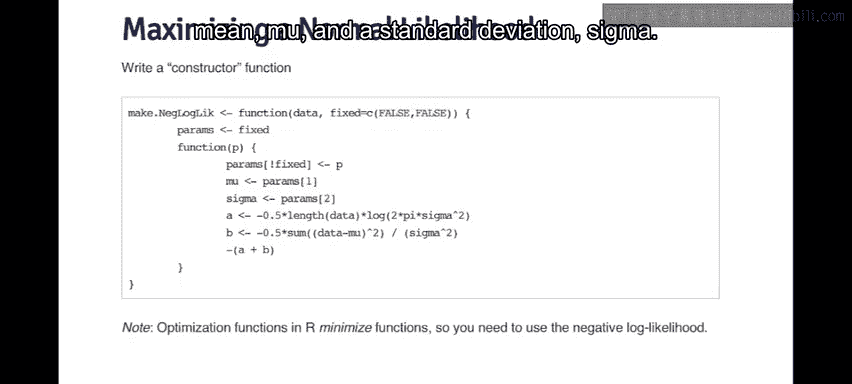


现在，让我们使用这个构造函数进行实际优化。


### 1. 生成模拟数据并创建目标函数

首先，我们生成一些来自正态分布（均值=1，标准差=2）的随机数据，并创建负对数似然函数。


```r
set.seed(1)
normals <- rnorm(100, mean = 1, sd = 2)
nLL <- make.NegLogLik(normals)
nLL
```

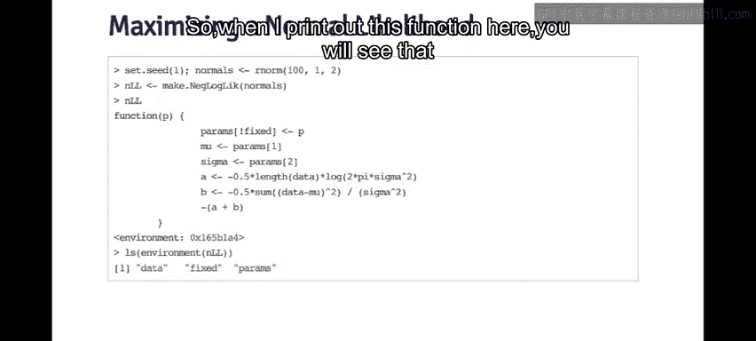


当你打印`nLL`函数时，会发现其函数体就是我们定义的代码，并且其**环境**指向一个特定的内存地址。这是因为该函数是在`make.NegLogLik`函数内部定义的，R需要记住其定义环境，以便查找`data`、`fixed`等自由变量。


### 2. 同时优化两个参数

我们可以使用`optim`函数同时优化均值（mu）和标准差（sigma）。以下是操作步骤：

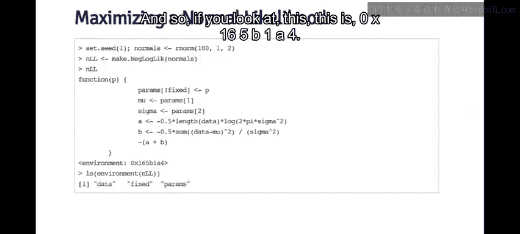

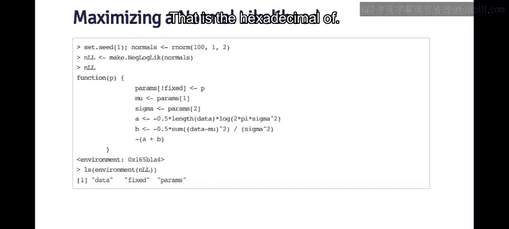

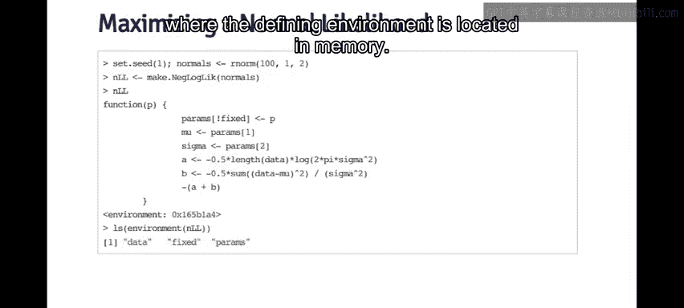

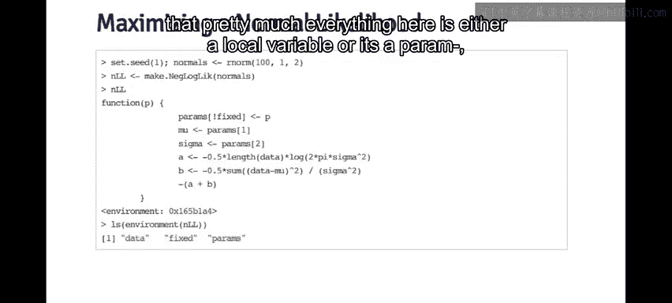

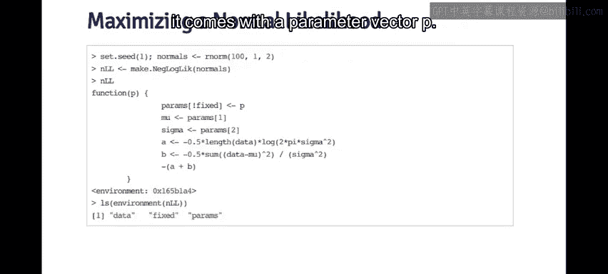


```r
# 初始值设为 mu=0， sigma=1
optim(c(mu = 0, sigma = 1), nLL)$par
```
运行后，你会得到mu和sigma的估计值，它们应该接近真实值1和2。


### 3. 固定一个参数，优化另一个参数

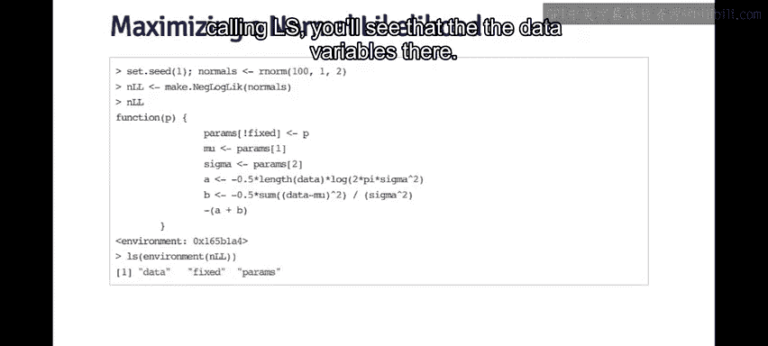


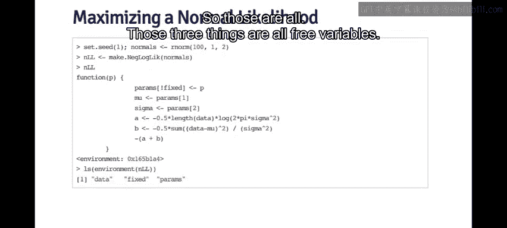

构造函数的设计允许我们灵活地固定某些参数。以下是具体操作：

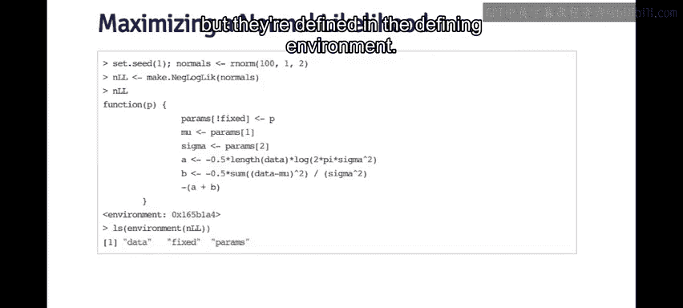

**固定sigma，优化mu：**
```r
# 固定 sigma = 2， 只优化 mu
nLL_fix_sigma <- make.NegLogLik(normals, c(FALSE, 2))
# optimize用于单参数优化
optimize(nLL_fix_sigma, c(-1, 3))$minimum
```


**固定mu，优化sigma：**
```r
# 固定 mu = 1， 只优化 sigma
nLL_fix_mu <- make.NegLogLik(normals, c(1, FALSE))
optimize(nLL_fix_mu, c(1e-6, 10))$minimum
```

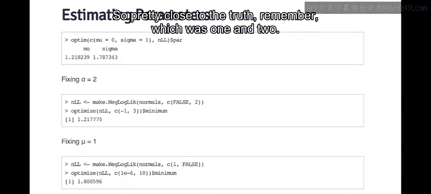


---

## 可视化似然函数

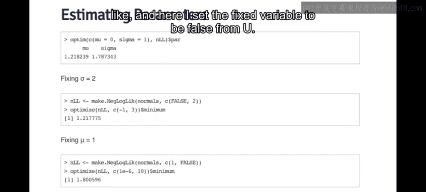


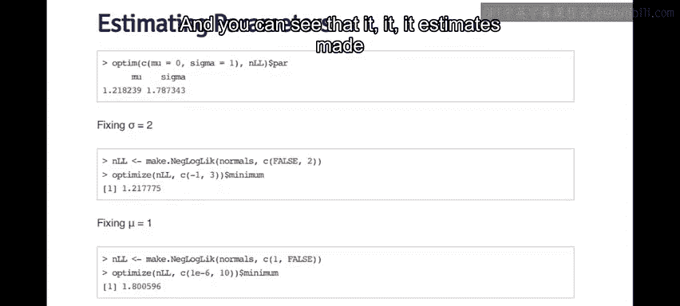

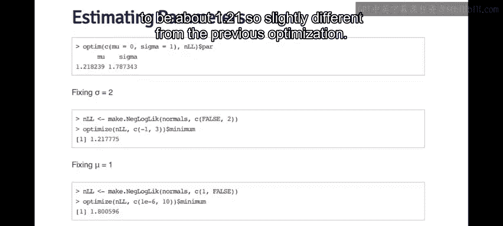


利用我们构建的函数，可以轻松地绘制似然函数曲线，这有助于直观理解优化过程。


以下是绘制负对数似然函数图的步骤：

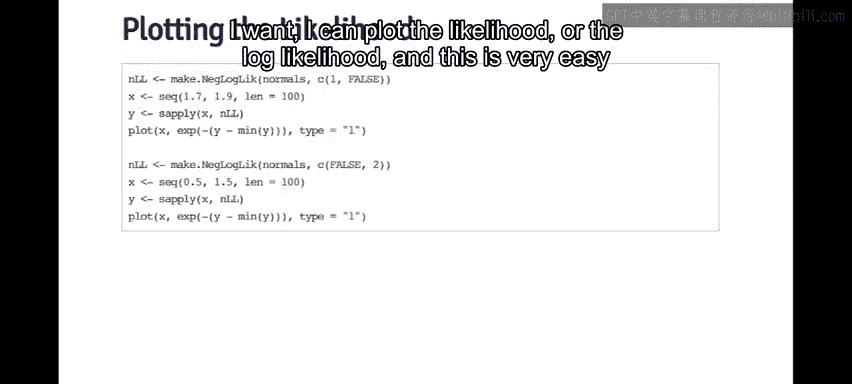

**固定mu，绘制关于sigma的曲线：**
```r
# 创建固定mu=1的函数
nLL_plot_sigma <- make.NegLogLik(normals, c(1, FALSE))
# 生成sigma的网格值
x <- seq(1.4, 2.1, len = 100)
# 计算每个sigma对应的负对数似然值
y <- sapply(x, nLL_plot_sigma)
# 绘图
plot(x, y, type = "l", xlab = expression(sigma), ylab = "Negative Log Likelihood")
```

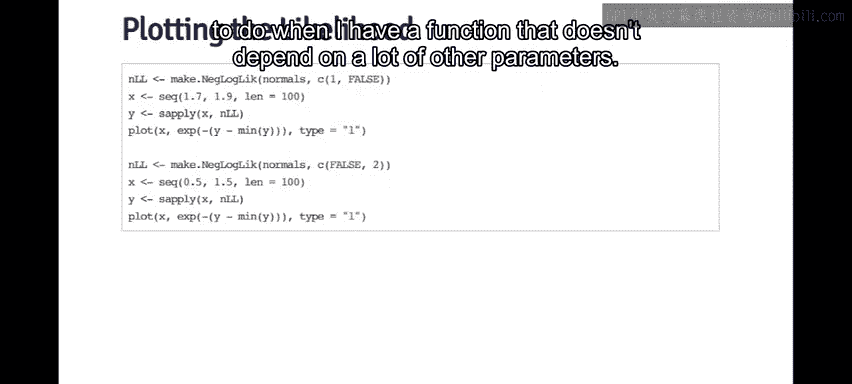

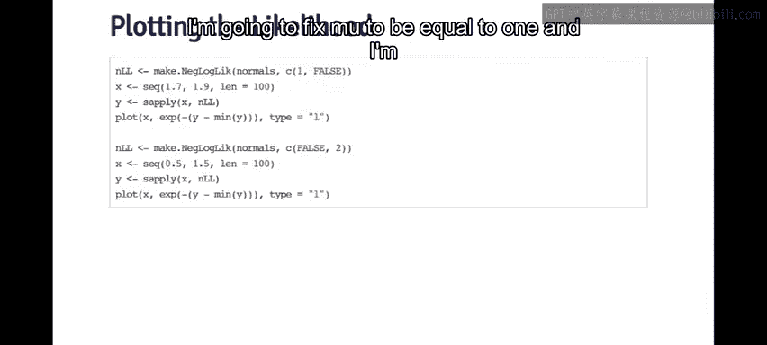


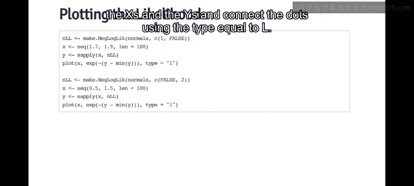

**固定sigma，绘制关于mu的曲线：**
```r
# 创建固定sigma=2的函数
nLL_plot_mu <- make.NegLogLik(normals, c(FALSE, 2))
x <- seq(0.5, 1.5, len = 100)
y <- sapply(x, nLL_plot_mu)
plot(x, y, type = "l", xlab = expression(mu), ylab = "Negative Log Likelihood")
```

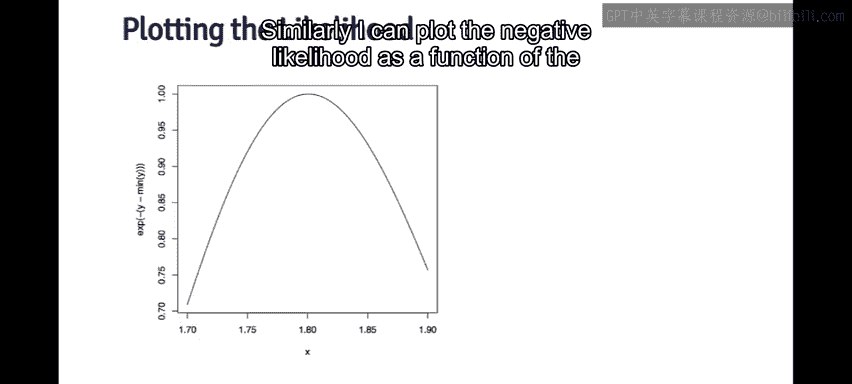

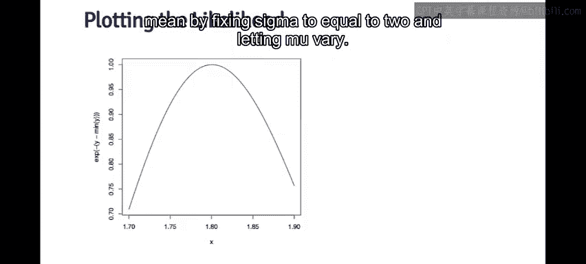

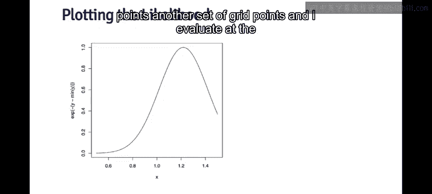

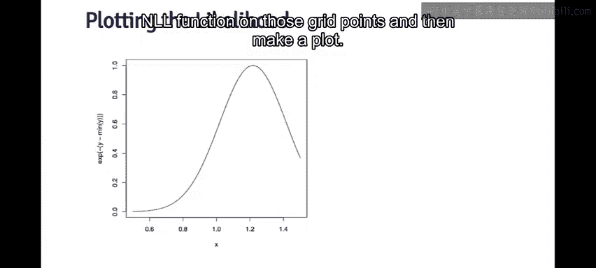

---


## 总结

本节课中，我们一起学习了如何利用R语言的词法作用域规则来构建用于优化的目标函数。核心方法是创建一个**构造函数**，它将数据和固定参数“打包”到目标函数的定义环境中。

这种方法的主要优势在于：
*   **代码简洁**：目标函数调用时参数列表很短，只需传入待优化的参数。
*   **灵活性强**：可以轻松固定任意参数，进行条件优化。
*   **便于探索**：非常适合于交互式数据分析和可视化（如绘制似然函数曲线）。


通过将复杂依赖关系封装在函数环境中，我们能够写出更清晰、更模块化且更易于维护的统计计算代码。这种模式在编写需要与`optim`、`nlm`等优化函数配合使用的似然函数、损失函数时尤其有用。


---
**参考**：关于R语言词法作用域在统计计算中应用的更深入讨论，可以参考Robert Gentleman和Ross Ihaka的论文《Lexical Scope and Statistical Computing》（发表于Journal of Computational and Graphical Statistics）。