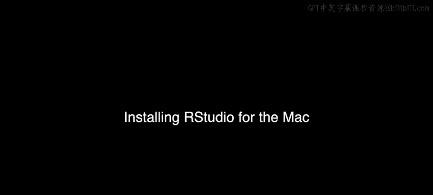
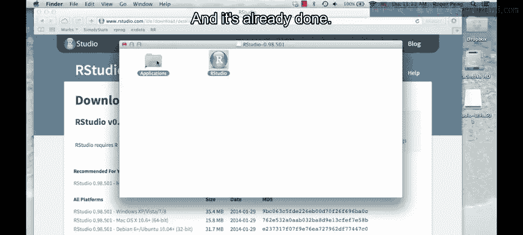

# 课程2：R编程 🍎 在Mac上安装R Studio

在本节课中，我们将学习如何在Mac操作系统上安装R Studio集成开发环境。这是一个非常简单的过程，仅需几个步骤即可完成。

## 概述

安装R Studio前，必须确保您的Mac上已经安装了R语言环境。这是运行R Studio的必要前提。一旦R安装完毕，您就可以前往R Studio官网下载并安装桌面版本。

## 安装步骤

以下是安装R Studio的具体步骤。

1.  **访问R Studio官网**
    首先，打开浏览器，访问R Studio官方网站：`rstudio.com`。

2.  **选择下载版本**
    在官网首页的左下角，您会看到一个绿色的下载按钮。点击后，页面会提供两个版本：桌面版和服务器版。本教程仅涉及桌面版的安装，请点击对应的“Download RStudio Desktop”按钮。

3.  **下载安装包**
    网站通常会**自动检测**您的操作系统类型。对于Mac用户，它会推荐相应的Mac OS版本安装包。点击下载链接，等待下载进度条完成。

4.  **安装应用程序**
    下载完成后，前往“下载”文件夹。找到刚刚下载的R Studio安装文件（通常是一个`.dmg`磁盘映像文件）。双击打开它。

5.  **拖拽至应用程序文件夹**
    打开`.dmg`文件后，会看到一个包含R Studio应用图标和“Applications”文件夹的窗口。与安装其他Mac应用一样，您只需将R Studio的图标**拖拽**到“Applications”文件夹的图标上即可完成安装。

6.  **启动R Studio**
    安装完成后，您可以进入“应用程序”文件夹，找到R Studio图标。双击图标启动程序，在系统提示时选择“打开”。至此，R Studio已成功安装并运行在您的Mac上。

## 总结

本节课中，我们一起学习了在Mac电脑上安装R Studio的完整流程。关键点在于：**先安装R，后安装R Studio**。整个过程只需访问官网、下载正确的桌面版安装包、并通过拖拽方式完成安装。现在，您的开发环境已经准备就绪，可以开始后续的R语言编程学习了。