# 课程2：《R编程》｜第40讲：R语言编码标准 📝

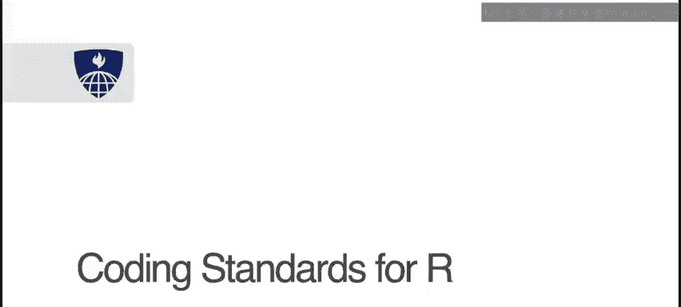

在本节课中，我们将学习R语言中的编码标准。编码标准对于编写可读性强、易于理解的代码至关重要。我们将探讨几个基本原则，帮助你编写更清晰、更易于维护的R代码。

---

## 概述

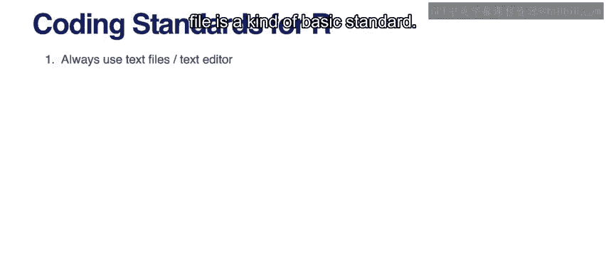

R语言中的编码标准非常重要，因为它们能帮助你使代码更具可读性，让你和其他人能够理解代码的逻辑。虽然像任何风格问题一样，很难让所有人都同意一套统一的标准，但有几个非常基本、最低限度的标准在R编程中至关重要。本节将讨论一些我认为在编写R代码时重要的编码标准，这些标准将使你的代码更易读、更易用。

---

## 基本原则

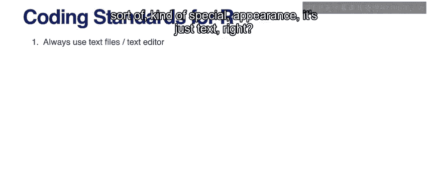

以下是编写R代码时应遵循的几个核心原则。

### 1. 使用文本编辑器 📄

在任何编程语言中，不仅仅是R，第一个非常重要的原则是：**始终使用文本编辑器编写代码，并将代码保存为文本文件**。

文本文件是一种基本标准。它通常没有任何格式或特殊外观，只是纯文本。通常，它是ASCII文本。如果你在美国或英国以外的地区使用非英语语言，可能会有其他标准文本格式。但基本思想是，如今几乎任何基本的编辑程序都可以读取文本格式。

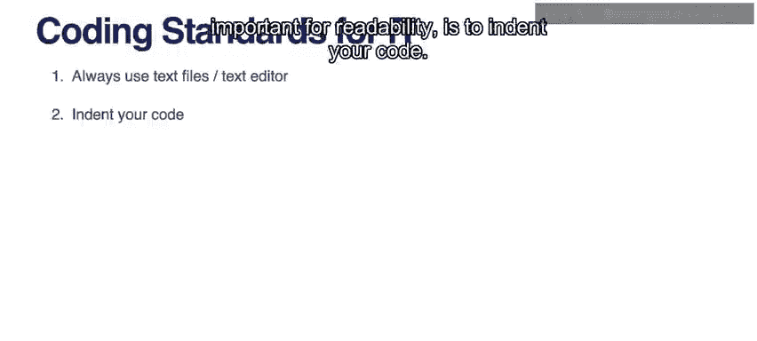

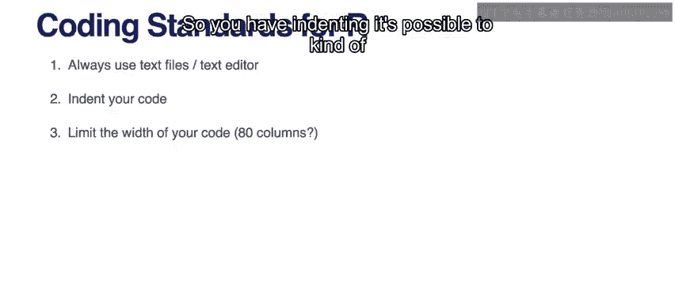

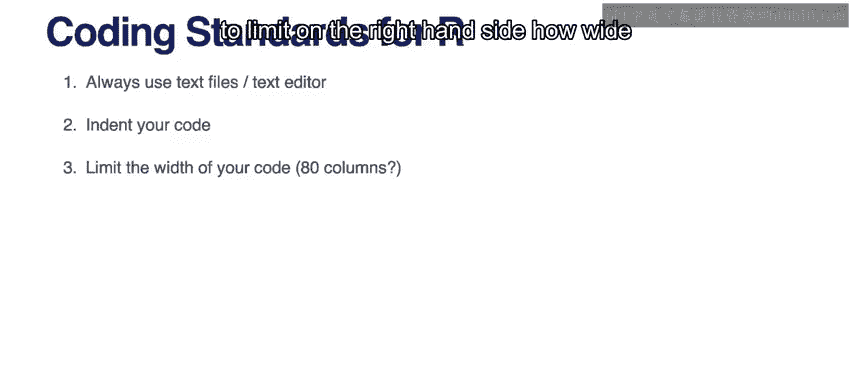

当你编写内容时，有很多不同的工具可以使用，比如写书或网页。但在编写代码时，应始终尝试使用文本编辑器，因为这是最低的共同标准，确保每个人都能访问和改进你的代码。

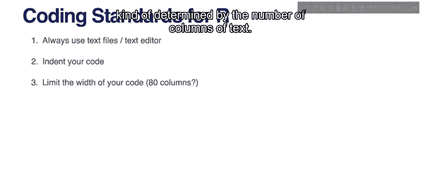

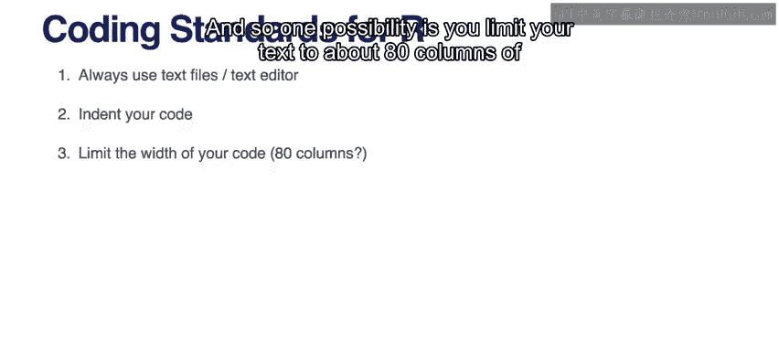


---

### 2. 缩进代码

为了提高可读性，第二个非常重要的原则是：**缩进你的代码**。

缩进是一个在许多邮件列表和其他讨论组中经常激烈讨论的话题，关于多少缩进是合适的。虽然我不打算深入讨论这个问题，但我有一些建议。最重要的是，你需要理解为什么缩进很重要。

缩进是指不同的代码块应该比其他代码块向右多空出一些空间。仅通过缩进，你就能看出程序的**控制流**和**流程**。

---

### 3. 限制代码宽度

与缩进相关的第三个原则非常简单：**限制代码的宽度**。

如果你进行缩进，代码可能会无限向右缩进。因此，你需要在右侧限制代码的宽度。通常，这通过文本列数来控制。一种可能性是将文本限制在大约80列，这样代码的宽度永远不会超过这个限制。

让我们看一个简单的例子。

```r
# 示例：未缩进的代码
if (x > 0) {
print("x是正数")
} else {
print("x是负数或零")
}
```

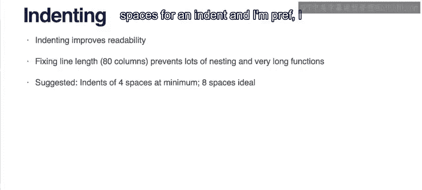

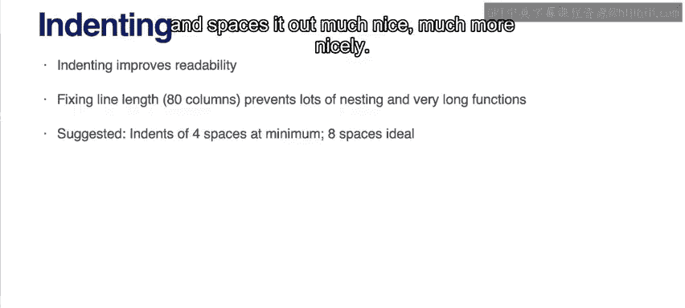

在上面的示例中，代码没有缩进，结构不清晰。通过缩进，代码的结构会变得更加明显。

```r
# 示例：缩进后的代码
if (x > 0) {
    print("x是正数")
} else {
    print("x是负数或零")
}
```

在RStudio中，你可以轻松调整缩进设置。转到“Preferences”菜单，选择“Code Editing”，然后调整缩进空格数。我个人推荐使用**8个空格**进行缩进，因为它使代码结构非常清晰，可读性更强。

缩进策略不仅使代码更易读，还能迫使你以不同的方式思考代码的编写。例如，使用8空格缩进和80列右侧边距，你可能无法嵌套超过两个`for`循环。这实际上有助于避免编写难以阅读的代码。

---

### 4. 限制函数长度

最后一个要讨论的原则是：**限制函数的长度**。

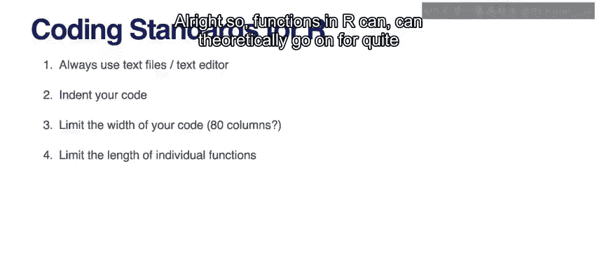

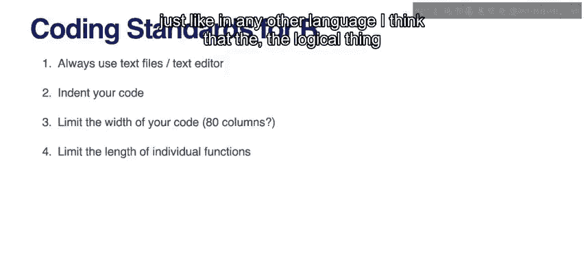

在R中，函数理论上可以非常长。但就像在任何其他语言中一样，我认为函数的逻辑做法是将其限制在一个基本活动内。例如，如果你的函数名为`read_data`，那么它应该只读取数据，而不应该同时处理数据、拟合模型和打印输出。

将代码拆分为逻辑函数有几个优点：
- 函数可以写在一页代码中，无需滚动即可查看整个函数。
- 如果函数全部显示在编辑器的一个屏幕上，你可以一次性查看整个函数的功能。

将代码拆分为逻辑函数的另一个优点是，当你使用`traceback`、分析器或调试器时，这些工具通常会告诉你在函数调用栈中的位置。如果函数被逻辑地拆分为多个部分，当出现错误时，你可以知道问题发生在哪个函数中，从而更容易定位和修复问题。

当然，过度拆分函数也不可取，比如编写100个只有三行的函数。你只需要确保函数的分离是逻辑的，每个函数专门完成一个特定的任务。

---

## 总结

在本节课中，我们一起学习了R语言编码标准的几个基本原则：
1. **使用文本编辑器**编写和保存代码。
2. **缩进代码**以提高可读性，推荐至少使用4个空格，我个人偏好8个空格。
3. **限制代码宽度**，例如使用80列右侧边距，避免代码过于拥挤。
4. **限制函数长度**，确保每个函数只完成一个逻辑任务，便于阅读和调试。

遵循这四个原则，你的代码将更具可读性，不仅对你自己，也对其他人更有用，从而使编写R代码对每个人都更加实用。