# 约翰霍普金斯大学数据科学课程2：《R编程课程》｜P45：循环函数 tapply 🧮


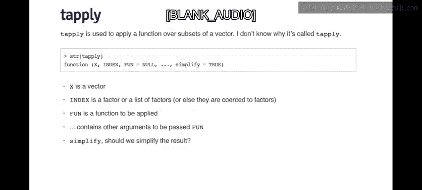

在本节课中，我们将要学习R语言中一个非常实用的循环函数：`tapply`。这个函数主要用于对向量的子集应用某个函数，例如计算不同组别的均值或标准差等汇总统计量。

## 概述 📋

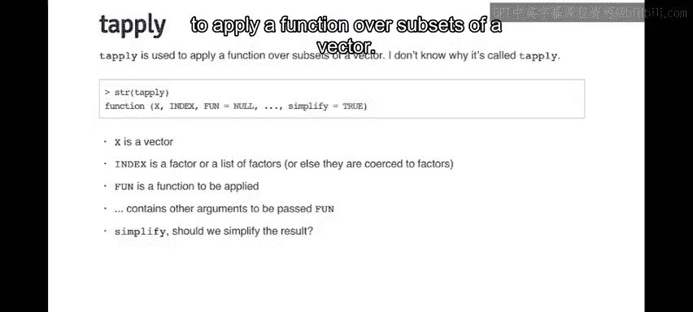

`tapply` 函数的核心思想是：你有一个向量（通常是数值型向量），并且你想对这个向量中不同的“组”或“子集”分别计算某个汇总统计量。为了实现这一点，你需要另一个长度相同的向量（通常是因子变量）来标识原始向量中每个元素属于哪个组。

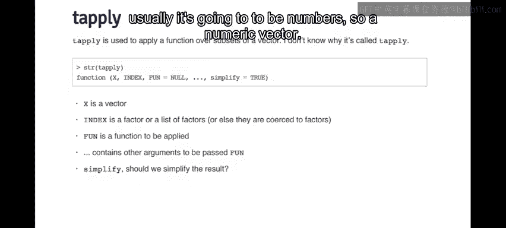

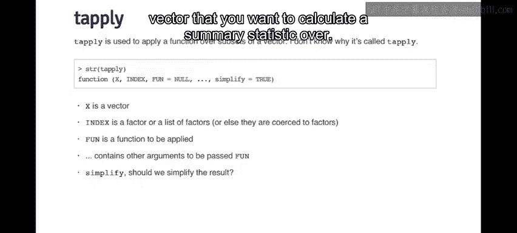


上一节我们介绍了`sapply`和`lapply`，本节中我们来看看如何对分组数据进行操作。

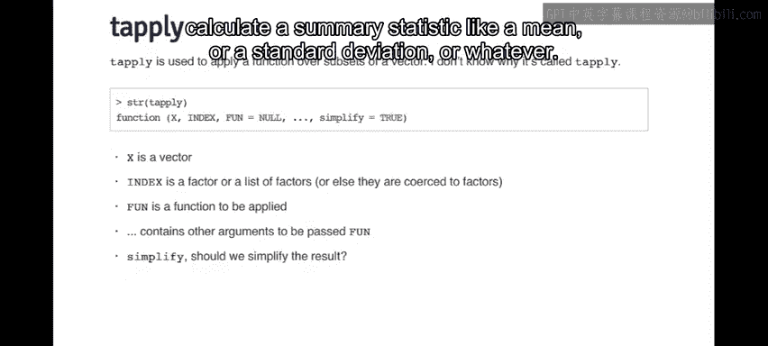

## `tapply` 函数的基本原理


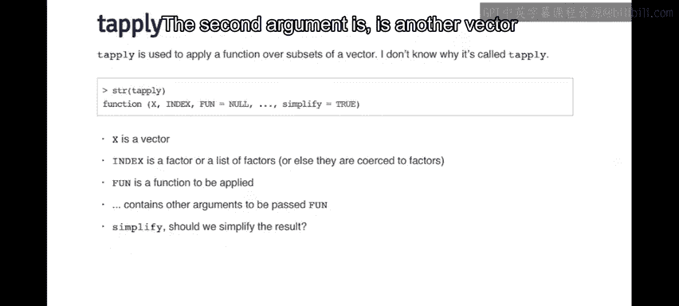

`tapply` 函数的基本语法结构如下：

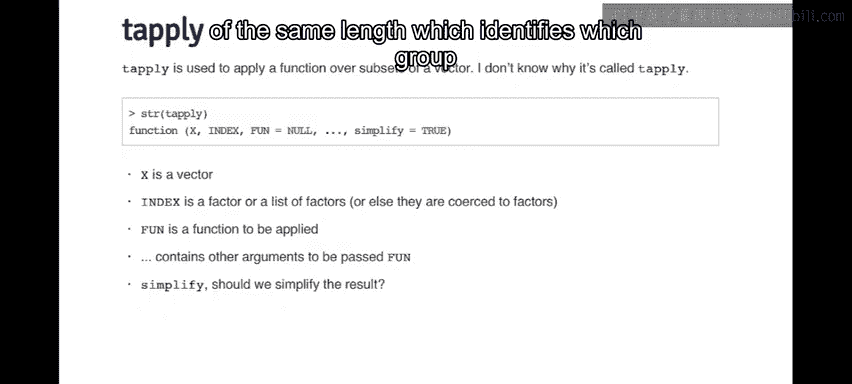

```r
tapply(X, INDEX, FUN, ..., simplify = TRUE)
```


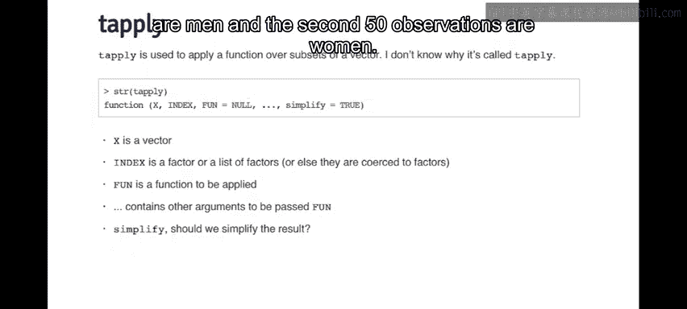

以下是各个参数的含义：

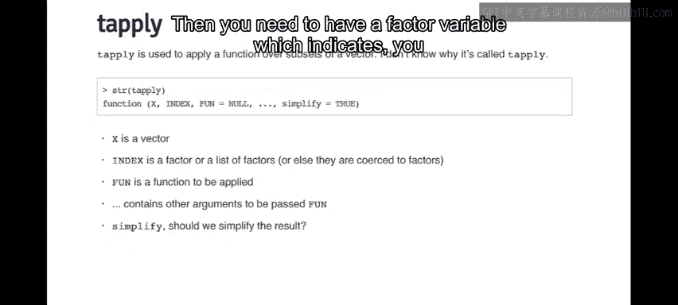

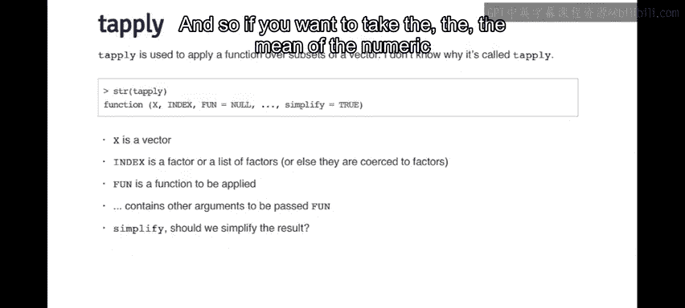

*   **`X`**： 一个向量，通常是数值型向量，是你想要处理的数据。
*   **`INDEX`**： 一个因子或可以转换为因子的列表，其长度必须与 `X` 相同。它定义了 `X` 中每个元素所属的组。
*   **`FUN`**： 你想要应用到每个组上的函数，例如 `mean`、`sd`、`sum` 等。
*   **`...`**： 传递给 `FUN` 函数的其他参数。
*   **`simplify`**： 一个逻辑值，指示是否简化结果。如果为 `TRUE`（默认值），`tapply` 会尝试将结果简化为数组；如果为 `FALSE`，则总是返回一个列表。

## 一个简单的示例

让我们通过一个具体的例子来理解 `tapply` 的用法。

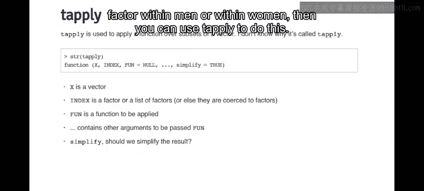

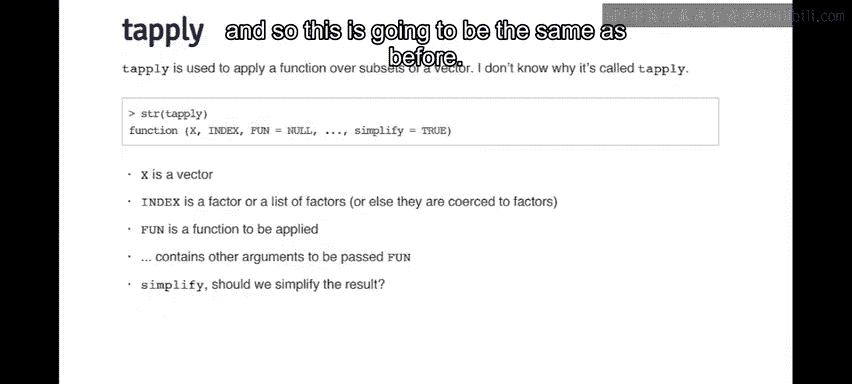

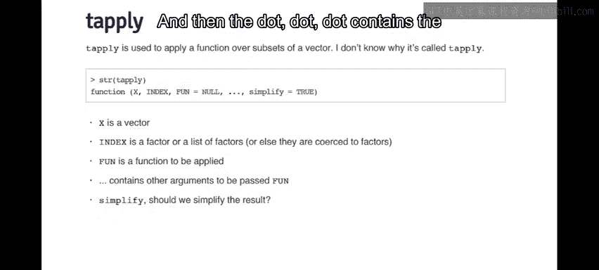


首先，我们创建一个包含三组数据的向量 `x`：
```r
# 生成示例数据
x <- c(rnorm(10), runif(10), rnorm(10, 1))
```
这个向量包含：10个标准正态随机数、10个均匀分布随机数、以及10个均值为1的正态随机数。


接着，我们需要创建一个因子变量来标识每个数据点属于哪一组。这里我们使用 `gl()` 函数来生成因子：
```r
# 创建分组因子：3个水平，每个水平重复10次
f <- gl(3, 10)
print(f)
```
`f` 是一个因子，包含10个“1”、10个“2”和10个“3”，正好对应 `x` 中的三组数据。

现在，我们可以使用 `tapply` 来计算每组数据的平均值：
```r
# 对x按因子f分组，并计算每组的均值
tapply(x, f, mean)
```
执行这行代码，`tapply` 会分别计算第一组（`f`为1）、第二组（`f`为2）和第三组（`f`为3）中 `x` 值的平均值，并以一个命名向量的形式返回结果。

## 控制输出格式：`simplify` 参数

`simplify` 参数控制着返回结果的格式。默认情况下（`simplify = TRUE`），如果可能，结果会被简化为一个数组（例如向量或矩阵）。

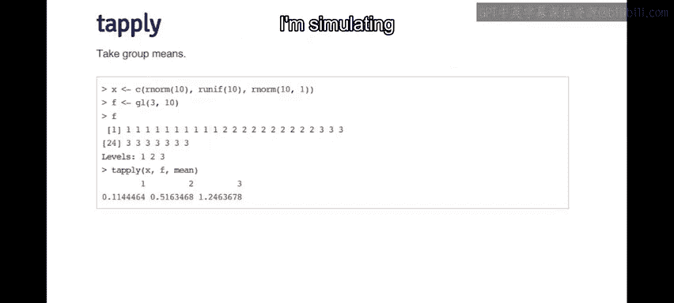

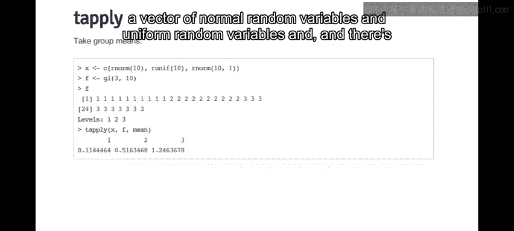

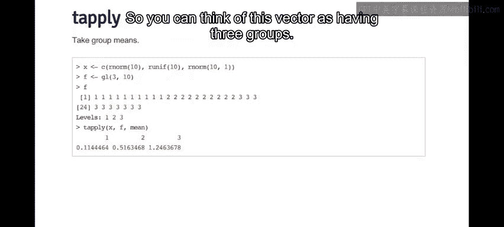

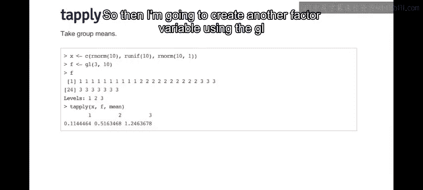

如果我们设置 `simplify = FALSE`，`tapply` 将始终返回一个列表：
```r
# 返回列表格式的结果
tapply(x, f, mean, simplify = FALSE)
```
此时，返回的是一个包含三个元素的列表，每个元素对应一个组的均值。

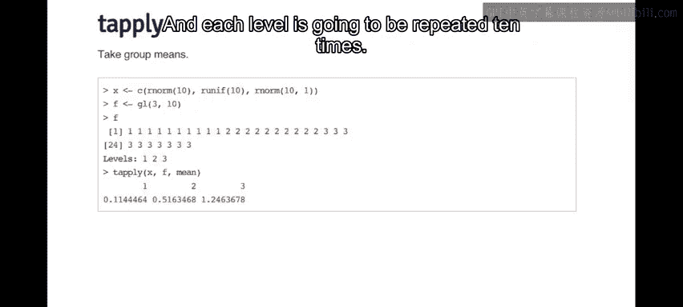

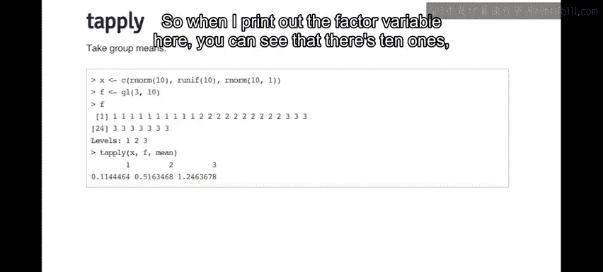

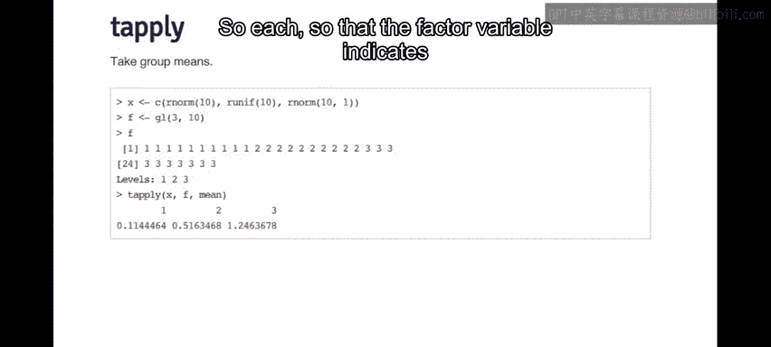

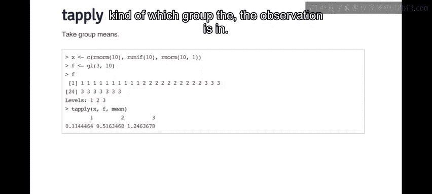

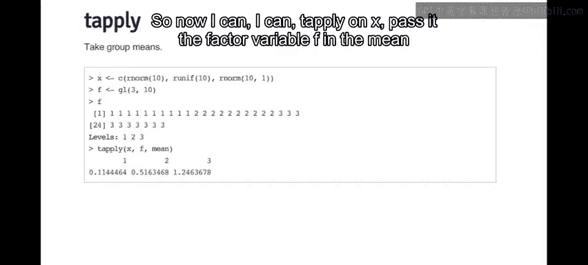

## 应用更复杂的函数

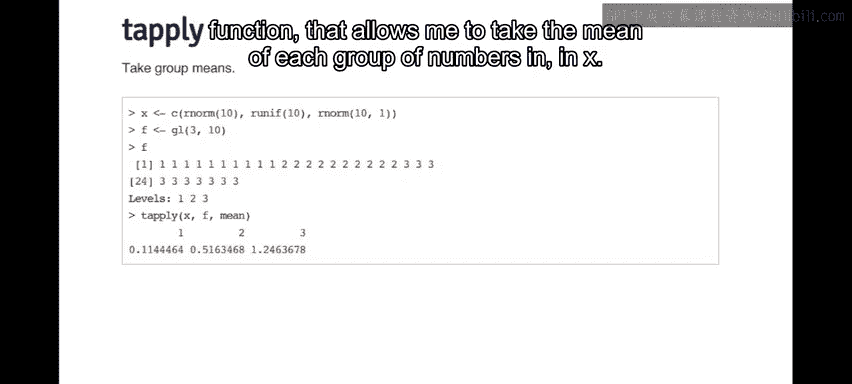

`tapply` 不仅可以应用像 `mean` 这样返回单个值的函数，也可以应用返回多个值的函数。

例如，我们可以计算每组数据的范围（最小值和最大值）：
```r
# 对x按因子f分组，并计算每组的范围（最小值和最大值）
tapply(x, f, range)
```
`range` 函数会返回一个包含两个元素的向量（最小值和最大值）。因此，上述代码的结果可能是一个矩阵（如果 `simplify = TRUE`），其中每一列代表一个组，两行分别是最小值和最大值；或者是一个列表（如果 `simplify = FALSE`），列表中的每个元素是一个长度为2的向量。

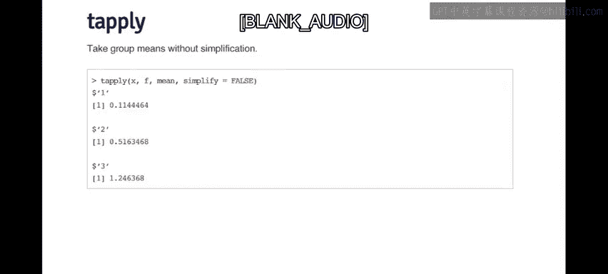

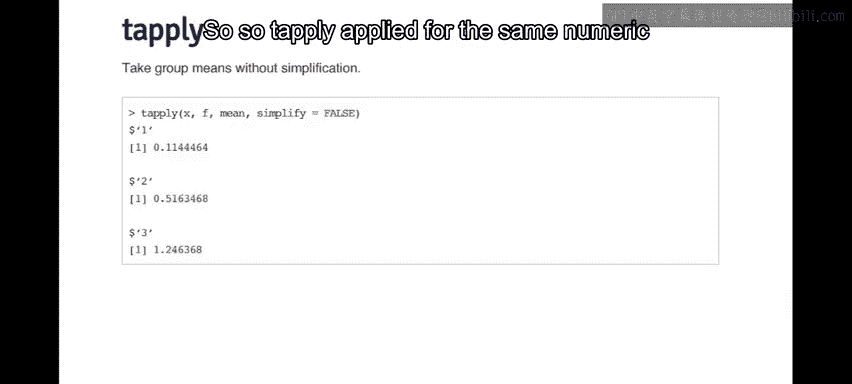


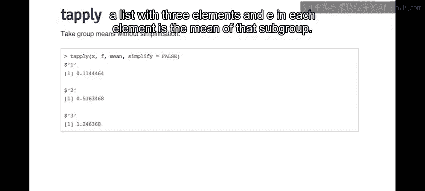

## 总结 🎯

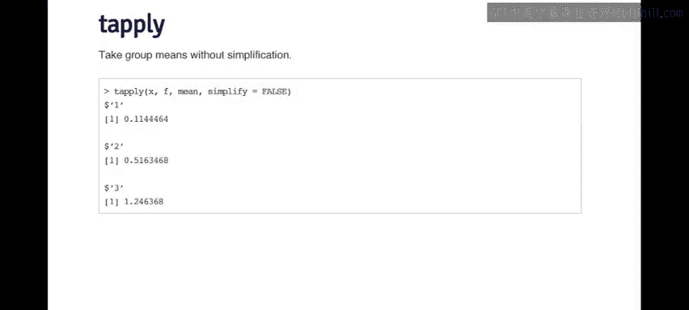

本节课中我们一起学习了 `tapply` 函数。我们了解到：

1.  `tapply` 用于**对向量的子集（分组）应用函数**。
2.  它的核心是**一个数据向量 `X`** 和一个**分组因子 `INDEX`**。
3.  通过 `FUN` 参数指定要应用的函数，例如计算分组的均值、总和或范围。
4.  `simplify` 参数可以控制返回结果是简化的数组还是列表。
5.  它是处理分组数据并计算汇总统计量的一个强大而高效的工具。

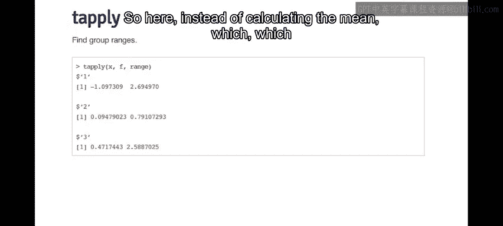

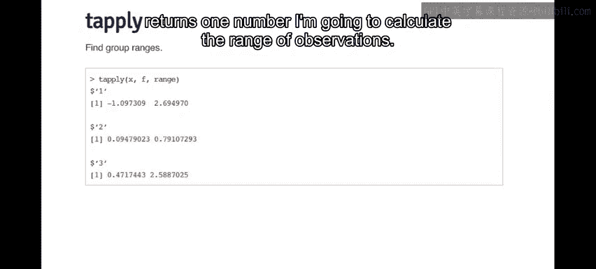

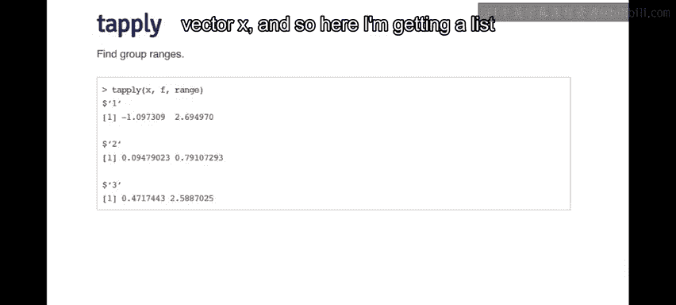

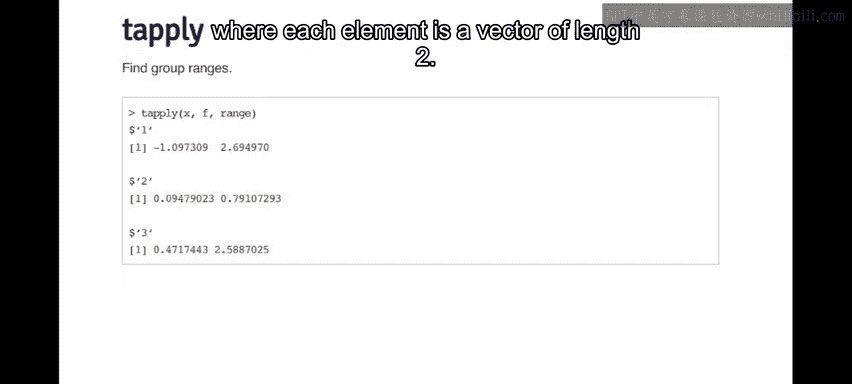

掌握 `tapply` 能让你在R语言中轻松应对需要按类别进行分析的数据任务。